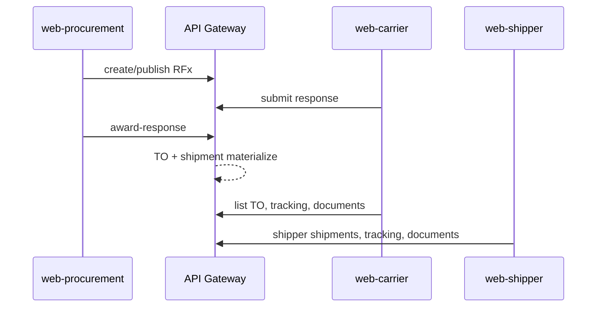

# Customer Portals — Cross-App Pilot 0.5B

**Stage:** `CUSTOMER-PORTALS-CROSS-APP-PILOT-0.5B`  
**Mode:** discovery + acceptance design only (no production UI, no staging seed, no new public write routes).  
**Related (out of scope for this PR):** PR #349 — 0.5A path/blocker discovery on a separate branch.

## Purpose

Define the **first safe live E2E pilot** that follows the real business path across **three existing apps**, with explicit roles, session rules, server-owned authority, and acceptance criteria. **Mock Playwright** (`pilot-walkthrough`, `core-pilot-path-mock`, office suites with `page.route`) is **not** evidence of backend integration.

**Apps and ports (per `docs/architecture` conventions):**

| App | Port | Role in pilot |
| --- | --- | --- |
| `web-procurement` | 3005 | Buyer create / publish / evaluate / **award** |
| `web-carrier` | 3002 | Carrier tender participate / submit / execution |
| `web-shipper` | 3001 | Shipper **post-award** visibility (shipments, tracking, documents) |

---

## 1. Business step sequence (authoritative order)

| # | Phase | Actor | App | UI route(s) | Gateway action (server-owned) | UI today |
| --- | --- | --- | --- | --- | --- | --- |
| 1 | Login | Buyer | `web-procurement` | `/login` | `POST /api/v1/auth/login` | **EXISTS** |
| 2 | Select buyer company | Buyer | `web-procurement` | tenant + company context (see §4) | JWT + `X-Company-ID` on requests (`useApi`) | **PARTIAL** — `localStorage` company, not portal `CompanyGate` |
| 3 | Create RFx | Buyer | `web-procurement` | `/tenders/new`, `/tenders/new-from-xlsx` | `POST /api/v1/rfx-events`, studio/xlsx routes | **EXISTS** |
| 4 | Publish tender | Buyer | `web-procurement` | `/tenders/[id]` | Publish transition on event | **EXISTS** (`publishTender`) |
| 5 | Login | Carrier | `web-carrier` | `/login` | Login | **EXISTS** |
| 6 | Company gate | Carrier | `web-carrier` | `company-gate` | `GET /api/v1/users/{id}/companies?tenant_id=` | **EXISTS** |
| 7 | Tender inbox | Carrier | `web-carrier` | `/tenders` | `GET /api/v1/carrier/rfx-events?carrier_company_id=` | **EXISTS** |
| 8 | Respond / submit | Carrier | `web-carrier` | `/tenders/[id]` | `POST .../responses`, `PATCH/POST .../submit` | **EXISTS** |
| 9 | Login (may be same human) | Buyer | `web-procurement` | `/login` | Login | **EXISTS** |
| 10 | Evaluation | Buyer | `web-procurement` | `/tenders/[id]/evaluation` | List responses, shortlist, scores | **EXISTS** |
| 11 | **Award** | Buyer | `web-procurement` | evaluation UI | `POST /api/v1/rfx-events/{id}/award-response` (`awardResponse`) | **EXISTS** |
| 12 | Backend propagate | System | — | — | Award → **transport order** → **shipment** (rfx / order-execution / shipment services) | **LIVE ONLY** — not proven by UI mocks |
| 13 | Carrier sees TO / award | Carrier | `web-carrier` | `/tenders/[id]` (own-award), `/transport-orders` | `own-award`, `carrier/transport-orders` | **EXISTS** (read) |
| 14 | Carrier tracking / docs | Carrier | `web-carrier` | `/shipments/{id}/tracking`, `.../documents` | `carrier/shipments/...`, `carrier/documents` | **EXISTS** |
| 15 | Shipper login + gate | Shipper | `web-shipper` | `/login`, `company-gate` | portal-client session + memberships | **EXISTS** |
| 16 | Shipper execution | Shipper | `web-shipper` | `/shipments`, tracking, documents | `shipper/shipments`, tracking, documents | **EXISTS** |

**Not in pilot UI:** buyer RFx in `web-shipper`; carrier duplicate tender UX under `web-procurement/pages/carrier/**` should **not** be the canonical script unless explicitly chosen.

---

## 2. Participant roles

### Buyer (procurement app)

| Role code | Enter `web-procurement` tender manage | Publish | Award (UI) | Award (gateway policy — see 0.1A map) | Enter `web-shipper` office |
| --- | --- | --- | --- | --- | --- |
| `SHIPPER_ADMIN` | Yes (`TENDER_MANAGE_ROLES`) | Yes | Yes | Yes (buyer-manage) | Yes (`canEnterShipperPortal`) |
| `SHIPPER_LOGIST` | Yes | Yes | Yes (UI) | **Risk:** gateway award often **admin-only** | Yes |
| `PROCUREMENT_MANAGER` | Yes | Yes | Yes | Per gateway membership | **No** — denied shipper portal |
| `FORWARDER_MANAGER` | Yes | Yes | Yes | Per policy | No |
| `PLATFORM_ADMIN` | Yes | Yes | Yes | Yes | N/A (not customer pilot persona) |

**Recommended pilot buyer for cross-app story:** `SHIPPER_ADMIN` on buyer company `co-shipper` (same company later in shipper portal).

### Carrier (`web-carrier`)

| Role | Tender respond | Transport orders | Tracking/documents |
| --- | --- | --- | --- |
| `CARRIER_DISPATCHER` | Yes | Yes | Yes |
| `CARRIER_ADMIN` | Yes | Yes | Yes (fleet read-only in office E2E) |

### Shipper execution (`web-shipper`)

| Role | Shipments / tracking / documents |
| --- | --- |
| `SHIPPER_ADMIN` | Yes |
| `SHIPPER_LOGIST` | Yes |

**Pilot cast (minimum):**

1. **User A** — `SHIPPER_ADMIN`, membership `co-shipper` — procurement + shipper.  
2. **User B** — `CARRIER_DISPATCHER`, membership `co-carrier` (or `co-1` per seed naming) — carrier only.

---

## 3. Same company across procurement and shipper

| Topic | Behaviour |
| --- | --- |
| Company identity | Same logical `company_id` (e.g. `co-shipper`) must be active in **both** apps for consistent buyer shipper visibility. |
| Procurement context | `freight_procurement_company_id` in `localStorage` via `useTenantStore.setCompany` (`apps/web-procurement/stores/tenant.ts`). |
| Shipper context | `freight_shipper_tab_session` in `sessionStorage`; `selectedCompanyId` + `selectShipperCompany` (`portal-client`). |
| Membership source | Both apps ultimately use gateway auth + company memberships; **no shared single sign-on handoff** between `:3005` and `:3001`. |
| Type filter | Shipper portal only offers **SHIPPER** `company_type` memberships (`shipperCompanies`). Procurement does not use `CompanyGate`; buyer company is operator-selected/stored. |
| **PROCUREMENT_MANAGER** | May run procurement on `co-shipper` but **cannot** open shipper office — use **SHIPPER_ADMIN** for steps 15–16. |

---

## 4. Re-login and company selection requirements

| App | Session storage | Company selection | On reload |
| --- | --- | --- | --- |
| `web-procurement` | JWT in auth store; tenant + company in `localStorage` | Manual / page flows `setCompany`; persisted `COMPANY_STORAGE_KEY` | Tenant + company restored from `localStorage` |
| `web-carrier` | `freight_carrier_tab_session` | **Mandatory gate** before business APIs | Membership refresh; tamper clears selection (E2E) |
| `web-shipper` | `freight_shipper_tab_session` | **Mandatory gate** | Same pattern as carrier |

**Pilot operator rules:**

1. Use **one tenant** (`tenant_id`) across all three logins.  
2. After award, **wait** for backend propagation before carrier TO list / shipper shipment inbox.  
3. Re-open carrier/shipper if token expired — repeat company gate.  
4. Do **not** assume procurement `currentCompanyId` transfers to shipper tab session.  
5. For live pilot, verify `shipper_company_id` / `carrier_company_id` query params match the **same** company ids chosen at gates.

---

## 5. Server-owned authority (must remain on server)

| Decision | Must be server-owned | Client may only |
| --- | --- | --- |
| Tenant membership | Gateway JWT + membership APIs | Display gate options from `GET .../companies` |
| Award winner | `POST .../award-response` | Invoke with `response_id`; show result |
| Transport order creation | Backend after award | Read lists/detail |
| Shipment linkage | shipment / order-execution services | Navigate via server-returned ids |
| Company scope on reads | Enforce `shipper_company_id` / `carrier_company_id` + gateway policies | Set scope from selected membership |
| Tender state (open/closed) | rfx-service | Disable UI when server says so |

**Trust-boundary note (live pilot review):**

- **`web-shipper` / `web-carrier`** use `portal-client`: **forbid** client `X-Tenant-ID`, `X-User-ID` (`assertNoAuthorityHeaders`).
- **`web-procurement`** `useApi` **sends** `X-Tenant-ID` and `X-User-ID` from client state (`constants/apiHeaders.ts`). Live cross-app pilot must treat this as **existing procurement behaviour** — gateway must **not** trust spoofed values over JWT (security review before staging writes).

**Do not** add new public write routes in pilot design. All writes listed above already exist on the gateway.

---

## 6. Live E2E acceptance criteria

Evidence class: **LIVE** = real gateway + DB/staging seed (operator-approved). **NOT** satisfied by mock Playwright.

| ID | Criterion | LIVE evidence |
| --- | --- | --- |
| **AC-5B-01** | Published RFx visible to invited carrier company | Carrier inbox shows event id/number after publish |
| **AC-5B-02** | Carrier submit persists; buyer sees response in evaluation | Non-empty evaluation list; status SUBMITTED |
| **AC-5B-03** | Award returns success and audit trail | Award API 2xx; `listAwardTransportOrders` or equivalent non-empty when applicable |
| **AC-5B-04** | Within agreed SLA, carrier `transport-orders` lists new TO for `carrier_company_id` | UI or API poll |
| **AC-5B-05** | Shipment visible in shipper inbox for `shipper_company_id` linked to award | `GET /api/v1/shipper/shipments` |
| **AC-5B-06** | Carrier tracking board **ACTIVE** (or honest empty/unavailable) for scoped shipment | No legacy `/api/v1/shipments/{id}/tracking` from customer apps |
| **AC-5B-07** | Carrier + shipper documents list shows POD (or empty) without storage secrets in UI | No bucket/key leakage |
| **AC-5B-08** | Cross-company: carrier cannot track peer shipment id | 403/404 + safe message (matches office/pilot patterns) |
| **AC-5B-09** | Wrong role cannot award (e.g. carrier JWT on award route) | 403 from gateway |
| **AC-5B-10** | Same tenant; foreign tenant data not visible | Negative test with second tenant (staging) |

**Explicit non-goals for first pilot:**

- Consignee portal, forwarder office, billing settlement UI.  
- XLSX questionnaire carrier path unless separately scoped.  
- Autopilot, production deploy, cohort seed without approval.

---

## 7. UI exists vs missing (cross-app)

| Capability | `web-procurement` | `web-carrier` | `web-shipper` |
| --- | --- | --- | --- |
| Create/publish RFx | **EXISTS** | — | **MISSING** |
| Evaluation/award | **EXISTS** | — | **MISSING** |
| Carrier submit | — (use **carrier app**, not `procurement/carrier/*` unless chosen) | **EXISTS** | — |
| Own award read | **EXISTS** (evaluation/TO list) | **EXISTS** | — |
| Transport orders | **EXISTS** (buyer views via evaluation APIs) | **EXISTS** | **MISSING** |
| Shipments inbox | Partial (freight-requests domain) | Via TO | **EXISTS** |
| Tracking/documents | Not customer-portal pattern | **EXISTS** | **EXISTS** |

---

## 8. Mock Playwright — not backend proof

| Suite | Proves | Does **not** prove |
| --- | --- | --- |
| `apps/web-*/e2e/pilot-walkthrough.spec.ts` | RU UI wiring with routed mocks | Award→TO→shipment propagation |
| `apps/web-*/e2e/core-pilot-path-mock.spec.ts` (PR #349) | Fragmented path + role denial | Cross-app procurement |
| `carrier-office.spec.ts` / `shipper-office.spec.ts` | Client scope + tamper recovery | Multi-service staging |

---

## 9. Minimal pilot navigation plan (operator script)

| Step | Where | URL | Actor | Check |
| --- | --- | --- | --- | --- |
| 1 | Procurement | `/login` → `/tenders/new` | `SHIPPER_ADMIN` | Event created |
| 2 | Procurement | `/tenders/{id}` | Buyer | **Publish** |
| 3 | Carrier | `/login` → gate `co-carrier` | `CARRIER_DISPATCHER` | Home shell |
| 4 | Carrier | `/tenders` → `/tenders/{id}` | Carrier | **Submit** offer |
| 5 | Procurement | `/tenders/{id}/evaluation` | Buyer | **Award** target response |
| 6 | Wait | — | Ops | Poll TO + shipment (API or ops runbook) |
| 7 | Carrier | `/transport-orders` → detail → tracking | Carrier | TO **CONFIRMED**, tracking loads |
| 8 | Carrier | documents from TO row | Carrier | Document list |
| 9 | Shipper | `/login` → gate `co-shipper` | `SHIPPER_ADMIN` | Inbox shows shipment |
| 10 | Shipper | shipment → tracking → documents | Shipper | Same shipment ref as backend |

**Ports:** open three browser profiles or incognito windows to avoid session collision between procurement JWT store and portal tab sessions.

---

## Blockers before live pilot

| ID | Blocker | Owner |
| --- | --- | --- |
| **CP05B-01** | Approved **staging seed** linking RFx event, carriers, buyer company, award pipeline | Operator |
| **CP05B-02** | Security sign-off on procurement client headers vs portal-client model in same tenant | Security |
| **CP05B-03** | Confirm award role matrix (`SHIPPER_LOGIST` vs admin) matches gateway on staging | QA |
| **CP05B-04** | Propagation SLA / observability for award → TO → shipment | Platform |
| **CP05B-05** | No cross-app Playwright in CI for this path — first proof is **manual/live** scripted run | Agent F / QA |

---

## Verdict

| Field | Value |
| --- | --- |
| **FINAL_VERDICT** | **`CROSS_APP_PILOT_DESIGNED`** with live execution **`BLOCKED`** until **CP05B-01**–**05** and operator staging approval |

Design is complete; **implementation and live E2E remain blocked** on staging seed, security review, and backend propagation checks. No production UI changes in this deliverable.
