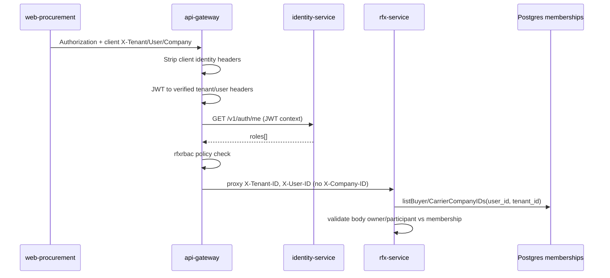

# Procurement header authority — discovery 0.5C

**Stage:** `PROCUREMENT-HEADER-AUTHORITY-DISCOVERY-0.5C`  
**Blocker:** `CP05B-02` (cross-app pilot security sign-off)  
**Related PRs:** #349, #355 (not modified by this deliverable)  
**Base SHA:** `3f306fc407aeda4bdc652d825954292f4a54fad6`  
**Method:** static code trace only — **no** forged requests to staging/production.

## Executive summary

| Header / field | Sent by `web-procurement` | Affects gateway RBAC? | Reaches `rfx-service` on proxied RFx routes? | Affects RFx company authority? |
| --- | --- | --- | --- | --- |
| `Authorization` (JWT) | Yes | **Yes** — source of truth | Bearer forwarded | Indirect (user id in JWT) |
| `X-Tenant-ID` (client) | Yes (`useApi`, some composables) | **No** when `AuthEnabled` — stripped, replaced from JWT | JWT tenant only | **No** (trusted header from gateway) |
| `X-User-ID` (client) | Yes | **No** when `AuthEnabled` — stripped, replaced from JWT | JWT `sub` only | **No** |
| `X-Company-ID` (client) | Yes (`tenantStore.currentCompanyId`) | Captured then **stripped**; not restored on RFx proxy | **Empty** on RFx downstream (tests) | **No** — membership from DB by `user_id` |
| Body `owner_company_id` | Yes (create/publish flows) | N/A | Yes | **Yes** — resolved vs buyer memberships server-side |
| Body `participant_company_id` | Yes (carrier bid) | N/A | Yes | **Yes** — resolved vs carrier memberships + invite |
| Query `tenant_id` | Avoided / rejected | N/A | **403** if present | **No** |

**Conclusion (auth-enabled gateway):** Client `X-Tenant-ID`, `X-User-ID`, and `X-Company-ID` from `web-procurement` **do not override** verified JWT tenant/user at the gateway, and **do not** authorize RFx owner/carrier company actions. Company scope for RFx writes is enforced in **rfx-service** using **user id + tenant from gateway-injected headers** and **membership tables**, not procurement’s selected company header.

**Residual risk:** procurement still **sends** spoofable-looking headers (operator confusion, direct-to-service calls in misconfigured envs, `AuthEnabled=false` dev). **Remediation** is hygiene + live negative tests, not an emergency gateway rewrite.

**FINAL_VERDICT:** `AUTHORITY_ASSESSED` + `REMEDIATION_REQUIRED` (client alignment + staged negative proof). Live pilot **not blocked** on header authority **if** `AuthEnabled=true` and staging tests pass.

---

## 1. Client header formation (`web-procurement`)

| Location | Headers set | Notes |
| --- | --- | --- |
| `composables/useApi.ts` `buildHeaders` | `Authorization`, `X-User-ID`, `X-Tenant-ID`, `X-Company-ID`, `X-Request-ID`, `X-Locale` | Default path for RFx, evaluation, publish, award (`useRfxApi`, `useRfxEvaluationApi`, …) |
| `composables/useCarrierResponseApi.ts` | Same pattern | Carrier flows inside procurement SPA |
| `composables/useRfxScoreApi.ts` | Explicit duplicate of tenant/user/company | Parallel to `useApi` |
| E2E helpers (`e2e/**/helpers.ts`, live specs) | Full header set | Test harness only |
| `stores/tenant.ts` | `freight_procurement_tenant_id`, `freight_procurement_company_id` in `localStorage` | **UI / client state**; drives `X-Tenant-ID` and `X-Company-ID` in `useApi` |

**Not used:** `packages/portal-client` `assertNoAuthorityHeaders` / `FORBIDDEN_AUTHORITY_HEADERS` (shipper/carrier portals only).

---

## 2. Gateway path (RFx)

### 2.1 Global auth middleware

File: `services/api-gateway/internal/http/middleware/auth.go`

1. Reads `X-Company-ID` into `AuthContext.RequestedCompanyID` (then strips header).
2. `StripUntrustedIdentityHeaders` removes client `X-Tenant-ID`, `X-User-ID`, `X-Company-ID`, role/admin headers (`auth_context.go`).
3. Validates JWT; sets `X-Tenant-ID`, `X-User-ID`, `X-User-Email` from **claims** (not client).

Evidence: `TestAuthEnabledStripsSpoofedIdentityHeaders` (`auth_test.go`), `TestE7GatewayIdentityHeaderSpoof*` (`rfxrbac/guard_test.go`).

### 2.2 RFx route RBAC

File: `services/api-gateway/internal/http/router.go` + `rfxrbac/guard.go`

- `routeauth.BuildRequestContext` uses **`MustAuthContext`** → JWT tenant/user only when auth enabled.
- `IdentityClient.FetchUserRoles` calls identity `GET /v1/auth/me` with **JWT-derived** `reqCtx` headers only (`routeauth/client.go`).
- Role allow lists: `rfxrbac/policies.go` (`CanBuyerManage`, `CanCarrierRespond`, …).

### 2.3 Proxy to `rfx-service`

File: `services/api-gateway/internal/http/proxy.go`

- Generic reverse proxy forwards **post-middleware** headers.
- `X-Company-ID` is **not** re-applied for RFx paths (only `restorePublicAcceptCompanySelector` for one company route).
- **Observed:** `rfxrbac/guard_test.go` expects downstream `X-Company-ID == ""` after spoof.

### 2.4 RFx operation → gateway policy

| Operation | Procurement call (typical) | Gateway route | Policy |
| --- | --- | --- | --- |
| Create RFx | `POST /api/v1/rfx-events` | `POST /api/v1/rfx-events` | `PolicyBuyerManage` |
| Publish | `POST .../publish` or transitions | `POST /api/v1/rfx-events/{id}/publish` | `PolicyBuyerManage` |
| Evaluation list / recalc | `GET/POST .../responses`, `.../evaluation/recalculate` | same prefix | `PolicyBuyerRead` / `PolicyBuyerManage` |
| Award | `POST .../award-response` | `POST /api/v1/rfx-events/{id}/award-response` | `PolicyBuyerManage` |
| Carrier bid create | `POST .../responses` body `participant_company_id` | `PolicyCarrierRespond` | carrier JWT + gateway RBAC |
| Submit response | `POST /api/v1/rfx-responses/{id}/submit` | (router) | carrier policies |
| Award → TO convert / list | `POST/GET .../transport-orders` | `PolicyBuyerManage` / read | buyer manage/read |

---

## 3. `rfx-service` authority

### 3.1 Actor and tenant

File: `services/rfx-service/internal/http/handlers/context.go`, `tenant.go`

- `requireActor` → `resolveVerifiedTenant` from **`X-Tenant-ID`** (expects gateway-injected value).
- `X-User-ID` → `domain.ActorContext.UserID`.
- `tenant_id` query → **403** (`rejectClientTenantQuery`).
- Body `tenant_id` → must match authenticated tenant or be empty (`rejectBodyTenantMismatch`).

### 3.2 Membership (server-owned company scope)

Files: `service/owner_authorization.go`, `service/carrier_authorization.go`, `repository/membership_repository.go`

- **Buyer manage/publish/award:** `requireOwnerCompanyAccess` → `listBuyerCompanyIDs(tenant_id, user_id)` from **Postgres**; `owner_company_id` in body must be in that set (`resolveCreateOwnerCompanyID`, per-event checks).
- **Carrier bid/submit:** `resolveCarrierCompanyID` against `ListUserCarrierCompanyIDs`; participant must exist on event.
- **Not used for RFx authority:** client `X-Company-ID` header at rfx-service (stripped upstream).

### 3.3 Award → transport order

- `AwardResponse` handler: `evaluation_handler.go` — `response_id` in body; service uses event tenant + owner checks.
- `ConvertAwardToTransportOrders` / `ListAwardTransportOrders`: `award_conversion_handler.go` — buyer actor + event scope in service layer.

---

## 4. Role matrix (gateway + UI)

### 4.1 Gateway `PolicyBuyerManage` (publish, award, TO create)

| Role | Gateway allow | `web-procurement` `canManageTenders()` |
| --- | --- | --- |
| `SHIPPER_ADMIN` | Yes | Yes |
| `PROCUREMENT_MANAGER` | Yes | Yes |
| `SHIPPER_LOGIST` | **No** | **Yes** (UI mismatch) |
| `FORWARDER_MANAGER` | Yes | Yes |
| `CARRIER_DISPATCHER` | No | No |

### 4.2 Gateway `PolicyCarrierRespond` (bid/submit)

| Role | Gateway |
| --- | --- |
| `CARRIER_ADMIN`, `CARRIER_DISPATCHER` | Yes |
| Buyer roles | No |

### 4.3 Expected denials (gateway, JWT valid)

| Case | HTTP | Message (typical) |
| --- | --- | --- |
| Carrier JWT on `award-response` | 403 | `rfx buyer manage access denied` |
| `SHIPPER_LOGIST` on publish/award | 403 | `rfx buyer manage access denied` |
| Buyer JWT on `POST .../responses` (carrier policy) | 403 | `rfx carrier respond access denied` |
| No / bad JWT | 401 | unauthorized |

---

## 5. Negative tests (design — **NOT_RUN** live)

Use **only** in CI (existing) or **operator-approved** staging. Do not run from this task.

| ID | Scenario | Setup | Expected |
| --- | --- | --- | --- |
| NT-5C-01 | Spoof `X-Tenant-ID` on `GET /api/v1/rfx-events/{id}` | Valid JWT tenant A; header tenant B | Downstream tenant **A**; data scoped to A (`rfxrbac/guard_test` pattern) |
| NT-5C-02 | Spoof `X-User-ID` with valid JWT | JWT user U1; header U2 | Downstream **U1**; roles fetched for U1 |
| NT-5C-03 | Spoof `X-Company-ID` on RFx read | Any buyer JWT | Downstream company header **empty**; no extra access |
| NT-5C-04 | Body `owner_company_id` = foreign company in tenant | JWT with membership on co-A only | 404 `rfx event not found` / forbidden (not found obfuscation) |
| NT-5C-05 | Body `participant_company_id` = non-member carrier | Carrier JWT co-C only | Reject / not found |
| NT-5C-06 | Query `?tenant_id=` on RFx | Valid JWT | **403** `tenant_id query parameter is not accepted` |
| NT-5C-07 | Body `tenant_id` ≠ JWT tenant | Valid JWT tenant A | **403** body mismatch |
| NT-5C-08 | `SHIPPER_LOGIST` JWT award | UI may show award button | **403** at gateway before rfx |
| NT-5C-09 | Procurement `localStorage` tenant B + JWT tenant A | Normal login A | Operations succeed under A; UI may show wrong tenant label (**UX**, not authority) |

**Existing automated coverage (repository):** gateway identity spoof tests (`auth_test.go`, `rfxrbac/guard_test.go`, `systemwave2/security_regression_test.go`). **NOT** a substitute for staging NT-5C-04…07 on real membership data.

---

## 6. Unverified / trust boundaries

| ID | Topic | Status | Notes |
| --- | --- | --- | --- |
| UB-5C-01 | `AuthEnabled=false` / dev tenant | **UNVERIFIED** in this task | `BuildRequestContext` uses `DevTenantID`; client headers may matter |
| UB-5C-02 | Direct `rfx-service` access (bypass gateway) | **Out of pilot scope** | Would trust stripped headers if exposed |
| UB-5C-03 | Identity `GET /v1/auth/me` role source vs JWT claims | **Assumed** identity validates Bearer | Gateway RBAC depends on identity |
| UB-5C-04 | Procurement `currentCompanyId` vs `owner_company_id` in forms | **UNVERIFIED** E2E | Wrong UI company may still send valid body if operator picks wrong field |
| UB-5C-05 | Non-RFx procurement APIs using same headers | **NOT traced** in 0.5C | Other guards (e.g. `transportorderrbac`) use `RequestedCompanyID` differently |
| UB-5C-06 | Staging live negative suite | **NOT_RUN** | Required to close CP05B-02 formally |

---

## 7. Minimal remediation plan (no implementation in 0.5C)

| Priority | Action | Owner | Rationale |
| --- | --- | --- | --- |
| P1 | Run NT-5C-01…08 on **staging** with real JWTs | QA + Operator | Close CP05B-02 with evidence |
| P2 | Document for operators: procurement `X-Company-ID` is **not** RFx authority; use correct `owner_company_id` in forms | Docs | Reduces CP05B-02 confusion |
| P3 | **Optional** client hygiene: stop sending `X-Tenant-ID` / `X-User-ID` from `useApi` (Bearer only), align with `portal-client` | Frontend + Security review | Defense-in-depth; no behavior change if gateway unchanged |
| P4 | **Optional** gate award UI on same roles as `PolicyBuyerManage` (hide for `SHIPPER_LOGIST`) | Frontend | UX/security alignment |
| P5 | Add regression note in procurement AGENTS/docs: never call RFx without gateway | Docs | Misconfiguration prevention |

**Explicit non-actions:** no new public write routes; no gateway/router changes in this discovery PR.

---

## 8. Trace diagram

---

## 9. CP05B-02 disposition

| Question | Answer |
| --- | --- |
| Can client `X-Tenant-ID` / `X-User-ID` change **server** tenant/user for RFx through gateway? | **No** (when auth enabled; code + unit tests) |
| Can client `X-Company-ID` from procurement grant RFx owner rights? | **No** — stripped on proxy; rfx uses DB membership by user |
| Can body company ids bypass membership? | **Should not** — service resolves against DB; **prove on staging** (NT-5C-04/05) |
| Is mock Playwright proof? | **No** |

**Recommended CP05B-02 close criteria:** P1 staging negatives PASS + security ack on P3/P4 backlog.

---

## Verdict

| Field | Value |
| --- | --- |
| **FINAL_VERDICT** | `AUTHORITY_ASSESSED` |
| **REMEDIATION_REQUIRED** | Yes — P1 staging negatives + optional client/docs (P2–P5) |
| **LIVE_PILOT_BLOCKED_ON_HEADERS** | **No** (auth-enabled gateway); **blocked on** UB-5C-06 staging proof |
