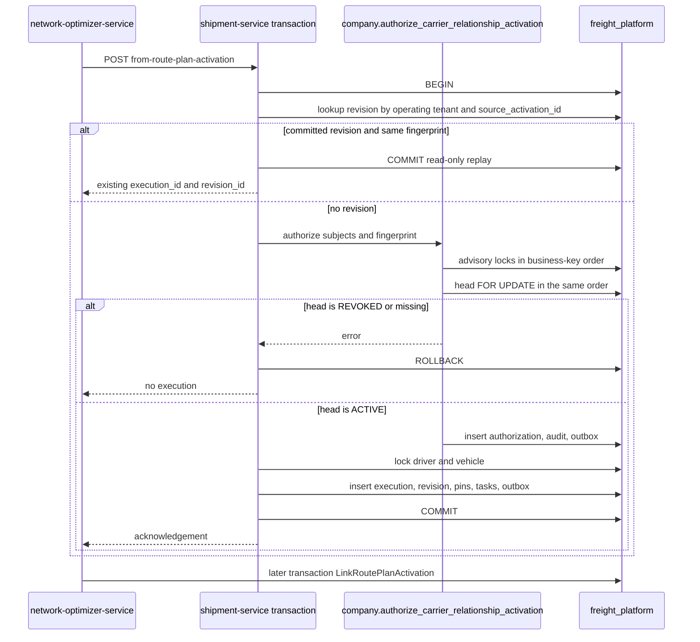

# BINTRANS PLATFORM / TMS

## CROSS-TENANT ACTIVATION AND RELATIONSHIP PINS 0.1 ARCHITECTURE

```text
AGENT=C
STAGE=TMS-CROSS-TENANT-ACTIVATION-PINS-0.1-ARCHITECTURE
BASE_SHA=e810056284ebb39014572903bf73a5ba29fc52e9
BRANCH=docs/tms-cross-tenant-activation-pins-v0.1
PR_290_PRESENT=YES
PR_290_MERGE_COMMIT=3551b960585f58d7a86c29d3b12fb4677caa6f88
PR_291_PRESENT=YES
PR_291_MERGE_COMMIT=6c7b4e5594b25a881cb6a8c964c5d6612a929a2e
PR_292_PRESENT=YES
PR_292_MERGE_COMMIT=92ad5e01d97748f7895aaa83ff2463894ad4aa87
PR_293_PRESENT=YES
PR_293_MERGE_COMMIT=18865282f5aa4c1e493955e770cb17ecf9357c6a
PR_294_PRESENT=YES
PR_294_MERGE_COMMIT=e810056284ebb39014572903bf73a5ba29fc52e9
MAIN_MIGRATION_HEAD=000102
ADR=docs/architecture/platform/adr/ADR-PLATFORM-003-tms-activation-relationship-pins.md
ADR_NUMBER=ADR-PLATFORM-003
DOCS_ONLY=YES
RUNTIME_AUTHORIZED=NO
IMPLEMENTATION_AUTHORIZED=NO
MIGRATION_AUTHORIZED=NO
MIGRATION_NUMBER_ASSIGNED=NO
MIGRATION_CREATED_IN_THIS_STAGE=NO
GATEWAY_CHANGE_AUTHORIZED=NO
FEATURE_FLAG_ENABLE_AUTHORIZED=NO
NLO_RUNTIME_AUTHORIZED=NO
CONTROL_TOWER_CHECKOUT_CHANGED=NO
MERGE_AUTHORIZED=NO
DEPLOYMENT_AUTHORIZED=NO
```

This document freezes how a confirmed carrier relationship becomes an immutable pin on a transport execution revision. It does not authorize runtime code, a migration file, a flag change, an NLO edit, a Control Tower edit, or deployment.

Authoritative inputs read at `e810056284ebb39014572903bf73a5ba29fc52e9`:

- `docs/architecture/platform/PLATFORM_CROSS_TENANT_EXECUTION_IDENTITY_0_1A_FREEZE.md`
- `docs/architecture/platform/PLATFORM_CROSS_TENANT_EXECUTION_IDENTITY_0_1B_RUNTIME_DESIGN.md`
- `docs/architecture/platform/adr/ADR-PLATFORM-001-public-relationship-accept.md`
- `docs/architecture/platform/adr/ADR-PLATFORM-002-relationship-revoke.md`
- `infrastructure/migrations/000088_tms_transport_execution_foundation_v0_1a.up.sql`
- `infrastructure/migrations/000086_nlo_route_plan_accept_activate_v0_4c.up.sql`
- `infrastructure/migrations/000100_company_carrier_relationship_foundation_v0_1c.up.sql`
- `infrastructure/migrations/000102_company_carrier_relationship_revoke_v0_2.up.sql`
- `infrastructure/migrations/000092_tms_control_tower_execution_projection_v0_1e.up.sql`
- `services/shipment-service/internal/repository/transport_execution_repository.go`
- `services/company-service/internal/repository/relationship_repository.go`
- `services/company-service/internal/repository/relationship_revoke.go`
- `services/network-optimizer-service/internal/service/execution_link.go`
- `services/network-optimizer-service/internal/executionproj/client.go`

## 1. What main already has

| Object | Present on this base | Owner |
| --- | --- | --- |
| `transport.transport_executions` | Yes. `operating_tenant_id`, `carrier_company_id`, `driver_id`, `vehicle_id`, `current_revision_id` | shipment-service |
| `transport.transport_execution_revisions` | Yes. Unique `(operating_tenant_id, source_activation_id)`. No relationship column | shipment-service |
| `transport.transport_execution_participants` | Yes. Shipment tenant and shipment id. No relationship column | shipment-service |
| `transport.transport_execution_active_shipments` | Yes. One active execution slot per shipment | shipment-service |
| `company.carrier_relationships` | Yes. Immutable endpoints. Unique `(shipper_tenant_id, shipper_carrier_company_id, operating_tenant_id)` | company-service |
| `company.carrier_relationship_versions` | Yes. Append-only `ACTIVE` or `REVOKED` | company-service |
| `company.carrier_relationship_heads` | Yes. Mutable current version | company-service |
| `transport.transport_execution_carrier_relationship_pins` | No | Not created |
| `company.authorize_carrier_relationship_activation` | No | Not created |
| `company.carrier_relationship_activation_authorizations` | No | Not created |
| `network_optimizer.route_plan_activations` | Yes. Public activate leaves `execution_id` null and status `PENDING_EXECUTION` | network-optimizer-service |
| `control_tower.execution_projection` | Yes. Post-commit read model. No relationship pin | control-tower consumer |
| `transport.drivers`, `transport.vehicles` | Yes. `tenant_id`, `carrier_company_id`, `status`, `deleted_at` | shipment-service |

`Project` begins a transaction, replays a matching activation digest, verifies shipment and cargo versions, and inserts the execution graph. It commits, and only then `AcceptRoutePlanActivation` reads the acknowledgement. NLO calls that route with `X-Internal-Service-Name: network-optimizer-service` and a 5 second HTTP timeout. On a temporary error, `finishActivationHandoff` leaves the activation `PENDING_EXECUTION`. On success it runs `LinkRoutePlanActivation` in a new NLO transaction. That link is not atomic with the pin.

The relationship lock key already used by Accept and Revoke is:

```text
relationship:{shipper_tenant_id}:{shipper_carrier_company_id}:{operating_tenant_id}
```

`pg_advisory_xact_lock(hashtextextended(key, 0))` runs before `SELECT ... FROM company.carrier_relationship_heads WHERE relationship_id = $1 FOR UPDATE`. UUID text from `uuid.String()` is lowercase. The SQL function must use `lower(uuid::text)` so the key matches.

Company-service and shipment-service use one database name, `freight_platform`, and today one login, `freight`. That shared login is not a privilege boundary.

```text
ACTIVATION_ATOMICITY_DATABASE=freight_platform
SHARED_FREIGHT_LOGIN_PRESENT=YES
PIN_TABLE_PRESENT=NO
AUTHORIZE_FUNCTION_PRESENT=NO
```

## 2. Authority

```text
TMS_EXECUTION_OWNER=SHIPMENT_SERVICE
OPERATING_CARRIER_IDENTITY=ROOT.operating_carrier_company_id
SOURCE_COMPANY_IDENTITY=ROOT.shipper_carrier_company_id
SHIPPER_LOCAL_CARRIER_UUID_EQUALS_OPERATING_CARRIER_UUID=NO
DIRECT_CARRIER_COMPANY_UUID_EQUALITY_VALID=NO
DRIVER_VEHICLE_OWNER=OPERATING_TENANT
CROSS_TENANT_DRIVER_BRIDGE_REQUIRED=NO
CROSS_TENANT_VEHICLE_BRIDGE_REQUIRED=NO
CLIENT_SUPPLIED_RELATIONSHIP_VERSION_AUTHORITY=NO
SERVER_CHECKS_REQUIRED=YES
```

The operating carrier is the `core.companies` row stored on the relationship root as `operating_carrier_company_id`, in `operating_tenant_id`. The shipper's local carrier reference is `transport.shipments.carrier_company_id` in the shipment tenant. Those are different UUIDs. Equality of the two UUIDs is not authority. The relationship root is the authority that they name the same operating carrier.

A driver or vehicle used on the execution is a `transport.drivers` or `transport.vehicles` row whose `tenant_id` is the operating tenant and whose `carrier_company_id` is the operating company. Shipment-local driver and vehicle ids are not compared and are not copied onto the execution.

The projection body must not contain `relationship_id`, `relationship_version`, or `relationship_version_id`. If any of those fields is present, shipment-service refuses with `RELATIONSHIP_VERSION_NOT_AUTHORITATIVE` before `BEGIN`. The version written on the pin is the `current_version_id` read from the locked head.

`COMPANY_RELATIONSHIP_COMMANDS_ENABLED` remains the relationship-command flag. It is not the activation switch. The activation switch is `TMS_RELATIONSHIP_ACTIVATION_ENABLED`, default off. This stage does not turn either flag on. While the activation flag is off, this design does not change `Project`. When a later stage turns it on, a projection that cannot pin rolls back. It must not commit an execution without pins.

## 3. Who owns each step

The public route-plan activate command does not pin. NLO writes `PENDING_EXECUTION` with null execution ids. The pin is the internal projection.

| Step | Owner | What is true when the step finishes |
| --- | --- | --- |
| 1. Verified caller | API gateway for the user command that created the activation. Shipment-service for the internal route | Internal caller is `network-optimizer-service` after the internal token check. `OperatingTenantID` equals the verified tenant. `route_plan_activations` does not store a user id. NLO audit records the actor. That actor is provenance, not a relationship version |
| 2. Shipment and transport order | shipment-service | Each subject shipment exists at the command version, `deleted_at` is null, and the cargo version matches. A transport order is not a pin subject. Order status is not moved |
| 3. Operating carrier | shipment-service | `core.companies.id = carrier_company_id` and `tenant_id = operating_tenant_id` and `deleted_at` is null. This company is not the shipper-local carrier UUID |
| 4. ACTIVE relationship | `company.authorize_carrier_relationship_activation` on the same connection | Head is locked and is `ACTIVE`. The returned version is the only version the pin may name |
| 5. Driver and vehicle | shipment-service | A non-null id matches operating tenant, operating company, `status = ACTIVE`, and `deleted_at IS NULL`, under `FOR UPDATE`. Null remains "no assignment" |
| 6. Pins | shipment-service | One immutable pin per shipment participant, using the version from step 4 |
| 7. Execution revision | shipment-service | Existing insert of execution, revision, participants, stops, actions, and driver stop tasks |
| 8. Audit and outbox | company function and shipment-service, same transaction | `carrier_relationship.activation_authorized` and `shipment.execution_plan.created` |
| 9. Idempotent result | shipment-service, then NLO in a later transaction | Shipment-service returns the committed ids. NLO links `EXECUTION_LINKED` only after that acknowledgement |

Step 4 is not an HTTP call to company-service. Company-service remains the owner of the relationship rules because the function is `SECURITY DEFINER`, `search_path = company, pg_temp`, and it writes only `company.*`.

## 4. Transaction boundary

```text
SHARED_POSTGRESQL_TRANSACTION=YES
SHARED_TRANSACTION_SCOPE=company_schema_function_plus_transport_execution_insert
SHARED_TRANSACTION_MECHANISM=ONE_LOCAL_COMMIT_ON_freight_platform
NLO_LINK_ATOMIC_WITH_PINS=NO
CONTROL_TOWER_ATOMIC_WITH_PINS=NO
HTTP_ACK_ATOMIC_WITH_PINS=NO
TWO_PHASE_COMMIT=NO
SPLIT_DATABASE_ACTIVATION_POLICY=FAIL_CLOSED_NO_HTTP_READ_THEN_COMMIT
```

One local transaction is available for the company schema and the transport schema because both are in `freight_platform`, and shipment-service can call the function on its open transaction. That is the mechanism. This document does not call the NLO link, the HTTP response, or Control Tower atomic with the pin.

Data that is not in that commit:

| Data | Where it is written | When |
| --- | --- | --- |
| Relationship head, version, authorization, relationship audit, relationship outbox | `company` schema, inside the projection transaction | Same commit as the pins |
| Execution, revision, pins, driver stop tasks, execution outbox | `transport` schema, same transaction | Same commit |
| `route_plan_activations.status = EXECUTION_LINKED` | `network_optimizer` schema, NLO transaction after HTTP 201/200 | After the acknowledgement |
| `control_tower.execution_projection` | Control Tower inbox consumer | After the execution event is published |
| User HTTP response | NLO handler | After the NLO link transaction |

If company and transport are ever placed in different databases, the function call fails. Activation then fails closed. It must not fall back to reading the head over HTTP and committing later.

The `freight` login can today insert into either schema without the function. Enabling the flag before a dedicated shipment role exists is forbidden. The later role has `EXECUTE` on the function only. It has no `INSERT`, `UPDATE`, or `DELETE` on `company.carrier_relationship_heads`, `company.carrier_relationship_versions`, or `company.carrier_relationships`. This stage does not create the role.

### Lock order



```text
ACTIVATION_LOCK_ORDER=1_ALL_ADVISORY_KEYS_SORTED+2_ALL_HEADS_FOR_UPDATE_SAME_ORDER+3_SHIPMENT_ROWS+4_DRIVER_AND_VEHICLE+5_INSERTS+6_COMMIT
HEAD_LOCK_BEFORE_ADVISORY=FORBIDDEN
ADVISORY_LOCK=pg_advisory_xact_lock
ADVISORY_LOCK_LIFETIME=UNTIL_COMMIT_OR_ROLLBACK
HEAD_LOCK_LIFETIME=UNTIL_COMMIT_OR_ROLLBACK
```

Sort key is lowercase `shipper_tenant_id`, then lowercase `shipper_carrier_company_id`. The advisory key text is the Accept/Revoke key. Revoke of one relationship takes that same advisory lock and then that head. It cannot pass an activation that already holds them, and an activation cannot pass a revoke that already holds them.

### Revoke race

The fix point is the head lock inside the projection transaction, before any pin or execution insert.

| Order | Result |
| --- | --- |
| Revoke commits, then activation locks the head | Head is `REVOKED`. Function raises `RELATIONSHIP_REVOKED`. Rollback. No execution and no pin |
| Activation holds the head, revoke waits | Activation commits the pin for the `ACTIVE` version it locked. Revoke then inserts the next `REVOKED` version. The pin row is not updated |
| Activation and revoke request the same advisory key | One waits. There is no TOCTOU window between the `ACTIVE` check and the pin insert |
| Replay after the pin commit, head now `REVOKED` | The revision lookup returns the committed execution. The function is not called. History stays |

An HTTP read of `ACTIVE` before `Project` is not this protocol. `REVOCATION_DURING_PREPARED_ACTIVATION_POLICY=NO_DURABLE_PREPARED_ROW`. There is no authorization row that survives a rollback and blocks revoke.

### Timeout, crash, and lost acknowledgement

| Failure | Relationship and execution | Recovery |
| --- | --- | --- |
| PostgreSQL or shipment-service crash before `COMMIT` | Rollback. No authorization, pin, execution, task, audit, or outbox | NLO left the activation `PENDING_EXECUTION` on a timeout. The next attempt is a full activation |
| HTTP timeout after `COMMIT` and before the response | Pins and execution are committed. NLO is still `PENDING_EXECUTION` because the link has not run | Retry calls `Project`. The activation unique key returns the same revision when the fingerprint matches. NLO then links |
| NLO link transaction fails after a valid acknowledgement | Pins stay. Activation stays `PENDING_EXECUTION` | Retry `Project`, then `LinkRoutePlanActivation`. Do not roll the pins back |
| Same activation id, different fingerprint, execution already committed | Conflict. Pins unchanged. No second execution | Do not mark the NLO row `REJECTED` merely because the retry body differs. A committed revision for that activation id is linked, not rejected |
| Permanent refusal before commit, including `RELATIONSHIP_REVOKED` | Nothing committed | NLO may mark `REJECTED` only while `execution_id` is still null |

`MarkRoutePlanActivationRejected` updates only a `PENDING_EXECUTION` row whose execution ids are null. That guard is not enough if a retry receives a permanent error after the execution committed and the link did not. The later NLO stage must treat "revision already stored for this `source_activation_id`" as link, not reject. This stage does not change that Go code.

There is no incomplete activation row to repair. Recovery is the committed revision. Absence means run the whole activation again. Presence with the same fingerprint means return it.

## 5. Pin schema proposal

This SQL is a proposal. It is not a file under `infrastructure/migrations`. It has no number. Applying it is not authorized.

```text
MIGRATION_NUMBER_ASSIGNED=NO
FUTURE_BACKFILL_POLICY=NO_BACKFILL
HISTORICAL_REVISIONS_REMAIN_UNPINNED=YES
```

```sql
-- Proposal only. Do not assign a migration number.

CREATE TABLE company.carrier_relationship_activation_authorizations (
    id uuid PRIMARY KEY,
    source_activation_id uuid NOT NULL,
    operating_tenant_id uuid NOT NULL,
    operating_carrier_company_id uuid NOT NULL,
    pin_set_fingerprint text NOT NULL CHECK (char_length(pin_set_fingerprint) = 64),
    created_at timestamptz NOT NULL DEFAULT clock_timestamp(),
    CONSTRAINT uq_cr_activation_auth UNIQUE (operating_tenant_id, source_activation_id)
);

CREATE TABLE transport.transport_execution_carrier_relationship_pins (
    pin_id uuid PRIMARY KEY,
    execution_revision_id uuid NOT NULL REFERENCES transport.transport_execution_revisions (id),
    operating_tenant_id uuid NOT NULL,
    shipment_tenant_id uuid NOT NULL,
    shipment_id uuid NOT NULL,
    source_company_id uuid NOT NULL,
    relationship_id uuid NOT NULL,
    relationship_version_id uuid NOT NULL REFERENCES company.carrier_relationship_versions (relationship_version_id),
    relationship_version integer NOT NULL CHECK (relationship_version >= 1),
    operating_carrier_company_id uuid NOT NULL,
    pin_set_fingerprint text NOT NULL CHECK (char_length(pin_set_fingerprint) = 64),
    created_at timestamptz NOT NULL DEFAULT clock_timestamp(),
    CONSTRAINT uq_execution_relationship_pin UNIQUE (execution_revision_id, shipment_tenant_id, shipment_id)
);

CREATE INDEX transport_execution_relationship_pins_relationship_idx
    ON transport.transport_execution_carrier_relationship_pins (relationship_id, relationship_version_id);
```

`source_company_id` is the shipper-local carrier company, the same value as `company.carrier_relationships.shipper_carrier_company_id` and as the fingerprint field `shipment_carrier_company_id`. It is not `shipper_company_id` and it is not the operating company.

Tenant ownership of the pin row is `operating_tenant_id`, the execution owner. `shipment_tenant_id` records which participant the pin covers. A shipper reads a pin only through its own shipment participation. The read returns the relationship id and version. It does not return operating `driver_id` or `vehicle_id`.

A revision may add a nullable `pin_set_fingerprint`. Existing rows stay null. A revision that has a pin must store the same fingerprint as every pin row of that revision. No backfill.

Constraints the later migration must enforce with triggers, because the current primary keys do not cover every match:

- `BEFORE UPDATE OR DELETE` on the pin table raises and leaves the row unchanged.
- Insert rejects a `relationship_version_id` whose version row has a different `relationship_id` or `relationship_version`.
- Insert rejects a pin whose `operating_tenant_id` differs from the revision.
- Insert rejects a pin whose `operating_carrier_company_id` or `source_company_id` differs from the relationship root.
- Insert rejects a second fingerprint on the same revision.
- Every subject in the batch shares one `operating_tenant_id` and one `operating_carrier_company_id`. One failed subject rolls the batch back.
- The outbox check gains `carrier_relationship.activation_authorized`. `activation_consumed` is not a second event. The pin rows are the consumption record in the same commit. `activation_expired` stays unused because the authorization lifetime is the transaction, not a clock.

The authorization row is inserted only in the transaction that also inserts the revision. It stores the fingerprint and the activation id. It does not store `execution_revision_id`, so the company function does not need a foreign key into `transport` and does not update the row after the revision id exists. Correlation is `(operating_tenant_id, source_activation_id)`, which the revision already stores.

Foreign keys from `transport` to `company.carrier_relationship_versions` are valid only while both schemas stay in `freight_platform`. A split database drops that constraint and is unsupported for activation.

## 6. Fingerprint

```text
PIN_SET_FINGERPRINT_ALGORITHM=SHA-256
PIN_SET_FINGERPRINT_ENCODING=lowercase_hex
PIN_SET_FINGERPRINT_CANONICAL_JSON=UTF-8 compact object
PIN_SET_FINGERPRINT_TOP_LEVEL_KEYS=operating_tenant_id,operating_carrier_company_id,subjects
PIN_SET_FINGERPRINT_SUBJECT_KEYS=shipment_tenant_id,shipment_id,shipment_carrier_company_id
PIN_SET_FINGERPRINT_SUBJECT_SORT=shipment_tenant_id ASC then shipment_id ASC
PIN_SET_FINGERPRINT_EXCLUDES=relationship_id,relationship_version,relationship_version_id
```

UUID values are lowercase. Subject key `shipment_carrier_company_id` is `source_company_id` on the pin. The fingerprint covers the requested participant set and the operating company. A retry of the same set matches before the server tells the caller which version it locked. The locked `relationship_version_id` is stored on the pin and is not taken from the client.

Same activation lookup key and same fingerprint returns the existing execution. Same key and a different fingerprint is HTTP 409 `RELATIONSHIP_ACTIVATION_FINGERPRINT_CONFLICT`. That response does not insert a second execution and does not update pins.

## 7. API contract

No gateway route is added. The internal projection route stays the only activation command.

```text
ACTIVATION_HTTP_ROUTE=POST /internal/v1/transport-executions/from-route-plan-activation
ACTIVATION_CALLER=network-optimizer-service
PUBLIC_USER_ROUTE_PINS_DIRECTLY=NO
RELATIONSHIP_FIELDS_IN_BODY=FORBIDDEN
```

The body remains the current `ProjectionCommand`. Additional relationship fields are a refusal, not an optional locator.

| Code | HTTP | When | Writes |
| --- | --- | --- | --- |
| `RELATIONSHIP_VERSION_NOT_AUTHORITATIVE` | 400 | Body contains a relationship id or version | None |
| `RELATIONSHIP_NOT_FOUND` | 404 | No root for the shipment carrier, shipment tenant, and operating tenant | None |
| `RELATIONSHIP_OPERATING_COMPANY_MISMATCH` | 409 | Root exists and `operating_carrier_company_id` differs from the command | None. Internal only. No company list |
| `RELATIONSHIP_REVOKED` | 409 | Locked head is `REVOKED` | None |
| `RELATIONSHIP_AMBIGUOUS` | 409 | More than one current head or root | None |
| `RELATIONSHIP_ACTIVATION_FINGERPRINT_CONFLICT` | 409 | Same activation id, different fingerprint | None |
| `OPERATING_DRIVER_NOT_VALID` | 409 | Supplied driver fails the operating-tenant predicate | None |
| `OPERATING_VEHICLE_NOT_VALID` | 409 | Supplied vehicle fails the operating-tenant predicate | None |
| `RELATIONSHIP_STORE_UNAVAILABLE` | 503 | Database error. Must not be returned as not-found | None |
| Committed replay | 200 | Same activation id and same fingerprint | None |
| First commit | 201 | Head was `ACTIVE` through commit | Authorization, pins, execution, audit, outbox |

`RELATIONSHIP_NOT_FOUND` is also the result for a foreign operating tenant, because the lookup key includes `operating_tenant_id`. The function does not search other tenants.

Success body stays the current acknowledgement: `operating_tenant_id`, `activation_id`, `route_plan_id`, `execution_id`, `execution_revision_id`. It does not include a relationship version. The version is on the pin row.

Driver stop tasks are created only in the successful commit. The driver application reads those tasks by the operating driver id. A refused activation creates none. A later revoke does not delete them.

## 8. Authorization matrix

| Actor | Action | Result |
| --- | --- | --- |
| `network-optimizer-service` with internal token, operating tenant matches | Project | Enters the transaction |
| Any other `X-Internal-Service-Name` | Project | 403 before the transaction. Existing handler |
| User JWT on the internal route | Project | Not the authorized caller |
| Operating company equal to the root | Activation | Eligible for the `ACTIVE` check |
| Sibling company in the operating tenant | Activation | `RELATIONSHIP_OPERATING_COMPANY_MISMATCH`. No pin |
| Foreign tenant | Activation | `RELATIONSHIP_NOT_FOUND`. No pin |
| Shipper tenant as the projection tenant | Activation | Refused by the operating-tenant check unless that tenant is the operating tenant of the execution |
| Driver id from another tenant or another carrier company | Activation | `OPERATING_DRIVER_NOT_VALID`. Rollback |
| Vehicle id from another tenant or another carrier company | Activation | `OPERATING_VEHICLE_NOT_VALID`. Rollback |
| Null driver or null vehicle | Activation | Stored null. Not a cross-tenant copy |
| Client relationship version | Activation | 400 before `BEGIN` |
| Shipper reading the execution | Read | Own shipment participation only. No operating driver or vehicle id |
| Control Tower | Read | Existing execution projection. Not pin authority |

`GOV_INSPECTOR` is not an activation role. `PLATFORM_ADMIN` does not bypass the locked `ACTIVE` check.

## 9. Concurrency matrix

| Case | First transaction | Second transaction | Committed result |
| --- | --- | --- | --- |
| Active head, one activation | Locks key, sees `ACTIVE`, commits | None | One revision, one pin set |
| Revoke commits first | Revoke moves the head to `REVOKED` | Activation locks and refuses | No new execution |
| Activation holds the lock | Activation commits pins | Revoke waits, then inserts `REVOKED` | Execution and pins unchanged |
| Two activations, same `source_activation_id`, same fingerprint | One inserts | The other waits, then replays | One execution |
| Two activations, same id, different fingerprint | One commits | Conflict | Stored pins unchanged |
| Two activations, different ids, same shipment | One takes the active-shipment slot | The other hits `transport_execution_active_shipments` primary key | One active execution. The loser rolls back its authorization |
| Two activations, different shipments, same relationship | Serialized on the advisory key | The second reads the head after the first commits | Two pin sets. Each names the version it locked |
| Replay after revoke | Revision exists | Replay does not lock the head | Same execution |
| Crash before commit | Rollback | Retry | Either a new commit or a replay of a later commit |
| Lost HTTP ack | Commit succeeded | NLO retries `Project`, then links | Pins stay. NLO becomes `EXECUTION_LINKED` only in its own transaction |
| Accept reactivation beside activation | Both use the advisory key then the head | One waits | Activation sees the head status that won the lock |

Deadlock with Revoke is avoided by the advisory-then-head order. Two activations take advisory locks in the same sorted order before any head lock.

## 10. Historical reads and neighbors

Revoke after a successful activation inserts a new relationship version. It does not update pins, `driver_id`, `vehicle_id`, shipment rows, finance snapshots, POD, driver stop tasks, or `control_tower.execution_projection`.

A historical read of the execution uses the pin's `relationship_version_id`, not the current head. The named version remains `ACTIVE` because versions are append-only. The head may be `REVOKED`.

NLO handoff stays the existing pair of calls. The verified execution context NLO may store is `execution_id`, `execution_revision_id`, and `source_activation_id`. It must not store a client relationship version. A later reader that needs the relationship loads the pin from the revision. `execution_supported` stays false. This stage does not change NLO.

Current NLO code sets `shipment_tenant_id` from the acting tenant. Shipment-service looks the shipment up by that tenant id. A cross-tenant shipment whose tenant differs from the actor fails the existing materialized-row check and creates no execution. The later NLO stage must send the shipment row's tenant. Until then, mismatch fails closed. This stage does not patch that client.

Control Tower checkout is unchanged. The execution projection is not a pin and is not rewritten on revoke.

Finance and POD keep their historical tenant-local company ids. No auto-match and no backfill.

## 11. PostgreSQL test plan

The later runtime stage runs these tests against PostgreSQL. This stage does not add them.

| Id | Setup | Expected |
| --- | --- | --- |
| TAP-01 | `ACTIVE` head, valid operating driver and vehicle | One execution, one pin per subject, pin version equals the locked head, 201 |
| TAP-02 | Head `REVOKED` | `RELATIONSHIP_REVOKED`. Zero executions, pins, authorizations, tasks |
| TAP-03 | Revoke and activation start together | The waiter sees the winner's commit. Either no execution, or an execution whose pin is not updated by the revoke |
| TAP-04 | Two concurrent first activations, different activation ids, one shipment | One active slot. One rollback with no authorization left behind |
| TAP-05 | Replay of TAP-01 body | 200, same execution id, no second pin |
| TAP-06 | Commit, drop the HTTP response, retry the same body | Same execution. NLO can link. Pins unchanged |
| TAP-07 | Operating tenant is not the relationship operating tenant | `RELATIONSHIP_NOT_FOUND`. No pin |
| TAP-08 | Command company is a sibling of `operating_carrier_company_id` | `RELATIONSHIP_OPERATING_COMPANY_MISMATCH`. No pin |
| TAP-09 | Driver or vehicle id belongs to another tenant or company | 409. Rollback includes the authorization |
| TAP-10 | Forced error after the function insert and before commit | No authorization, pin, execution, audit, or outbox |
| TAP-11 | `UPDATE` or `DELETE` of a committed pin | Trigger failure. Row unchanged |
| TAP-12 | Revoke after TAP-01 | New `REVOKED` version. Pin, driver, vehicle, shipment, and execution unchanged |
| TAP-13 | Read execution after TAP-12 | Pin still names the original `relationship_version_id` |
| TAP-14 | Projection ack committed | NLO link, in its own transaction, stores that execution id and revision id. It does not write a relationship version |
| TAP-15 | Body includes `relationship_version_id` | 400. Transaction not opened |
| TAP-16 | Same activation id, different subject set | 409 fingerprint conflict. Stored pin unchanged |

Each test asserts the other tenant cannot observe the row through a shipper list, and a shipper read does not return the operating driver or vehicle id.

## 12. Implementation roadmap

Not authorized by this stage.

| Order | Stage | Allowed to change | Stop condition |
| --- | --- | --- | --- |
| 0 | This document and ADR-PLATFORM-003 | Docs only | Draft PR, exact-head CI, Agent I review |
| 1 | Database role split | Login and grants only | Shipment login can execute the function and cannot insert relationship rows. Flag still off |
| 2 | Company function, authorization table, outbox event type | company-service and one unnumbered-until-then migration | Function refuses `REVOKED` under the Accept/Revoke lock order. No TMS insert yet |
| 3 | Pin table and `Project` integration | shipment-service behind `TMS_RELATIONSHIP_ACTIVATION_ENABLED` default off | TAP-01 through TAP-16. Flag off leaves today's `Project` unchanged |
| 4 | NLO lost-ack classification and shipment tenant | network-optimizer-service only, separate PR | A committed revision is linked, not rejected. `execution_supported` still false |
| 5 | Flag enablement | Operations authorization | Separate from stages 0–4 |

Stages 1–5 are not started here. Merge of this document is not merge of runtime.

```text
READY_FOR_AGENT_I_REVIEW=YES
READY_FOR_MERGE=NO
READY_FOR_RUNTIME=NO
NLO_CHANGED=NO
CONTROL_TOWER_CHANGED=NO
```
