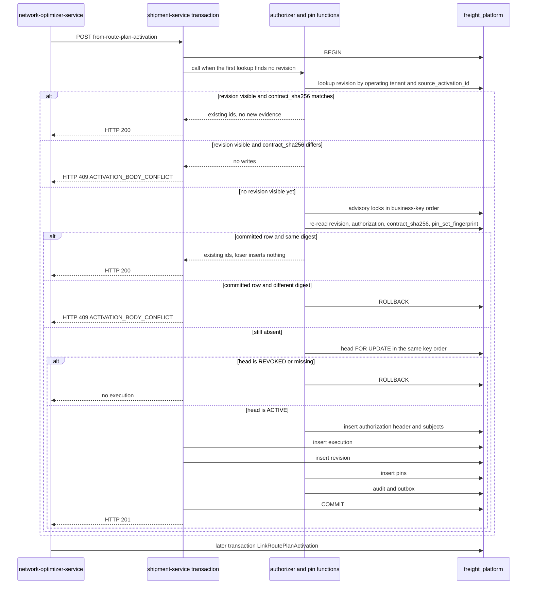

# BINTRANS PLATFORM / TMS

## CROSS-TENANT ACTIVATION AND RELATIONSHIP PINS 0.1 ARCHITECTURE

```text
AGENT=C
STAGE=TMS-CROSS-TENANT-ACTIVATION-PINS-0.1-ARCHITECTURE
BASE_SHA=e810056284ebb39014572903bf73a5ba29fc52e9
BRANCH=docs/tms-cross-tenant-activation-pins-v0.1
PR_290_PRESENT=YES
PR_290_MERGE_COMMIT=3551b960585f58d7a86c29d3b12fb4677caa6f88
PR_291_PRESENT=YES
PR_291_MERGE_COMMIT=6c7b4e5594b25a881cb6a8c964c5d6612a929a2e
PR_292_PRESENT=YES
PR_292_MERGE_COMMIT=92ad5e01d97748f7895aaa83ff2463894ad4aa87
PR_293_PRESENT=YES
PR_293_MERGE_COMMIT=18865282f5aa4c1e493955e770cb17ecf9357c6a
PR_294_PRESENT=YES
PR_294_MERGE_COMMIT=e810056284ebb39014572903bf73a5ba29fc52e9
MAIN_MIGRATION_HEAD=000102
ADR=docs/architecture/platform/adr/ADR-PLATFORM-003-tms-activation-relationship-pins.md
ADR_NUMBER=ADR-PLATFORM-003
DOCS_ONLY=YES
RUNTIME_AUTHORIZED=NO
IMPLEMENTATION_AUTHORIZED=NO
MIGRATION_AUTHORIZED=NO
MIGRATION_NUMBER_ASSIGNED=NO
MIGRATION_CREATED_IN_THIS_STAGE=NO
GATEWAY_CHANGE_AUTHORIZED=NO
FEATURE_FLAG_ENABLE_AUTHORIZED=NO
NLO_RUNTIME_AUTHORIZED=NO
CONTROL_TOWER_CHECKOUT_CHANGED=NO
MERGE_AUTHORIZED=NO
DEPLOYMENT_AUTHORIZED=NO
R1_REMEDIATION=PIN-01,PIN-02,PIN-03,PIN-04
R2_REMEDIATION=R2-01,R2-02,R2-03,R2-04,R2-05
SECURITY_DEFINER_SEARCH_PATH=pg_catalog
REPLAY_PREDICATE=contract_sha256
PIN_SET_FINGERPRINT_REPLACES_CONTRACT_SHA256=NO
SHARED_FREIGHT_LOGIN=DEPLOYMENT_BLOCKER
```

This document freezes how a confirmed carrier relationship becomes an immutable pin on a transport execution revision. R1 keeps `contract_sha256` as the replay predicate and copies the committed pin set onto a successor revision. R2 binds each pin to the locked subject version, keeps shipment DML on executions and revisions, denies pin and authorization DML to `shipment_runtime`, sets every definer function to `search_path = pg_catalog`, and leaves a lost-ack body conflict pending in NLO. It does not authorize runtime code, a migration file, a flag change, an NLO edit, a Control Tower edit, or deployment.

Authoritative inputs read at `e810056284ebb39014572903bf73a5ba29fc52e9`:

- `docs/architecture/platform/PLATFORM_CROSS_TENANT_EXECUTION_IDENTITY_0_1A_FREEZE.md`
- `docs/architecture/platform/PLATFORM_CROSS_TENANT_EXECUTION_IDENTITY_0_1B_RUNTIME_DESIGN.md`
- `docs/architecture/platform/adr/ADR-PLATFORM-001-public-relationship-accept.md`
- `docs/architecture/platform/adr/ADR-PLATFORM-002-relationship-revoke.md`
- `infrastructure/migrations/000088_tms_transport_execution_foundation_v0_1a.up.sql`
- `infrastructure/migrations/000086_nlo_route_plan_accept_activate_v0_4c.up.sql`
- `infrastructure/migrations/000100_company_carrier_relationship_foundation_v0_1c.up.sql`
- `infrastructure/migrations/000102_company_carrier_relationship_revoke_v0_2.up.sql`
- `infrastructure/migrations/000092_tms_control_tower_execution_projection_v0_1e.up.sql`
- `services/shipment-service/internal/repository/transport_execution_repository.go`
- `services/shipment-service/internal/repository/transport_execution_successor_repository.go`
- `services/shipment-service/internal/domain/transport_execution.go`
- `services/company-service/internal/repository/relationship_repository.go`
- `services/company-service/internal/repository/relationship_revoke.go`
- `services/network-optimizer-service/internal/service/execution_link.go`
- `services/network-optimizer-service/internal/executionproj/client.go`

## 1. What main already has

| Object | Present on this base | Owner |
| --- | --- | --- |
| `transport.transport_executions` | Yes. `operating_tenant_id`, `carrier_company_id`, `driver_id`, `vehicle_id`, `current_revision_id` | shipment-service |
| `transport.transport_execution_revisions` | Yes. Unique `(operating_tenant_id, source_activation_id)`. Stores `contract_sha256`. No relationship column | shipment-service |
| `transport.transport_execution_participants` | Yes. Shipment tenant and shipment id. No relationship column | shipment-service |
| `transport.transport_execution_active_shipments` | Yes. One active execution slot per shipment | shipment-service |
| `company.carrier_relationships` | Yes. Immutable endpoints. Unique `(shipper_tenant_id, shipper_carrier_company_id, operating_tenant_id)` | company-service |
| `company.carrier_relationship_versions` | Yes. Append-only `ACTIVE` or `REVOKED` | company-service |
| `company.carrier_relationship_heads` | Yes. Mutable current version | company-service |
| `transport.transport_execution_carrier_relationship_pins` | No | Not created |
| `company.authorize_carrier_relationship_activation` | No | Not created |
| `company.carrier_relationship_activation_authorizations` | No | Not created |
| `network_optimizer.route_plan_activations` | Yes. Public activate leaves `execution_id` null and status `PENDING_EXECUTION` | network-optimizer-service |
| `control_tower.execution_projection` | Yes. Post-commit read model. No relationship pin | control-tower consumer |
| `transport.drivers`, `transport.vehicles` | Yes. `tenant_id`, `carrier_company_id`, `status`, `deleted_at` | shipment-service |
| Successor revision | Yes. `CreateSuccessorRevision` locks the execution, inserts a revision, and sets `current_revision_id`. It copies no pins | shipment-service |

`Project` begins a transaction, replays a matching activation digest, verifies shipment and cargo versions, and inserts the execution graph. It commits, and only then `AcceptRoutePlanActivation` reads the acknowledgement. NLO calls that route with `X-Internal-Service-Name: network-optimizer-service` and a 5 second HTTP timeout. On a temporary error, `finishActivationHandoff` leaves the activation `PENDING_EXECUTION`. On success it runs `LinkRoutePlanActivation` in a new NLO transaction. That link is not atomic with the pin.

The relationship lock key already used by Accept and Revoke is:

```text
relationship:{shipper_tenant_id}:{shipper_carrier_company_id}:{operating_tenant_id}
```

`pg_advisory_xact_lock(hashtextextended(key, 0))` runs before `SELECT ... FROM company.carrier_relationship_heads WHERE relationship_id = $1 FOR UPDATE`. UUID text from `uuid.String()` is lowercase. The SQL function must use `lower(uuid::text)` so the key matches.

Company-service and shipment-service use one database name, `freight_platform`, and today one login, `freight`. That shared login is not a privilege boundary.

```text
ACTIVATION_ATOMICITY_DATABASE=freight_platform
SHARED_FREIGHT_LOGIN_PRESENT=YES
PIN_TABLE_PRESENT=NO
AUTHORIZE_FUNCTION_PRESENT=NO
```

## 2. Authority

```text
TMS_EXECUTION_OWNER=SHIPMENT_SERVICE
OPERATING_CARRIER_IDENTITY=ROOT.operating_carrier_company_id
SOURCE_COMPANY_IDENTITY=ROOT.shipper_carrier_company_id
SHIPPER_LOCAL_CARRIER_UUID_EQUALS_OPERATING_CARRIER_UUID=NO
DIRECT_CARRIER_COMPANY_UUID_EQUALITY_VALID=NO
DRIVER_VEHICLE_OWNER=OPERATING_TENANT
CROSS_TENANT_DRIVER_BRIDGE_REQUIRED=NO
CROSS_TENANT_VEHICLE_BRIDGE_REQUIRED=NO
CLIENT_SUPPLIED_RELATIONSHIP_VERSION_AUTHORITY=NO
SERVER_CHECKS_REQUIRED=YES
REPLAY_PREDICATE=contract_sha256
PIN_SET_FINGERPRINT_ROLE=PARTICIPANT_SET_EVIDENCE
FINGERPRINT_MATCH_OVERRIDES_DIGEST_CONFLICT=NO
```

The operating carrier is the `core.companies` row stored on the relationship root as `operating_carrier_company_id`, in `operating_tenant_id`. The shipper's local carrier reference is `transport.shipments.carrier_company_id` in the shipment tenant. Those are different UUIDs. Equality of the two UUIDs is not authority. The relationship root is the authority that they name the same operating carrier.

A driver or vehicle used on the execution is a `transport.drivers` or `transport.vehicles` row whose `tenant_id` is the operating tenant and whose `carrier_company_id` is the operating company. Shipment-local driver and vehicle ids are not compared and are not copied onto the execution.

The projection body must not contain `relationship_id`, `relationship_version`, or `relationship_version_id`. If any of those fields is present, shipment-service refuses with `RELATIONSHIP_VERSION_NOT_AUTHORITATIVE` before `BEGIN`. The version written on the pin is the `current_version_id` read from the locked head.

`Project` already hashes the canonical projection with `CanonicalDigest` and stores it on the revision as `contract_sha256`. That digest covers `activation_id`, `activation_version`, `activation_status`, route plan id and version, `planning_mode`, `operating_tenant_id`, context shipment id, tenant, and version, `carrier_company_id`, `vehicle_id`, `driver_id`, `evaluation_fingerprint`, supersedes ids, `execution_subjects`, `stops`, and `actions`. `RejectReplayOrCreate` returns the stored revision only when the new digest equals the stored digest. A different digest returns `409 ACTIVATION_BODY_CONFLICT`. R1 does not replace that predicate with `pin_set_fingerprint`. A matching fingerprint does not cancel a digest conflict. The same shipment set with a different driver or vehicle is a different digest.

A correct replay does not call the authorizer and does not insert authorization, pins, audit, or outbox. The committed revision stays the result.

A legacy revision is a committed row for `(operating_tenant_id, source_activation_id)` whose `pin_set_fingerprint` is null and which has no pin rows. `Project` detects it by that lookup. The same `contract_sha256` returns HTTP 200 and the stored execution and revision ids. The request does not receive a new relationship authorization and does not gain pins. Attaching authorization later would name a version the original commit never locked, including a version that is current only now or a head that has since been revoked. A different digest returns `409 ACTIVATION_BODY_CONFLICT` and writes nothing. Null fingerprint is not treated as equal to a newly computed fingerprint, and it is not treated as a fingerprint conflict when the digest matches.

`COMPANY_RELATIONSHIP_COMMANDS_ENABLED` remains the relationship-command flag. It is not the activation switch. The activation switch is `TMS_RELATIONSHIP_ACTIVATION_ENABLED`, default off. This stage does not turn either flag on. While the activation flag is off, this design does not change `Project`. When a later stage turns it on, a projection that cannot pin rolls back. It must not commit an execution without pins.

## 3. Who owns each step

The public route-plan activate command does not pin. NLO writes `PENDING_EXECUTION` with null execution ids. The pin is the internal projection.

| Step | Owner | What is true when the step finishes |
| --- | --- | --- |
| 1. Verified caller | API gateway for the user command that created the activation. Shipment-service for the internal route | Internal caller is `network-optimizer-service` after the internal token check. `OperatingTenantID` equals the verified tenant. `route_plan_activations` does not store a user id. NLO audit records the actor. That actor is provenance, not a relationship version |
| 2. Shipment and transport order | shipment-service | Each subject shipment exists at the command version, `deleted_at` is null, and the cargo version matches. A transport order is not a pin subject. Order status is not moved |
| 3. Operating carrier | shipment-service | `core.companies.id = carrier_company_id` and `tenant_id = operating_tenant_id` and `deleted_at` is null. This company is not the shipper-local carrier UUID |
| 4. ACTIVE relationship | `company.authorize_carrier_relationship_activation`, called by shipment-service on the same connection | Head is locked and is `ACTIVE`. The evidence stores that locked `relationship_version_id`. It is the only version a new pin may name |
| 5. Driver and vehicle | shipment-service | A non-null id matches operating tenant, operating company, `status = ACTIVE`, and `deleted_at IS NULL`, under `FOR UPDATE`. Null remains "no assignment". This check is after the head lock and before the execution insert |
| 6. Execution | `shipment_runtime` DML | Insert `transport.transport_executions` |
| 7. Execution revision | `shipment_runtime` DML | Insert the revision after the execution row. `supersedes_revision_id` is null for this first activation revision |
| 8. Pins | `transport.attach_activation_pins` | One immutable pin per subject after the revision exists. The pin foreign key to the revision is immediate |
| 9. Audit and outbox | company function and shipment-service, same transaction, after the pins | `carrier_relationship.activation_authorized` and `shipment.execution_plan.created` |
| 10. Idempotent result | shipment-service, then NLO in a later transaction | Same `contract_sha256` returns the committed ids with HTTP 200 and no new evidence. NLO links `EXECUTION_LINKED` only after that acknowledgement |

Step 4 is not an HTTP call to company-service. Company-service remains the owner of the relationship rules because `company.authorize_carrier_relationship_activation` is `SECURITY DEFINER`, owned by `freight_migrations`, with `search_path = pg_catalog`. It writes authorization evidence only. Every name in that function is schema-qualified. The idempotent-result step stays step 10 in the narrative above: shipment-service returns the committed ids, and NLO links only after that acknowledgement.

## 4. Transaction boundary

```text
SHARED_POSTGRESQL_TRANSACTION=YES
SHARED_TRANSACTION_SCOPE=company_schema_function_plus_transport_execution_insert
SHARED_TRANSACTION_MECHANISM=ONE_LOCAL_COMMIT_ON_freight_platform
NLO_LINK_ATOMIC_WITH_PINS=NO
CONTROL_TOWER_ATOMIC_WITH_PINS=NO
HTTP_ACK_ATOMIC_WITH_PINS=NO
TWO_PHASE_COMMIT=NO
SPLIT_DATABASE_ACTIVATION_POLICY=FAIL_CLOSED_NO_HTTP_READ_THEN_COMMIT
```

One local transaction is available for the company schema and the transport schema because both are in `freight_platform`, and shipment-service can call the function on its open transaction. That is the mechanism. This document does not call the NLO link, the HTTP response, or Control Tower atomic with the pin.

Data that is not in that commit:

| Data | Where it is written | When |
| --- | --- | --- |
| Relationship head, version, authorization, relationship audit, relationship outbox | `company` schema, inside the projection transaction | Same commit as the pins |
| Execution, revision, pins, driver stop tasks, execution outbox | `transport` schema, same transaction | Same commit |
| `route_plan_activations.status = EXECUTION_LINKED` | `network_optimizer` schema, NLO transaction after HTTP 201/200 | After the acknowledgement |
| `control_tower.execution_projection` | Control Tower inbox consumer | After the execution event is published |
| User HTTP response | NLO handler | After the NLO link transaction |

If company and transport are ever placed in different databases, the function call fails. Activation then fails closed. It must not fall back to reading the head over HTTP and committing later.

The `freight` login can today insert into either schema without the function. Migrations in this base create no other role. Enabling the flag while that login is shared is a deployment blocker. Section 5 defines the later roles. This stage does not create them.

### Lock order



```text
ACTIVATION_INSERT_ORDER=1_ADVISORY_LOCKS+2_REREAD_FOR_REPLAY+3_HEADS_FOR_UPDATE+4_ACTIVE_CHECK+5_AUTHORIZATION_HEADER_AND_SUBJECTS+6_EXECUTION+7_REVISION+8_PINS+9_AUDIT_AND_OUTBOX+10_COMMIT
HEAD_LOCK_BEFORE_ADVISORY=FORBIDDEN
PIN_BEFORE_REVISION=FORBIDDEN
PIN_REVISION_FK=IMMEDIATE
NEW_ACTIVATION_EVIDENCE_CHECK=DEFERRABLE_AT_COMMIT
ADVISORY_LOCK=pg_catalog.pg_advisory_xact_lock
ADVISORY_LOCK_LIFETIME=UNTIL_COMMIT_OR_ROLLBACK
HEAD_LOCK_LIFETIME=UNTIL_COMMIT_OR_ROLLBACK
REPLAY_DOES_NOT_LOCK_HEAD=YES
SECURITY_DEFINER_SEARCH_PATH=pg_catalog
```

Sort key is lowercase `shipper_tenant_id`, then lowercase `shipper_carrier_company_id`. Every advisory lock for the subject set is taken before any head lock. The advisory key text is the Accept/Revoke key: `relationship:{shipper_tenant_id}:{shipper_carrier_company_id}:{operating_tenant_id}`. Revoke of one relationship takes that same advisory lock and then that head. It cannot pass an activation that already holds them, and an activation cannot pass a revoke that already holds them. Shipment row checks and driver or vehicle row locks happen after the head locks and before the inserts. They do not move ahead of the advisory lock. If a unique constraint still fires, the losing transaction rolls back and does not commit. The following read uses the committed row, the same way `replayAfterConflict` reads after rollback today. The same `contract_sha256` returns HTTP 200. A different digest returns HTTP 409. The loser does not report success for inserts it rolled back.

### Revoke race

The fix point is the head lock inside the projection transaction, before any pin or execution insert.

| Order | Result |
| --- | --- |
| Revoke commits, then activation locks the head | Head is `REVOKED`. Function raises `RELATIONSHIP_REVOKED`. Rollback. No execution and no pin |
| Activation holds the head, revoke waits | Activation commits the pin for the `ACTIVE` version it locked. Revoke then inserts the next `REVOKED` version. The pin row is not updated |
| Activation and revoke request the same advisory key | One waits. There is no TOCTOU window between the `ACTIVE` check and the pin insert |
| Replay after the pin commit, head now `REVOKED` | The revision lookup compares `contract_sha256`. The same digest returns the committed execution. The authorizer is not called. History stays |

An HTTP read of `ACTIVE` before `Project` is not this protocol. `REVOCATION_DURING_PREPARED_ACTIVATION_POLICY=NO_DURABLE_PREPARED_ROW`. There is no authorization row that survives a rollback and blocks revoke.

### Timeout, crash, and lost acknowledgement

| Failure | Relationship and execution | Recovery |
| --- | --- | --- |
| PostgreSQL or shipment-service crash before `COMMIT` | Rollback. No authorization, pin, execution, task, audit, or outbox | NLO left the activation `PENDING_EXECUTION` on a timeout. The next attempt is a full activation |
| HTTP timeout after `COMMIT` and before the response | Pins and execution are committed. NLO is still `PENDING_EXECUTION` because the link has not run | Retry calls `Project`. The same `contract_sha256` returns HTTP 200 and the same revision. NLO then links |
| NLO link transaction fails after a valid acknowledgement | Pins stay. Activation stays `PENDING_EXECUTION` | Retry `Project`, then `LinkRoutePlanActivation`. Do not roll the pins back |
| Same activation id, different `contract_sha256`, execution already committed | `409 ACTIVATION_BODY_CONFLICT`. Pins unchanged. No second execution and no new authorization | Not a link. NLO stays `PENDING_EXECUTION`. `MarkRoutePlanActivationRejected` does not run. The original body can still return HTTP 200 and then be linked |
| Identical concurrent `Project`, winner already committed | Loser rolls back. Following read returns HTTP 200. One execution and one authorization | NLO may link. `MarkRoutePlanActivationRejected` does not run |
| Permanent refusal before commit, including `RELATIONSHIP_REVOKED` | Nothing committed. No revision row | A later NLO stage may mark `REJECTED` only for this class, and only after it has seen that no revision is stored. `ACTIVATION_BODY_CONFLICT` is not this class |

```text
NLO_HTTP_201=LINK_NEW_EXECUTION
NLO_HTTP_200=LINK_EXISTING_EXECUTION
NLO_HTTP_409_ACTIVATION_BODY_CONFLICT=DO_NOT_LINK_STAY_PENDING_EXECUTION
NLO_CONFIRMED_PRECOMMIT_REFUSAL=REJECT_ONLY_WHEN_NO_REVISION_STORED
IDENTICAL_CONCURRENT_PROJECT_HTTP=200
```

`executionproj.HTTPClient.Project` treats HTTP 200 and HTTP 201 as success. It treats HTTP 409 as a non-temporary error. `finishActivationHandoff` calls `MarkRoutePlanActivationRejected` for every non-temporary error, and that update matches only `PENDING_EXECUTION` with null execution ids. This stage does not change that Go code.

The later NLO stage must split those 409 responses. `ACTIVATION_BODY_CONFLICT` means a revision for this activation id may already be committed with a different digest, which is the state after a lost HTTP 201. NLO does not link that mismatched body and does not mark the activation `REJECTED`. The row stays `PENDING_EXECUTION`. Recovery resends the original body. The same `contract_sha256` returns HTTP 200, and only then does NLO run `LinkRoutePlanActivation` and move the row to `EXECUTION_LINKED`.

A confirmed refusal is a response whose code is `RELATIONSHIP_REVOKED`, `RELATIONSHIP_NOT_FOUND`, `RELATIONSHIP_OPERATING_COMPANY_MISMATCH`, `OPERATING_DRIVER_NOT_VALID`, or `OPERATING_VEHICLE_NOT_VALID`, after a transaction that rolled back and left no revision. The later stage may mark `REJECTED` only for that class, and only after a read shows no revision for `(operating_tenant_id, source_activation_id)`. A timeout has no TMS body. It stays `PENDING_EXECUTION` and retries the same command. If the classifier cannot tell the class, it stays `PENDING_EXECUTION` rather than rejecting.

There is no incomplete activation row to repair. Recovery of the same command is the committed revision. Absence of a revision means the activation was not committed. Presence with the same `contract_sha256` means HTTP 200. Presence with a different digest means HTTP 409, the NLO row stays pending, and no new evidence is written.

## 5. Pin schema proposal

This SQL is a proposal. It is not a file under `infrastructure/migrations`. It has no number. Applying it is not authorized.

```text
MIGRATION_NUMBER_ASSIGNED=NO
FUTURE_BACKFILL_POLICY=NO_BACKFILL
HISTORICAL_REVISIONS_REMAIN_UNPINNED=YES
```

```sql
-- Proposal only. Do not assign a migration number.

CREATE TABLE company.carrier_relationship_activation_authorizations (
    id uuid PRIMARY KEY,
    source_activation_id uuid NOT NULL,
    operating_tenant_id uuid NOT NULL,
    operating_carrier_company_id uuid NOT NULL,
    contract_sha256 text NOT NULL CHECK (char_length(contract_sha256) = 64),
    pin_set_fingerprint text NOT NULL CHECK (char_length(pin_set_fingerprint) = 64),
    created_at timestamptz NOT NULL DEFAULT clock_timestamp(),
    CONSTRAINT uq_cr_activation_auth UNIQUE (operating_tenant_id, source_activation_id)
);

CREATE TABLE company.carrier_relationship_activation_subjects (
    id uuid PRIMARY KEY,
    authorization_id uuid NOT NULL REFERENCES company.carrier_relationship_activation_authorizations (id),
    operating_tenant_id uuid NOT NULL,
    shipment_tenant_id uuid NOT NULL,
    shipment_id uuid NOT NULL,
    source_company_id uuid NOT NULL,
    relationship_id uuid NOT NULL,
    locked_relationship_version_id uuid NOT NULL REFERENCES company.carrier_relationship_versions (relationship_version_id),
    relationship_version integer NOT NULL CHECK (relationship_version >= 1),
    operating_carrier_company_id uuid NOT NULL,
    CONSTRAINT uq_cr_activation_subject UNIQUE (operating_tenant_id, authorization_id, shipment_tenant_id, shipment_id),
    CONSTRAINT uq_cr_activation_subject_version UNIQUE (id, locked_relationship_version_id)
);

CREATE TABLE transport.transport_execution_carrier_relationship_pins (
    pin_id uuid PRIMARY KEY,
    execution_revision_id uuid NOT NULL REFERENCES transport.transport_execution_revisions (id),
    authorization_subject_id uuid NOT NULL,
    operating_tenant_id uuid NOT NULL,
    shipment_tenant_id uuid NOT NULL,
    shipment_id uuid NOT NULL,
    source_company_id uuid NOT NULL,
    relationship_id uuid NOT NULL,
    relationship_version_id uuid NOT NULL REFERENCES company.carrier_relationship_versions (relationship_version_id),
    relationship_version integer NOT NULL CHECK (relationship_version >= 1),
    operating_carrier_company_id uuid NOT NULL,
    pin_set_fingerprint text NOT NULL CHECK (char_length(pin_set_fingerprint) = 64),
    created_at timestamptz NOT NULL DEFAULT clock_timestamp(),
    CONSTRAINT uq_execution_relationship_pin UNIQUE (execution_revision_id, shipment_tenant_id, shipment_id),
    CONSTRAINT fk_pin_subject_locked_version
        FOREIGN KEY (authorization_subject_id, relationship_version_id)
        REFERENCES company.carrier_relationship_activation_subjects (id, locked_relationship_version_id)
);

CREATE FUNCTION company.enforce_activation_subject_head()
RETURNS trigger
LANGUAGE plpgsql
SECURITY DEFINER
SET search_path = pg_catalog
AS $$
DECLARE
    head_status text;
    head_version uuid;
BEGIN
    PERFORM pg_catalog.pg_advisory_xact_lock(
        pg_catalog.hashtextextended(
            'relationship:' || NEW.shipment_tenant_id::pg_catalog.text
                || ':' || NEW.source_company_id::pg_catalog.text
                || ':' || NEW.operating_tenant_id::pg_catalog.text,
            0
        )
    );
    SELECT h.status, h.current_version_id
      INTO head_status, head_version
      FROM company.carrier_relationship_heads AS h
     WHERE h.relationship_id OPERATOR(pg_catalog.=) NEW.relationship_id
     FOR UPDATE;
    IF head_status IS DISTINCT FROM 'ACTIVE'
       OR head_version IS DISTINCT FROM NEW.locked_relationship_version_id THEN
        RAISE EXCEPTION 'activation subject version is not the active head'
            USING ERRCODE = 'check_violation';
    END IF;
    RETURN NEW;
END;
$$;

CREATE TRIGGER trg_cr_activation_subject_head
    BEFORE INSERT ON company.carrier_relationship_activation_subjects
    FOR EACH ROW
    EXECUTE FUNCTION company.enforce_activation_subject_head();

CREATE FUNCTION transport.enforce_new_activation_authorization()
RETURNS trigger
LANGUAGE plpgsql
SECURITY DEFINER
SET search_path = pg_catalog
AS $$
BEGIN
    IF NEW.source_activation_id IS NOT NULL
       AND NEW.supersedes_revision_id IS NULL
       AND NOT EXISTS (
            SELECT 1
              FROM company.carrier_relationship_activation_authorizations AS a
             WHERE a.operating_tenant_id OPERATOR(pg_catalog.=) NEW.operating_tenant_id
               AND a.source_activation_id OPERATOR(pg_catalog.=) NEW.source_activation_id
       ) THEN
        RAISE EXCEPTION 'new activation revision has no authorization header'
            USING ERRCODE = 'check_violation';
    END IF;
    RETURN NULL;
END;
$$;

CREATE CONSTRAINT TRIGGER trg_new_activation_authorization
    AFTER INSERT ON transport.transport_execution_revisions
    DEFERRABLE INITIALLY DEFERRED
    FOR EACH ROW
    EXECUTE FUNCTION transport.enforce_new_activation_authorization();

REVOKE ALL ON FUNCTION company.enforce_activation_subject_head() FROM PUBLIC;
REVOKE ALL ON FUNCTION transport.enforce_new_activation_authorization() FROM PUBLIC;
GRANT EXECUTE ON FUNCTION transport.enforce_new_activation_authorization() TO shipment_runtime;

GRANT SELECT, INSERT, UPDATE ON transport.transport_executions TO shipment_runtime;
GRANT SELECT, INSERT, UPDATE ON transport.transport_execution_revisions TO shipment_runtime;
REVOKE INSERT, UPDATE, DELETE ON transport.transport_execution_carrier_relationship_pins FROM shipment_runtime;
REVOKE INSERT, UPDATE, DELETE ON company.carrier_relationship_activation_authorizations FROM shipment_runtime;
REVOKE INSERT, UPDATE, DELETE ON company.carrier_relationship_activation_subjects FROM shipment_runtime;
```

The pin foreign key to `transport.transport_execution_revisions` is immediate. A pin inserted before its revision fails that foreign key and does not wait for `COMMIT`. The authorization header does not reference the revision. That avoids a cycle with the revision's evidence check. The shared key is `(operating_tenant_id, source_activation_id)`, the same key as `transport_execution_revisions_activation_uq`.

`uq_cr_activation_subject_version` is the target of `fk_pin_subject_locked_version`. A pin cannot name a `relationship_version_id` other than `locked_relationship_version_id` on the subject row it cites.

Each subject row stores the activation's tenant, the shipment, the shipper-local carrier as `source_company_id`, `relationship_id`, and the `locked_relationship_version_id` read from the locked head. The header stores the `contract_sha256` of the command that was authorized.

`BEFORE INSERT` on `company.carrier_relationship_activation_subjects` runs `company.enforce_activation_subject_head`. That function is `SECURITY DEFINER`, owned by `freight_migrations`, with `search_path = pg_catalog`, and it uses only schema-qualified names. For the new row it takes `pg_catalog.pg_advisory_xact_lock(pg_catalog.hashtextextended(...))` on `relationship:{shipment_tenant_id}:{source_company_id}:{operating_tenant_id}`. Those three subject columns are the Accept/Revoke business key: shipper tenant, shipper-local carrier, and operating tenant. It then locks `company.carrier_relationship_heads` `FOR UPDATE`. It raises unless `status` is `ACTIVE` and `current_version_id` equals `locked_relationship_version_id`. A historical version row that is still `ACTIVE` is refused once the head is `REVOKED` or points at another version, including an insert by the function owner. The same transaction already holding that advisory lock may take it again. The authorizer takes the full sorted advisory set before the first subject insert, so the trigger repeats locks the caller already holds and does not open a second lock order. The trigger does not read `current_setting`. `shipment_runtime` does not receive `EXECUTE` on this trigger function. The authorizer inserts subjects as `freight_migrations`.

`shipment_runtime` does receive `EXECUTE` on `transport.enforce_new_activation_authorization` because that role inserts revisions itself. The function returns without raising when `supersedes_revision_id` is not null or `source_activation_id` is null, so successor and non-activation revisions still commit. `PUBLIC` has no `EXECUTE` on either trigger function. `company_runtime` receives neither trigger function and receives no `INSERT` on the authorization tables.

```sql
-- Proposal only. company_runtime keeps the writes Accept, Revoke, and Cancel already perform.
GRANT SELECT, INSERT, UPDATE ON company.carrier_relationships TO company_runtime;
GRANT SELECT, INSERT, UPDATE ON company.carrier_relationship_versions TO company_runtime;
GRANT SELECT, INSERT, UPDATE ON company.carrier_relationship_heads TO company_runtime;
GRANT SELECT, INSERT, UPDATE ON company.carrier_relationship_requests TO company_runtime;
GRANT SELECT, INSERT, UPDATE ON company.carrier_relationship_request_events TO company_runtime;
GRANT SELECT, INSERT, UPDATE ON company.carrier_relationship_request_heads TO company_runtime;
GRANT SELECT, INSERT, UPDATE ON company.carrier_relationship_request_idempotency TO company_runtime;
GRANT SELECT, INSERT, UPDATE ON company.carrier_relationship_acceptance_idempotency TO company_runtime;
GRANT SELECT, INSERT, UPDATE ON company.carrier_relationship_revoke_idempotency TO company_runtime;
GRANT SELECT, INSERT, UPDATE ON company.carrier_relationship_cancel_idempotency TO company_runtime;
GRANT SELECT, INSERT, UPDATE ON company.carrier_relationship_audit TO company_runtime;
GRANT SELECT, INSERT, UPDATE ON company.carrier_relationship_outbox TO company_runtime;
GRANT SELECT ON core.companies TO company_runtime;
GRANT SELECT ON core.tenants TO company_runtime;
REVOKE INSERT, UPDATE, DELETE ON company.carrier_relationship_activation_authorizations FROM company_runtime;
REVOKE INSERT, UPDATE, DELETE ON company.carrier_relationship_activation_subjects FROM company_runtime;
```

`transport.enforce_new_activation_authorization` is a constraint trigger on `transport.transport_execution_revisions`, `DEFERRABLE INITIALLY DEFERRED`, so it runs at `COMMIT`. The predicate is exact: `source_activation_id IS NOT NULL AND supersedes_revision_id IS NULL`. For that row the trigger requires an authorization header with the same `operating_tenant_id` and `source_activation_id` visible in the transaction. The header is inserted before the revision, and the check waits until `COMMIT`, so the insert order is possible. A successor revision has `supersedes_revision_id IS NOT NULL` and is outside the predicate. Rows committed before this trigger exists are historical. The trigger does not rewrite them and does not require authorization for them. A new insert that matches the predicate without a header fails at `COMMIT` and leaves no revision.

`source_company_id` is the shipper-local carrier company, the same value as `company.carrier_relationships.shipper_carrier_company_id` and as the fingerprint field `shipment_carrier_company_id`. It is not `shipper_company_id` and it is not the operating company.

Tenant ownership of the pin row is `operating_tenant_id`, the execution owner. `shipment_tenant_id` records which participant the pin covers. A shipper reads a pin only through its own shipment participation. The read returns the relationship id and version. It does not return operating `driver_id` or `vehicle_id`.

A revision may add a nullable `pin_set_fingerprint`. Existing rows stay null. A revision that has a pin must store the same fingerprint as every pin row of that revision. No backfill. Replay does not use that column as the equivalence predicate. It uses `contract_sha256`.

Constraints the later migration must enforce. Triggers are owned by `freight_migrations`. The shipment runtime role cannot disable them because it does not own the tables:

- `BEFORE UPDATE OR DELETE` on the pin table raises and leaves the row unchanged.
- A pin insert requires a subject evidence row with the same `relationship_id`, operating tenant, operating company, shipment tenant, and shipment id. `fk_pin_subject_locked_version` requires the pin's `relationship_version_id` to equal that subject's `locked_relationship_version_id`.
- A new activation pin's revision is the revision inserted in the same transaction. A successor pin copies `authorization_subject_id` and `relationship_version_id` from a pin on the revision named by `supersedes_revision_id`.
- Insert rejects a version row whose `relationship_id` or `relationship_version` differs from the pin.
- Insert rejects a pin whose `operating_tenant_id` differs from the revision.
- Insert rejects a pin whose `operating_carrier_company_id` or `source_company_id` differs from the relationship root.
- `company.enforce_activation_subject_head` rejects a subject whose locked version is not the current `ACTIVE` head. An older version row that is still marked `ACTIVE` does not pass after the head is `REVOKED`.
- Insert rejects a second fingerprint on the same revision.
- Every subject in the batch shares one `operating_tenant_id` and one `operating_carrier_company_id`. One failed subject rolls the batch back.
- At `COMMIT`, a revision with `source_activation_id IS NOT NULL AND supersedes_revision_id IS NULL` requires the matching authorization header. Successor revisions and historical rows are outside that predicate. `shipment_runtime` may insert the execution and the revision. The commit check is what rejects a new activation that skipped the authorizer.
- The outbox check gains `carrier_relationship.activation_authorized`. `activation_consumed` is not a second event. The pin rows are the consumption record in the same commit. `activation_expired` stays unused because the authorization lifetime is the transaction, not a clock.

The authorizer does not read `current_setting` and does not accept a session tenant. Tenant ids are arguments checked against the locked relationship root. A SQL `SET` cannot switch the tenant.

Foreign keys from `transport` to `company.carrier_relationship_versions` are valid only while both schemas stay in `freight_platform`. A split database drops that constraint and is unsupported for activation.

### Database roles

```text
SHARED_FREIGHT_LOGIN=DEPLOYMENT_BLOCKER
ACTIVATION_FLAG_ENABLE_BEFORE_ROLE_SPLIT=FORBIDDEN
MIGRATION_ROLE=freight_migrations
COMPANY_RUNTIME_ROLE=company_runtime
SHIPMENT_RUNTIME_ROLE=shipment_runtime
```

`freight_migrations` owns `company` and `transport` tables, the security-definer functions, and the triggers. It is the migration job login. Services do not use it. `company_runtime` is the later company-service login. It does not receive `EXECUTE` on the activation functions and does not receive `INSERT` on the authorization tables. `shipment_runtime` is the later shipment-service login.

Every proposed function is `SECURITY DEFINER`, owned by `freight_migrations`, with `search_path = pg_catalog`. That path does not include `pg_temp`, so a temporary table or function in the session cannot capture an unqualified name. Relations, functions, and operators are schema-qualified, including `pg_catalog.pg_advisory_xact_lock`, `pg_catalog.hashtextextended`, and `OPERATOR(pg_catalog.=)`. Dynamic SQL is forbidden. The functions do not read `current_setting`. Tenant ids are arguments checked against the locked relationship root.

`company.authorize_carrier_relationship_activation` inserts the authorization header and subject rows. `company.record_activation_audit` inserts the relationship audit row and `carrier_relationship.activation_authorized` after the pins. `transport.attach_activation_pins` inserts the first pin rows after the revision exists. `transport.propagate_execution_relationship_pins` copies pins for a successor. `EXECUTE` on those four functions is granted to `shipment_runtime` only.

`shipment_runtime` keeps `SELECT`, `INSERT`, and `UPDATE` on `transport.transport_executions` and `transport.transport_execution_revisions`. That preserves `Project`, `CreateSuccessorRevision`, and `event_seq = event_seq + 1`. It has no `INSERT`, `UPDATE`, or `DELETE` on `transport.transport_execution_carrier_relationship_pins` or on the authorization tables. A direct pin insert is permission denied. A direct insert of a new activation revision, `source_activation_id IS NOT NULL AND supersedes_revision_id IS NULL`, can be written and then fails at `COMMIT` without an authorization header. Successor updates of `current_revision_id` stay allowed.

`company_runtime` keeps the DML Accept, Revoke, and Cancel already use: `SELECT`, `INSERT`, and `UPDATE` on `company.carrier_relationships`, `company.carrier_relationship_versions`, `company.carrier_relationship_heads`, `company.carrier_relationship_requests`, `company.carrier_relationship_request_events`, `company.carrier_relationship_request_heads`, `company.carrier_relationship_request_idempotency`, `company.carrier_relationship_acceptance_idempotency`, `company.carrier_relationship_revoke_idempotency`, `company.carrier_relationship_cancel_idempotency`, `company.carrier_relationship_audit`, and `company.carrier_relationship_outbox`. It may `SELECT` `core.companies` and `core.tenants` for the membership checks those commands already perform. It cannot write activation evidence.

The shared `freight` login owns the tables today and bypasses grants. The flag stays off until the service logins exist and that shared login is no longer a service credential. This is a deployment blocker. The missing pin grant is enforced on `shipment_runtime`. It is not a comment on `freight`.

## 6. Fingerprint

```text
PIN_SET_FINGERPRINT_ALGORITHM=SHA-256
PIN_SET_FINGERPRINT_ENCODING=lowercase_hex
PIN_SET_FINGERPRINT_CANONICAL_JSON=UTF-8 compact object
PIN_SET_FINGERPRINT_TOP_LEVEL_KEYS=operating_tenant_id,operating_carrier_company_id,subjects
PIN_SET_FINGERPRINT_SUBJECT_KEYS=shipment_tenant_id,shipment_id,shipment_carrier_company_id
PIN_SET_FINGERPRINT_SUBJECT_SORT=shipment_tenant_id ASC then shipment_id ASC
PIN_SET_FINGERPRINT_EXCLUDES=relationship_id,relationship_version,relationship_version_id
PIN_SET_FINGERPRINT_ROLE=PARTICIPANT_SET_EVIDENCE
REPLAY_PREDICATE=contract_sha256
PIN_SET_FINGERPRINT_REPLACES_CONTRACT_SHA256=NO
```

UUID values are lowercase. Subject key `shipment_carrier_company_id` is `source_company_id` on the pin. The fingerprint covers the requested participant set and the operating company. It excludes `relationship_id` and `relationship_version` so a retry can be compared before the server reads the locked version, and so the client cannot supply that version. The locked `relationship_version_id` is stored on the evidence and on the pin. It is not part of the fingerprint and it is not taken from the client.

`contract_sha256` answers whether this `ProjectionCommand` is the command already committed. `pin_set_fingerprint` answers which participant set that command authorized. The same activation id and the same digest return the existing execution. The same activation id and a different digest return HTTP 409 `ACTIVATION_BODY_CONFLICT`, including when the fingerprint would still match because only the driver, vehicle, stops, or actions changed. This R1 rule supersedes the 0.1B sentence that used `pin_set_fingerprint` as the activation replay predicate. `RELATIONSHIP_ACTIVATION_FINGERPRINT_CONFLICT` is not the replay response.

## 7. API contract

No gateway route is added. The internal projection route stays the only activation command.

```text
ACTIVATION_HTTP_ROUTE=POST /internal/v1/transport-executions/from-route-plan-activation
ACTIVATION_CALLER=network-optimizer-service
PUBLIC_USER_ROUTE_PINS_DIRECTLY=NO
RELATIONSHIP_FIELDS_IN_BODY=FORBIDDEN
```

The body remains the current `ProjectionCommand`. Additional relationship fields are a refusal, not an optional locator.

| Code | HTTP | When | Writes |
| --- | --- | --- | --- |
| `RELATIONSHIP_VERSION_NOT_AUTHORITATIVE` | 400 | Body contains a relationship id or version | None |
| `RELATIONSHIP_NOT_FOUND` | 404 | No root for the shipment carrier, shipment tenant, and operating tenant | None |
| `RELATIONSHIP_OPERATING_COMPANY_MISMATCH` | 409 | Root exists and `operating_carrier_company_id` differs from the command | None. Internal only. No company list |
| `RELATIONSHIP_REVOKED` | 409 | Locked head is `REVOKED` | None |
| `RELATIONSHIP_AMBIGUOUS` | 409 | More than one current head or root | None |
| `ACTIVATION_BODY_CONFLICT` | 409 | Same activation id, different `contract_sha256`. A matching fingerprint does not change this result | None |
| `OPERATING_DRIVER_NOT_VALID` | 409 | Supplied driver fails the operating-tenant predicate | None |
| `OPERATING_VEHICLE_NOT_VALID` | 409 | Supplied vehicle fails the operating-tenant predicate | None |
| `RELATIONSHIP_STORE_UNAVAILABLE` | 503 | Database error. Must not be returned as not-found | None |
| Committed replay | 200 | Same activation id and same `contract_sha256`, including a legacy null fingerprint | None |
| First commit | 201 | Head was `ACTIVE` through commit | Authorization, pins, execution, audit, outbox |

`RELATIONSHIP_NOT_FOUND` is also the result for a foreign operating tenant, because the lookup key includes `operating_tenant_id`. The function does not search other tenants.

Success body stays the current acknowledgement: `operating_tenant_id`, `activation_id`, `route_plan_id`, `execution_id`, `execution_revision_id`. It does not include a relationship version. The version is on the pin row.

Driver stop tasks are created only in the successful commit. The driver application reads those tasks by the operating driver id. A refused activation creates none. A later revoke does not delete them.

## 8. Authorization matrix

| Actor | Action | Result |
| --- | --- | --- |
| `network-optimizer-service` with internal token, operating tenant matches | Project | Enters the transaction |
| Any other `X-Internal-Service-Name` | Project | 403 before the transaction. Existing handler |
| User JWT on the internal route | Project | Not the authorized caller |
| Operating company equal to the root | Activation | Eligible for the `ACTIVE` check |
| Sibling company in the operating tenant | Activation | `RELATIONSHIP_OPERATING_COMPANY_MISMATCH`. No pin |
| Foreign tenant | Activation | `RELATIONSHIP_NOT_FOUND`. No pin |
| Shipper tenant as the projection tenant | Activation | Refused by the operating-tenant check unless that tenant is the operating tenant of the execution |
| Driver id from another tenant or another carrier company | Activation | `OPERATING_DRIVER_NOT_VALID`. Rollback |
| Vehicle id from another tenant or another carrier company | Activation | `OPERATING_VEHICLE_NOT_VALID`. Rollback |
| Null driver or null vehicle | Activation | Stored null. Not a cross-tenant copy |
| Client relationship version | Activation | 400 before `BEGIN` |
| Shipper reading the execution | Read | Own shipment participation only. No operating driver or vehicle id |
| Control Tower | Read | Existing execution projection. Not pin authority |

`GOV_INSPECTOR` is not an activation role. `PLATFORM_ADMIN` does not bypass the locked `ACTIVE` check.

## 9. Concurrency matrix

| Case | First transaction | Second transaction | Committed result |
| --- | --- | --- | --- |
| Active head, one activation | Locks key, sees `ACTIVE`, commits | None | One revision, one pin set |
| Revoke commits first | Revoke moves the head to `REVOKED` | Activation locks and refuses | No new execution |
| Activation holds the lock | Activation commits pins | Revoke waits, then inserts `REVOKED` | Execution and pins unchanged |
| Two activations, same `source_activation_id`, same `contract_sha256` | One inserts under the advisory lock | The other waits, re-reads, rolls back, and returns the committed row | One execution, one authorization, HTTP 201 then HTTP 200. NLO does not mark `REJECTED` |
| Two activations, same id, different `contract_sha256` | One commits | `409 ACTIVATION_BODY_CONFLICT` | Stored pins unchanged. Not a successful link |
| Two activations, different ids, same shipment | One takes the active-shipment slot | The other hits `transport_execution_active_shipments` primary key | One active execution. The loser rolls back its authorization |
| Two activations, different shipments, same relationship | Serialized on the advisory key | The second reads the head after the first commits | Two pin sets. Each names the version it locked |
| Replay after revoke | Revision exists | Replay does not lock the head | Same execution |
| Crash before commit | Rollback | Retry | Either a new commit or a replay of a later commit |
| Lost HTTP ack | Commit succeeded | NLO retries `Project`, then links | Pins stay. NLO becomes `EXECUTION_LINKED` only in its own transaction |
| Accept reactivation beside activation | Both use the advisory key then the head | One waits | Activation sees the head status that won the lock |

Deadlock with Revoke is avoided by the advisory-then-head order. Two activations take advisory locks in the same sorted order before any head lock.

## 10. Historical reads and neighbors

Revoke after a successful activation inserts a new relationship version. It does not update pins, `driver_id`, `vehicle_id`, shipment rows, finance snapshots, POD, driver stop tasks, or `control_tower.execution_projection`.

A historical read of the execution uses the pin's `relationship_version_id`, not the current head. The named version remains `ACTIVE` because versions are append-only. The head may be `REVOKED`. A new activation after a later accept sees the head that wins the lock. It does not reuse the superseded pin. A new `source_activation_id` is a new authorization. The old activation id continues to replay by `contract_sha256`.

### Successor revisions

`CreateSuccessorRevision` locks `transport.transport_executions` `FOR UPDATE`, checks the expected current revision, inserts one new `ACTIVE` revision with `supersedes_revision_id`, and sets `current_revision_id` to that revision. It does not read `company.carrier_relationship_heads`.

When that current revision has pins, the same transaction calls `transport.propagate_execution_relationship_pins` before `COMMIT`. The source is the pin set on the revision being superseded. Each new pin copies `relationship_id`, `relationship_version_id`, `relationship_version`, `operating_tenant_id`, `operating_carrier_company_id`, `shipment_tenant_id`, `shipment_id`, `source_company_id`, `pin_set_fingerprint`, and `authorization_subject_id`. The new revision stores the same fingerprint. No new authorization header or subject row is inserted. The authorizer is not called. The head is not locked and is not read. A later revoke updates neither the old pins nor the copy. If the copy fails, the successor transaction rolls back, including the new revision and the `current_revision_id` change.

The successor command has no operating-carrier field. The copied `operating_tenant_id` and `operating_carrier_company_id` must equal the execution row. A difference aborts the transaction. Replacing the operating carrier is a new activation with a new `source_activation_id`, not a successor.

A superseded revision with a null fingerprint and no pins produces a successor with no pins. The copy does not invent authorization for that legacy revision. After a pinned successor commits, `current_revision_id` references the new revision, and that revision's pins name the original `relationship_version_id`.

NLO handoff stays the existing pair of calls. The verified execution context NLO may store is `execution_id`, `execution_revision_id`, and `source_activation_id`. It must not store a client relationship version. A later reader that needs the relationship loads the pin from the revision. `execution_supported` stays false. This stage does not change NLO.

Current NLO code sets `shipment_tenant_id` from the acting tenant. Shipment-service looks the shipment up by that tenant id. A cross-tenant shipment whose tenant differs from the actor fails the existing materialized-row check and creates no execution. The later NLO stage must send the shipment row's tenant. Until then, mismatch fails closed. This stage does not patch that client.

Control Tower checkout is unchanged. The execution projection is not a pin and is not rewritten on revoke.

Finance and POD keep their historical tenant-local company ids. No auto-match and no backfill.

## 11. PostgreSQL test plan

The later runtime stage runs these tests against PostgreSQL. This stage does not add them and does not claim they have been executed. TAP-01 through TAP-16 keep their existing ids. Lost acknowledgement stays TAP-06. TAP-16 stays the different-subject case, now decided by `contract_sha256`. TAP-17 through TAP-28 are the next free ids. These rows are specifications. This stage does not claim they have been executed.

| Id | Setup | Expected |
| --- | --- | --- |
| TAP-01 | `ACTIVE` head, valid operating driver and vehicle. One attempt inserts a pin before the revision. The successful attempt uses advisory lock, head lock, subjects, execution, revision, pins, then audit | The early pin fails the immediate revision foreign key. The ordered attempt commits one execution, one pin per subject, and one subject per shipment whose locked version equals the head. HTTP 201 |
| TAP-02 | Head `REVOKED` | `RELATIONSHIP_REVOKED`. Zero executions, pins, authorizations, tasks |
| TAP-03 | Revoke and activation start together | The waiter sees the winner's commit. Either no execution, or an execution whose pin is not updated by the revoke |
| TAP-04 | Two concurrent first activations, different activation ids, one shipment | One active slot. One rollback with no authorization left behind |
| TAP-05 | Replay of the TAP-01 command, same `contract_sha256` | HTTP 200, same execution id, no second pin, no second authorization, authorizer not called |
| TAP-06 | TAP-01 commits, the HTTP 201 is dropped, a different digest is sent, then the original body is sent again | The different digest is HTTP 409 `ACTIVATION_BODY_CONFLICT`. NLO stays `PENDING_EXECUTION` and is not `REJECTED`. The original digest is HTTP 200. NLO then links `EXECUTION_LINKED` |
| TAP-07 | Operating tenant is not the relationship operating tenant | `RELATIONSHIP_NOT_FOUND`. No pin |
| TAP-08 | Command company is a sibling of `operating_carrier_company_id` | `RELATIONSHIP_OPERATING_COMPANY_MISMATCH`. No pin |
| TAP-09 | Driver or vehicle id belongs to another tenant or company | 409. Rollback includes the authorization |
| TAP-10 | Forced error after the function insert and before commit | No authorization, pin, execution, audit, or outbox |
| TAP-11 | `UPDATE` or `DELETE` of a committed pin | Trigger failure. Row unchanged |
| TAP-12 | Revoke after TAP-01 | New `REVOKED` version. Pin, driver, vehicle, shipment, and execution unchanged |
| TAP-13 | Read execution after TAP-12 | Pin still names the original `relationship_version_id` |
| TAP-14 | Projection ack committed | NLO link, in its own transaction, stores that execution id and revision id. It does not write a relationship version |
| TAP-15 | Body includes `relationship_version_id` | 400. Transaction not opened |
| TAP-16 | Same activation id, different subject set | HTTP 409 `ACTIVATION_BODY_CONFLICT` because the digest differs. Stored pin unchanged. Not a successful link |
| TAP-17 | Same activation id and same shipment set, different driver or vehicle, after a lost HTTP 201 | HTTP 409 `ACTIVATION_BODY_CONFLICT`. Fingerprint equality does not return the old execution and does not mark NLO `REJECTED`. The original digest then returns HTTP 200 and NLO links |
| TAP-18 | Legacy revision, null `pin_set_fingerprint`, no pin rows, same digest | HTTP 200 and the stored ids. No new authorization and no new pins |
| TAP-19 | Two parallel `Project` calls, one activation id, same digest | One HTTP 201 and one HTTP 200. One execution. One authorization. NLO is not `REJECTED` |
| TAP-20 | `shipment_runtime` inserts a pin directly | Permission denied. Zero new pin rows |
| TAP-21 | `shipment_runtime` inserts an execution and a revision with `source_activation_id` set and `supersedes_revision_id` null, and no authorization header | The revision statement is allowed. `COMMIT` fails the deferred evidence check. No revision remains. A successor revision with `supersedes_revision_id` set is outside that predicate |
| TAP-22 | Insert an authorization subject that names a historical `ACTIVE` version while the head is `REVOKED`, including an insert by the function owner | `company.enforce_activation_subject_head` raises. The composite pin foreign key cannot cite that version. No new execution |
| TAP-23 | TAP-01, then successor, then revoke | `current_revision_id` references the successor. Its pins keep the original `relationship_version_id` and authorization subject ids. Revoke changes neither pin set. `shipment_runtime` can perform the successor revision DML after the role split |
| TAP-24 | Successor pin copy raises before commit | Successor revision, `current_revision_id` change, and copied pins all roll back |
| TAP-25 | `shipment_runtime` increments `transport.transport_executions.event_seq` | The update commits. The role still cannot insert a pin |
| TAP-26 | `company_runtime` runs the existing Accept and Revoke writes | Version, head, audit, and outbox rows are written. The role cannot insert an activation subject |
| TAP-27 | The session creates a temporary function or table with the name of a catalog function before calling the authorizer | The call uses `pg_catalog` and schema-qualified names. The temporary object is not executed |
| TAP-28 | `shipment_runtime` replaces a definer function or grants itself pin `INSERT` | Both fail. The function owner remains `freight_migrations` |

Each test asserts the other tenant cannot observe the row through a shipper list, and a shipper read does not return the operating driver or vehicle id.

## 12. Implementation roadmap

Not authorized by this stage.

| Order | Stage | Allowed to change | Stop condition |
| --- | --- | --- | --- |
| 0 | This document and ADR-PLATFORM-003 | Docs only | Draft PR, exact-head CI, Agent I review |
| 1 | Database role split | Logins and grants only | `shipment_runtime` can insert and update executions and revisions, can update `event_seq`, and cannot insert pins or authorization rows. `company_runtime` can still Accept and Revoke. `freight` is not a service login. Flag still off |
| 2 | Authorizer, authorization tables, outbox event type | company-service and one unnumbered-until-then migration | Function refuses `REVOKED` and refuses a historical version under the Accept/Revoke lock order. Evidence stores `locked_relationship_version_id`. No TMS insert yet |
| 3 | Pin table, authorizer, and `Project` integration | shipment-service behind `TMS_RELATIONSHIP_ACTIVATION_ENABLED` default off | TAP-01 through TAP-28. Flag off leaves today's `Project` unchanged |
| 4 | NLO response mapping and shipment tenant | network-optimizer-service only, separate PR | HTTP 200 and HTTP 201 link. HTTP 409 `ACTIVATION_BODY_CONFLICT` stays `PENDING_EXECUTION` and is not `REJECTED`. The original digest can then return HTTP 200 and link. `execution_supported` still false |
| 5 | Flag enablement | Operations authorization | Separate from stages 0–4 |

Stages 1–5 are not started here. Merge of this document is not merge of runtime.

```text
READY_FOR_AGENT_I_RECHECK=YES
READY_FOR_MERGE=NO
READY_FOR_RUNTIME=NO
NLO_CHANGED=NO
CONTROL_TOWER_CHANGED=NO
```
