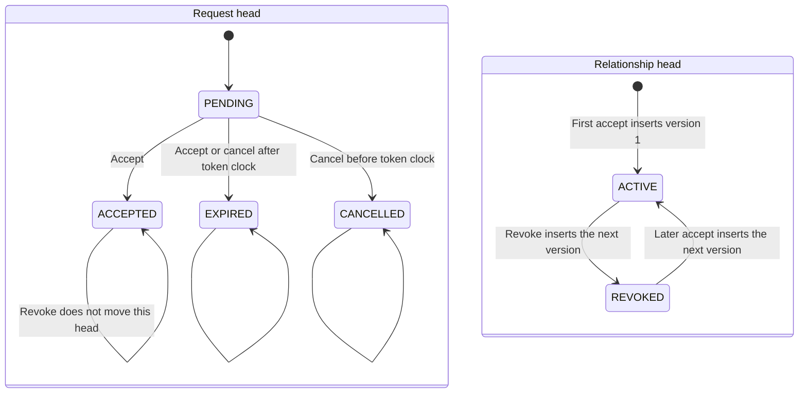

# BINTRANS PLATFORM / IDENTITY

## CROSS-TENANT RELATIONSHIP REVOKE 0.1 ARCHITECTURE

```text
AGENT=C
STAGE=TMS-CROSS-TENANT-RELATIONSHIP-REVOKE-0.1-ARCHITECTURE
BASE_SHA=3551b960585f58d7a86c29d3b12fb4677caa6f88
PR_290_PRESENT=YES
PR_290_MERGE_COMMIT=3551b960585f58d7a86c29d3b12fb4677caa6f88
BRANCH=docs/bintrans-relationship-revoke-v0.1
R1_STAGE=TMS-CROSS-TENANT-RELATIONSHIP-REVOKE-0.1-R1-REMEDIATION
R1_FINDINGS=RV-01,RV-02,RV-03,RV-04
ADR=docs/architecture/platform/adr/ADR-PLATFORM-002-relationship-revoke.md
ADR_NUMBER=ADR-PLATFORM-002
ADR_PLATFORM_001_RESERVED_BY=PR_291_PUBLIC_ACCEPT
DOCS_ONLY=YES
PRODUCT_RUNTIME_AUTHORIZED=NO
IMPLEMENTATION_AUTHORIZED=NO
MIGRATION_AUTHORIZED=NO
MIGRATION_NUMBER_ASSIGNED=NO
MIGRATION_CREATED_IN_THIS_STAGE=NO
GATEWAY_CHANGE_AUTHORIZED=NO
OPENAPI_PUBLICATION_AUTHORIZED=NO
TMS_ACTIVATION_AUTHORIZED=NO
NLO_RUNTIME_AUTHORIZED=NO
MERGE_AUTHORIZED=NO
DEPLOYMENT_AUTHORIZED=NO
```

This document defines how an already accepted carrier relationship becomes `REVOKED` without changing historical transport execution. It does not authorize runtime code, a migration file, a gateway change, TMS activation, an NLO change, or deployment.

Authoritative inputs read at `3551b960585f58d7a86c29d3b12fb4677caa6f88`:

- `docs/architecture/platform/PLATFORM_CROSS_TENANT_EXECUTION_IDENTITY_0_1A_FREEZE.md`
- `docs/architecture/platform/PLATFORM_CROSS_TENANT_EXECUTION_IDENTITY_0_1B_RUNTIME_DESIGN.md`
- `docs/architecture/platform/PLATFORM_CROSS_TENANT_RELATIONSHIP_CANCEL_RECOVERY_0_1_DISCOVERY.md`
- `infrastructure/migrations/000100_company_carrier_relationship_foundation_v0_1c.up.sql`
- `infrastructure/migrations/000101_company_carrier_relationship_cancel_recovery_v0_2.up.sql`
- company-service create, accept, and cancel commands
- `infrastructure/migrations/000088_tms_transport_execution_foundation_v0_1a.up.sql`

PR #290 is the merge commit above. Its title is "Cancel a pending carrier relationship request and recover a lost token". The merged diff adds cancel idempotency, the request-head transition guard, the company-service cancel command, and the shipment-service and rfx-service recovery routes. It does not add a revoke command.

## 1. Verified lifecycle

Request status lives on `company.carrier_relationship_request_heads.request_status`. The check allows `PENDING`, `ACCEPTED`, `EXPIRED`, and `CANCELLED`. `REVOKED` is not in that check. Relationship status lives on `company.carrier_relationship_heads.status` and `company.carrier_relationship_versions.status`. Those checks allow `ACTIVE` and `REVOKED`.

| Status | Where it lives | Writer on this base | Meaning |
| --- | --- | --- | --- |
| `PENDING` | Request head | Create | One open request for that source and shipper carrier company |
| `ACCEPTED` | Request head | Accept | Token consumed. A relationship version exists |
| `EXPIRED` | Request head | Accept, or cancel when the token clock is due | Terminal request. Not a relationship status |
| `CANCELLED` | Request head | Cancel, when the token clock is not due | Terminal request. The relationship root is untouched |
| `ACTIVE` | Relationship head and version | Accept | Current operating authority |
| `REVOKED` | Relationship head and version | No command writes it | Legal successor status. Accept can later insert a new `ACTIVE` version on the same root |

`RelationshipRepository.ensureActiveRelationship` already distinguishes the two relationship statuses. An `ACTIVE` head is reused. A `REVOKED` head receives `current_version + 1` as a new `ACTIVE` version with `supersedes_relationship_version_id` set to the revoked version. That path is reactivation. This architecture does not replace it and does not add an un-revoke command.

The foundation integration test rejects `UPDATE company.carrier_relationship_versions SET status = 'REVOKED'`. Revoke must insert a new version. An in-place update is not the command.

`transport.transport_executions` stores `driver_id` and `vehicle_id`. `transport.transport_execution_revisions` has no `relationship_id` column. The pin table named by 0.1B, `transport.transport_execution_carrier_relationship_pins`, does not exist. `company.authorize_carrier_relationship_activation` does not exist. The gateway has no carrier-relationship route.

```text
CANCEL_TARGET=PENDING_REQUEST
REVOKE_TARGET=ACTIVE_RELATIONSHIP_HEAD
REVOKED_IS_NOT_CANCELLED=YES
REQUEST_EVENT_TYPE_REVOKED=FORBIDDEN
```

## 2. State machine



Legal relationship-head transitions:

| From | Command | Guard under the business-key lock and the head lock | To | Version write |
| --- | --- | --- | --- | --- |
| No root | Accept of the first request for that business key | Existing accept contract | `ACTIVE` version 1 | Insert root, version, and head |
| `ACTIVE` | Revoke | Authorized endpoint actor. Optional expected version equals the current version | `REVOKED` | Insert `current_version + 1`. Do not update the previous version |
| `ACTIVE` | Accept of another request for the same business key | Existing accept contract | `ACTIVE` | No new version. Link the request to the current version |
| `REVOKED` | Revoke, same or different idempotency key, still authorized | Head is already terminal | `REVOKED` | No new version |
| `REVOKED` | Accept of a new pending request | Existing accept contract, including a new token | `ACTIVE` | Insert the next version. The revoked version stays |
| `ACTIVE` or `REVOKED` | Cancel of the accepted request | Request head is `ACCEPTED` | Unchanged | None. Cancel returns `409` `RELATIONSHIP_REQUEST_ALREADY_ACCEPTED` |

A `PENDING`, `EXPIRED`, or `CANCELLED` request has no relationship head to revoke. Revoke addresses `relationship_id`, not `relationship_request_id`. Cancel of a still-pending request remains the PR #290 command and does not insert a relationship version.

```text
REVOKE_STATE_MACHINE=ACTIVE_HEAD_TO_NEW_REVOKED_VERSION
REACTIVATION_POLICY=NEW_ACTIVE_VERSION_AFTER_NEW_TWO_SIDED_ACCEPTANCE
REVOKED_RELATIONSHIP_REUSE_POLICY=REUSE_SAME_ROOT_INSERT_NEXT_VERSION
UNREVOKE_COMMAND=NONE
HARD_DELETE=NO
```

## 3. Authorization

Every revoke uses the user predicate in 0.1B section 5. The user row exists in `core.users`. Its `tenant_id` equals the tenant in the verified JWT. `deleted_at IS NULL`. `status = ACTIVE`. Company-scoped roles count only when `core.user_roles.company_id` is the selected company. Tenant-global `PLATFORM_ADMIN` counts only when `company_id IS NULL`. `ListUserRoleCodes` and identity `LookupPrincipal` are not company-scoped proof.

The acting tenant and the selected company decide the side. The body does not.

| Side | JWT tenant | Selected company | Role | Platform admin |
| --- | --- | --- | --- | --- |
| Requesting company | `shipper_tenant_id` on the relationship root | `requesting_company_id` of an `ACCEPTED` request event whose `relationship_id` is this relationship | Creator role for that event's source type: shipment uses `SHIPPER_ADMIN`, `SHIPPER_LOGIST`, or `FORWARDER_MANAGER`; RFx award and award-link also allow `PROCUREMENT_MANAGER` | Replaces the creator-role check only. Membership and the selected company remain required |
| Operating company | `operating_tenant_id` on the relationship root | `operating_carrier_company_id` | Company-scoped `CARRIER_ADMIN` on that company | Replaces the `CARRIER_ADMIN` check only. Membership and the selected company remain required |

`CARRIER_DISPATCHER`, `GOV_INSPECTOR`, a driver-only user, an ordinary member, a role on another company, and a role in the other tenant do not revoke.

If the JWT tenant is neither endpoint tenant, the response is `404` `RELATIONSHIP_NOT_FOUND`. If the tenant matches and the selected company is not the endpoint company for that side, the response is the same `404`. The body matches the unknown-id response. If the company matches and the user has no active membership, the response is `404`. If the company matches, the membership is active, and the role fails, the response is `403` `RELATIONSHIP_REVOKE_FORBIDDEN`.

```text
ACTIVE_RELATIONSHIP_REVOKE_AUTHORITY=SHIPPER_SOURCE_CREATOR_AUTHORIZATION|SHIPPER_TENANT_GLOBAL_PLATFORM_ADMIN|OPERATING_SELECTED_COMPANY_CARRIER_ADMIN|OPERATING_TENANT_GLOBAL_PLATFORM_ADMIN
REVOKE_REQUIRES_SELECTED_COMPANY=YES
SELECTED_COMPANY_CONTEXT_SOURCE=SERVER_VERIFIED_MEMBERSHIP_FOR_JWT_USER
X_COMPANY_ID_ROLE=NON_AUTHORITATIVE_SELECTOR
CLIENT_COMPANY_HEADER_AUTHORITY=NO
BODY_COMPANY_AUTHORITY=NO
GOV_INSPECTOR_CAN_REVOKE=NO
GLOBAL_PARTY_INTRODUCED=NO
```

There is one route for both sides. Company-service compares the JWT tenant with the two root tenants. It does not accept a client-supplied side, tenant, or company as authority. When both root tenants are equal, `operating_carrier_company_id` is tested first. A selected company that equals the operating company uses the operating predicate. Otherwise the shipper predicate is used.

## 4. API contract

Company-service route, user JWT, same credential class as public accept:

```text
REVOKE_ROUTE=/v1/carrier-operating-relationships/{relationship_id}/revocations
REVOKE_HTTP_METHOD=POST
PUBLIC_REVOKE_IDENTITY_SOURCE=VERIFIED_JWT
PUBLIC_REVOKE_TENANT_SOURCE=VERIFIED_JWT
IDENTITY_HEADERS_NOT_AUTHORITY=X-User-ID|X-Tenant-ID|X-User-Roles|X-Platform-Admin
COMMANDS_FLAG=COMPANY_RELATIONSHIP_COMMANDS_ENABLED
COMMANDS_FLAG_DEFAULT=OFF
GATEWAY_ROUTE_IN_THIS_STAGE=NO
```

The flag is the existing company-service flag. Off returns `403` `RELATIONSHIP_COMMANDS_DISABLED` before the relationship is loaded.

Request body:

```json
{
  "idempotency_key": "required, 1 to 200 characters",
  "reason": "optional, at most 500 characters",
  "expected_relationship_version": "optional integer"
}
```

`reason` is stored on the new version and on the audit row. It is not part of the idempotency hash. A body `company_id` or `tenant_id`, when present, must equal the verified selector or the verified JWT tenant. A mismatch is `403` `RELATIONSHIP_REVOKE_FORBIDDEN` for the company and `409` `TENANT_CONTEXT_CONFLICT` for the tenant. Neither field selects the actor. `X-Company-ID` is required. A missing or unparseable selector is `403` `RELATIONSHIP_REVOKE_FORBIDDEN` and does not load the relationship. A presented `acceptance_token` is a validation refusal.

Success, including replay and a later authorized observation of an already revoked head, is HTTP `200`:

```json
{
  "relationship_id": "uuid",
  "relationship_version": 2,
  "status": "REVOKED"
}
```

The response has no request status, no foreign tenant id, no foreign company id, and no token. `relationship_version` is the `REVOKED` version, not the superseded `ACTIVE` version.

| Code | HTTP | When | Writes |
| --- | --- | --- | --- |
| `RELATIONSHIP_COMMANDS_DISABLED` | 403 | Flag off | None |
| Authentication required | 401 | Missing or invalid JWT | None |
| `RELATIONSHIP_REVOKE_FORBIDDEN` | 403 | Endpoint company matches, role does not; or the company selector is missing | None |
| `RELATIONSHIP_NOT_FOUND` | 404 | Unknown id, other tenant, or selected company is not an endpoint | None |
| `RELATIONSHIP_VERSION_CONFLICT` | 409 | Head is `ACTIVE`, no stored row for this scope, and `expected_relationship_version` is present and differs | None |
| `RELATIONSHIP_STORE_UNAVAILABLE` | 503 | Store failure. Must not be returned as not-found | None |
| `TENANT_CONTEXT_CONFLICT` | 409 | Body tenant disagrees with the JWT tenant | None |

`RELATIONSHIP_REVOKED` remains the internal activation code from 0.1B. The public revoke command does not use it for a successful or repeated revoke. `RELATIONSHIP_REQUEST_CANCELLED` is not a revoke result.

Revoke does not return `RELATIONSHIP_IDEMPOTENCY_CONFLICT`. Create, accept, and cancel keep that code, because their hashes cover fields that are not part of their idempotency keys. This document does not change those commands. For revoke, the hash is only `relationship_id`, and `relationship_id` is already inside the scope key, so two calls in one scope always hash the same bytes. A different `reason` or a different `expected_relationship_version` does not change the hash and is not a conflict.

```text
REVOKE_IDEMPOTENCY_SCOPE=relationship_id+acting_tenant_id+selected_company_id+idempotency_key
REVOKE_BODY_HASH=SHA256_OF_RELATIONSHIP_ID
REVOKE_BODY_HASH_COVERS=relationship_id
REVOKE_BODY_HASH_EXCLUDES=reason+expected_relationship_version
REVOKE_REASON_IN_HASH=NO
REVOKE_EXPECTED_VERSION_IN_HASH=NO
REVOKE_SUCCESS_HTTP=200
REVOKE_REPLAY_HTTP=200
REVOKE_SAME_SCOPE_REPLAY_VERSION=STORED_REVOKED_VERSION
REVOKE_REASON_CHANGE_ON_STORED_SCOPE=NO_NEW_VERSION_NO_AUDIT_NO_OUTBOX
REVOKE_EXPECTED_VERSION_CHANGE_ON_STORED_SCOPE=NO_NEW_OPERATION
REVOKE_NEW_KEY_AFTER_REVOKED=NO_NEW_VERSION
REVOKE_IDEMPOTENCY_ROW_ON_COMMIT_ONLY=YES
REVOKE_UNCOMMITTED_FAILURE_IS_REPLAY=NO
REVOKE_SAME_SCOPE_HASH_CONFLICT=UNREACHABLE
REVOKE_USES_RELATIONSHIP_IDEMPOTENCY_CONFLICT=NO
```

## 5. Versioning and storage

The root `company.carrier_relationships` stays insert-only. Endpoint columns do not change. Revoke does not insert a second root for the same `(shipper_tenant_id, shipper_carrier_company_id, operating_tenant_id)`.

The new version copies `source_relationship_request_id` from the superseded `ACTIVE` version, because that column is `NOT NULL` and the revoke does not create a request. `created_by` is the revoking user. `created_at` is `clock_timestamp()` inside the insert. Those two columns are the revocation actor and time. Separate `revoked_at` and `revoked_by` columns would duplicate them and are not added. `supersedes_relationship_version_id` points at the previous version row. The 0.1A name `supersedes_relationship_id` means that column. The previous version row is not updated.

```text
RELATIONSHIP_STORAGE_MODEL=IMMUTABLE_ROOT_PLUS_APPEND_ONLY_VERSIONS_PLUS_MUTABLE_HEAD
REVOKE_VERSION_INSERT=YES
PREVIOUS_VERSION_MUTATED=NO
REVOKED_AT=VERSION_CREATED_AT
REVOKED_BY=VERSION_CREATED_BY
REVOKE_REASON_COLUMN=company.carrier_relationship_versions.revoke_reason
SOURCE_REQUEST_STATUS_ON_REVOKE=UNCHANGED
```

`revoke_reason` is nullable. A check requires it to be null when `status = ACTIVE`. A `REVOKED` insert may store the trimmed reason or null. Existing `ACTIVE` rows stay null. The append-only trigger still rejects `UPDATE` and `DELETE` of the version.

The head update sets `current_version`, `current_version_id`, and `status = REVOKED`. It is the only mutable relationship row.

Idempotency, not present on this base:

```text
TABLE=company.carrier_relationship_revoke_idempotency
PRIMARY_KEY=relationship_id+actor_tenant_id+selected_company_id+idempotency_key
STORED=body_hash+relationship_version+created_at
BODY_HASH_LENGTH=32
```

A stored row for the scope is a committed success. Replaying it returns HTTP `200` and the stored `relationship_version`. It does not read `reason` or `expected_relationship_version` from the new request, and it does not insert a version, an audit row, or an outbox row. The idempotency row is inserted only in the transaction that commits. A `401`, `403`, `404`, `409` version conflict, `503`, or rollback leaves no row. The next call with that key is a new attempt, not a `200` replay of the failure. A new key after the head is already `REVOKED` stores its own idempotency row, returns the current revoked version, and inserts no version.

## 6. Historical pins and current executions

```text
RELATIONSHIP_REVOKED_BEFORE_ACTIVATE_POLICY=REFUSE_NO_EXECUTION
RELATIONSHIP_REVOKED_AFTER_EXECUTION_POLICY=HISTORICAL_EXECUTION_UNCHANGED
HISTORICAL_PINS_PRESERVED=YES
PIN_TABLE_ON_THIS_BASE=ABSENT
ACTIVATION_FUNCTION_ON_THIS_BASE=ABSENT
DRIVER_ID_CHANGED=NO
VEHICLE_ID_CHANGED=NO
SHIPMENT_ROW_CHANGED=NO
FINANCE_ROW_CHANGED=NO
POD_ROW_CHANGED=NO
SHIPMENT_FSM_CHANGED=NO
```

A committed execution keeps the relationship version it pinned. Revoke inserts a later relationship version and does not update the pin, the execution revision, `driver_id`, or `vehicle_id`. The shipment continues. Revoke does not complete it, cancel it, or clear its assignment. Finance and POD rows stay as stored.

A shipment that has not been activated gains no execution from this command. The future `company.authorize_carrier_relationship_activation` must take the business-key advisory lock and then lock the head, require `ACTIVE`, and return `409` `RELATIONSHIP_REVOKED` when the head is `REVOKED`, without inserting an execution or a pin. That function and the pin table belong to the activation stage. This stage does not create them and does not call NLO.

Until those objects exist, the revoke transaction has no statement against `transport.*`, shipment tables, finance tables, or document tables. Preservation is the absence of those writes plus the append-only relationship version that a future pin would name.

## 7. Concurrency

`AcceptRelationshipRequest` in `services/company-service/internal/repository/relationship_repository.go` takes the relationship locks in this order: the advisory key `relationship:{shipper_tenant_id}:{shipper_carrier_company_id}:{operating_tenant_id}`, then `SELECT ... FOR UPDATE` on `company.carrier_relationship_heads` inside `ensureActiveRelationship`. The request-head lock earlier in accept is a different row. Revoke uses the same relationship order and does not lock a request head.

The 0.1B label `LOCK_HEAD_INSERT_REVOKED_VERSION_MOVE_HEAD_INSERT_AUDIT_AND_OUTBOX` names the writes in the transaction. It is not permission to lock the head before the advisory lock. That reverse order is forbidden.

Before the advisory lock, revoke reads the immutable relationship root by `relationship_id` so it knows the business key. That read is not a head lock. A missing root is `404` and takes no advisory lock.

```text
REVOKE_LOCK_ORDER=1_BUSINESS_KEY_ADVISORY+2_HEAD_FOR_UPDATE+3_VERSION_AND_AUTHORITY+4_INSERT_VERSION+5_UPDATE_HEAD+6_AUDIT_OUTBOX_IDEMPOTENCY
REVOKE_HEAD_LOCK_BEFORE_ADVISORY=FORBIDDEN
REQUEST_HEAD_LOCK_ON_REVOKE=NO
TRANSPORT_LOCK_ON_REVOKE=NO
ACCEPT_RELATIONSHIP_LOCK_ORDER=BUSINESS_KEY_ADVISORY_THEN_HEAD_FOR_UPDATE
```

1. `pg_advisory_xact_lock` on `relationship:{shipper_tenant_id}:{shipper_carrier_company_id}:{operating_tenant_id}`.
2. `SELECT current_version, current_version_id, status FROM company.carrier_relationship_heads WHERE relationship_id = $1 FOR UPDATE`.
3. Decide the transition. A stored idempotency row for this scope returns that version and skips the insert. No stored row and a `REVOKED` head is an observation, not a new version. No stored row, an `ACTIVE` head, and a present expected version that differs is `409` `RELATIONSHIP_VERSION_CONFLICT`. The endpoint membership and role are checked here, against the locked head. A refusal rolls back.
4. On the first `ACTIVE` to `REVOKED` transition, insert the next immutable version.
5. On that same transition, move the head to the new version.
6. In the same transaction, write audit and `carrier_relationship.revoked` only for that first transition. Write the idempotency row for a first transition and for a new key that observes an already `REVOKED` head. Commit. Replay of a stored row writes nothing.

A crash before commit rolls the version, the head move, the audit, the outbox, and the idempotency row back together. The same key then runs as a first attempt.

Two revokes take the same advisory lock first. The waiter does not hold the head, so the pair cannot deadlock. After the winner commits, the waiter locks the head, sees the stored row or the `REVOKED` head, and does not insert a second version.

Accept can hold the request head and then wait for this same advisory lock. Revoke, holding that advisory lock, next waits for the relationship head, which accept does not hold yet. Revoke never takes the request head. There is no cycle. If revoke locked the relationship head before the advisory lock, accept could hold the advisory lock and wait for the head while revoke held the head and waited for the advisory lock. That deadlock is the forbidden order.

| Case | Final head | HTTP | New version | New outbox |
| --- | --- | --- | --- | --- |
| Two revokes, same scope | `REVOKED` once | Both `200`, stored version | One | One |
| Same scope, different `reason` | `REVOKED` once | Replay `200`, stored version | None from the replay | None from the replay |
| Same scope, different `expected_relationship_version` after commit | `REVOKED` once | Replay `200`, stored version. No new operation | None from the replay | None from the replay |
| Two revokes, different keys, both authorized | `REVOKED` once | Both `200`, same version | One, written by the lock winner | One |
| New key after `REVOKED` | `REVOKED` | `200`, current version | None | None |
| Same key, different relationship id | Independent rows | Each follows its own head | At most one per relationship | At most one per relationship |
| First attempt rolls back, or returns `403`, `404`, or version `409` | Unchanged by that attempt | The error itself. No stored success | None | None |
| Retry of that key after the rollback | Follows a first attempt | Not a `200` replay of the error | One only if this attempt commits the transition | One only if this attempt commits the transition |
| Revoke and accept, revoke commits first, accept is a new request | `ACTIVE` at the following version if accept's own checks pass | Revoke `200`. Accept follows the existing accept contract and may reactivate | Revoked version, then accept's next `ACTIVE` version | `revoked`, then accept's `accepted` |
| Revoke and accept, accept commits first while the head is `ACTIVE` | `REVOKED` after revoke | Accept links the current version. Revoke then `200` | One `REVOKED` successor | One `revoked` |
| Revoke and accept together | One of the two rows above | Both finish. No deadlock | No duplicate `REVOKED` version | One `revoked` if revoke commits a transition |
| Two revokes together | `REVOKED` once | Both `200`. No deadlock | One | One |
| Revoke and cancel of the accepted request | Relationship follows revoke. Request stays `ACCEPTED` | Cancel `409` `RELATIONSHIP_REQUEST_ALREADY_ACCEPTED` | None from cancel | None from cancel |
| Revoke and a future activation that uses this same advisory-then-head order | `REVOKED` either before or after the activation commit | Activation on a `REVOKED` head is `409` `RELATIONSHIP_REVOKED` and writes no pin. Activation that committed first keeps its pins | One `REVOKED` successor when revoke wins the lock | One `revoked` |
| Expected version does not match an `ACTIVE` head, and this scope has no stored row | `ACTIVE` | `409` `RELATIONSHIP_VERSION_CONFLICT` | None | None |
| Crash before commit | Previous status | Caller `503`. Same key is not a success replay | None remain | None remain |

Accept after revoke is not an accident. 0.1B says a revoked head does not satisfy a later shipment until a new two-sided acceptance inserts the next `ACTIVE` version. The accept command is that acceptance. Revoke must not hold a lock that prevents it, and accept must not edit the revoked version.

The future activation function, when it exists, must take this same business-key advisory lock before `FOR UPDATE` on the head. There is no durable prepared authorization row. Revoke does not wait on a lease. This document does not add that function. The activation row above is the contract it must meet. A future function that locks the head first would deadlock with revoke and is not allowed.

## 8. Audit and outbox

The first transition writes one audit row and one outbox row in the same transaction as the version and the head move. Replay writes neither. A different key that only observes `REVOKED` writes an idempotency row and neither audit nor outbox.

Audit action is `relationship_revoked`. The row stores actor user, actor tenant, selected company, relationship id, the new relationship version, source type and source id copied from the superseded version's request, idempotency key, correlation id, reason, and `occurred_at`. It does not store a raw token, a token hash, or the pepper.

The outbox type `carrier_relationship.revoked` is already allowed by `chk_cr_outbox_event`. Aggregate id is `relationship_id`. The payload is `relationship_id`, `relationship_version`, `supersedes_relationship_version_id`, and `status = REVOKED`. It omits the token, the reason, and the actor. No new outbox type is required. Activation events stay out of this stage.

```text
AUDIT_OUTBOX_CONTRACT=ONE_TRANSACTION_VERSION_HEAD_AUDIT_OUTBOX_IDEMPOTENCY
OUTBOX_EVENT=carrier_relationship.revoked
REPLAY_WRITES_AUDIT_OR_OUTBOX=NO
TOKEN_IN_AUDIT_OR_OUTBOX=NO
```

## 9. Restoration

A revoked relationship becomes current authority only when a new pending request is accepted. That accept inserts the next `ACTIVE` version on the same root and leaves every `REVOKED` version in place. The new request needs its own create idempotency key and its own acceptance token. The old token stays consumed. Cancel does not restore the relationship. A second revoke does not restore it. No command sets the request head to `REVOKED` or the relationship head to `CANCELLED`.

```text
RESTORATION=NEW_PENDING_REQUEST_PLUS_NEW_TWO_SIDED_ACCEPTANCE
SAME_ROOT=YES
EDIT_REVOKED_VERSION=NO
```

## 10. Migration proposal

Already true on this base, and required:

- version and head checks allow `REVOKED`
- versions and roots are append-only
- the business key is unique
- the outbox check allows `carrier_relationship.revoked`
- request status checks do not allow `REVOKED`
- accept already inserts the next `ACTIVE` version when the head is `REVOKED`

Not present, and required before a runtime revoke command:

- a revoke idempotency table
- a place to store `revoke_reason` on the immutable successor
- a trigger that rejects an illegal head transition

```text
MIGRATION_PROPOSAL=ADD_REVOKE_IDEMPOTENCY_TABLE+ADD_NULLABLE_REVOKE_REASON_ON_VERSION+HEAD_TRANSITION_TRIGGER
MIGRATION_REQUIRED=YES
MIGRATION_NUMBER_ASSIGNED=NO
MIGRATION_CREATED_IN_THIS_STAGE=NO
NEXT_UNUSED_NUMBER_NOT_RESERVED=YES
MIGRATION_DOWN_POLICY=REFUSE_WHEN_ANY_REVOKED_VERSION_HAS_NONEMPTY_REVOKE_REASON
DOWN_CHECK_BEFORE_DROP_IN_SAME_TRANSACTION=YES
DOWN_REFUSAL_LEAVES_SCHEMA_VERSIONS_AND_AUDIT_UNCHANGED=YES
EMPTY_REVOKE_REASON_BLOCKS_DOWN=NO
ACTIVE_VERSION_BLOCKS_DOWN=NO
DOWN_DELETES_ROOT_VERSION_AUDIT_OR_OUTBOX=NO
```

The later runtime stage assigns the next unused migration number when it is authorized. This architecture does not reserve a number and does not add a SQL file. The migration class is:

1. `company.carrier_relationship_revoke_idempotency`, keyed as section 5, with a 32-byte body hash and the revoked version stored for replay. The key length and hash length are checks.
2. `revoke_reason TEXT NULL` on `company.carrier_relationship_versions`, with a check that `ACTIVE` rows have a null reason and a `REVOKED` reason is null or at most 500 characters. Existing rows remain valid because they are `ACTIVE` and the new column is null.
3. `company.reject_relationship_head_illegal_transition` before update of `company.carrier_relationship_heads`. The same status may be rewritten only when `current_version` and `current_version_id` are unchanged. `ACTIVE` may become `REVOKED`, and `REVOKED` may become `ACTIVE`, only when `current_version = OLD.current_version + 1` and `current_version_id` changes. Every other transition raises `55000`.

The down migration runs in one transaction. Before it drops anything, it looks for a `REVOKED` version whose `revoke_reason` is not null and whose `btrim(revoke_reason)` is not empty. If that row exists, the migration raises and the transaction aborts. The idempotency table, the column, the check, the trigger, every version, every reason, and every audit and outbox row stay as they were. A null reason, a reason that is empty after `btrim`, and every `ACTIVE` version do not block down.

When the check passes, down drops the trigger, the check, the `revoke_reason` column, and the idempotency table. It does not `DELETE` from relationship roots, versions, audit, or outbox. Dropping the column removes only that column. The version rows remain. Foundation tables are not rewritten. This architecture does not add the SQL file.

The head trigger must keep accept's reactivation legal. A trigger that allowed only `ACTIVE` to `REVOKED` would break the current accept path.

## 11. PostgreSQL regression plan

The runtime stage runs these tests against PostgreSQL. Store fakes are not sufficient. This docs pull request does not add them.

1. An authorized shipper creator and an authorized operating `CARRIER_ADMIN` each revoke an `ACTIVE` relationship. Each insert yields one new `REVOKED` version, the previous version is unchanged, the head points at the new version, and the accepted request head is still `ACCEPTED`.
2. The same idempotency scope returns `200` and the stored version. A changed `reason` on that replay does not add a version, an audit row, or an outbox row. A changed `expected_relationship_version` on that replay does not start a new operation.
3. A different key after revoke returns `200` and the same version, adds one idempotency row, and adds no version, audit row, or outbox row.
4. The same key with a different relationship id is a different scope. Revoke has no same-scope hash conflict and does not return `RELATIONSHIP_IDEMPOTENCY_CONFLICT`. Create, accept, and cancel tests for that code stay as they are.
5. Two concurrent revokes leave one `REVOKED` version and one outbox row. Both authorized callers receive `200`. The test fails if either session is cancelled as a deadlock.
6. Revoke concurrent with accept leaves the request and relationship constraints intact: one terminal request event, versions append-only, and the head version equal to the latest version. When revoke commits first, a valid new acceptance may insert the next `ACTIVE` version. When accept commits first on an `ACTIVE` head, revoke then inserts one `REVOKED` successor. Neither path updates the previous version. The test fails if either session is cancelled as a deadlock. Both commands take the business-key advisory lock before the relationship head lock.
7. Cancel of the accepted request after revoke returns `409` `RELATIONSHIP_REQUEST_ALREADY_ACCEPTED` and does not change the relationship head.
8. A missing JWT is `401`. The commands flag off is `403` and writes nothing. Spoofed `X-User-ID`, `X-Tenant-ID`, `X-User-Roles`, and `X-Platform-Admin` do not change the actor.
9. A foreign tenant, a same-tenant company that is not the endpoint, and a user without membership receive `404` `RELATIONSHIP_NOT_FOUND` with the same body shape. A member of the endpoint company without the creator role or `CARRIER_ADMIN` receives `403`. `PLATFORM_ADMIN` without membership, or with membership on a different company, does not revoke. `GOV_INSPECTOR` and `CARRIER_DISPATCHER` do not revoke.
10. `expected_relationship_version` that disagrees with an `ACTIVE` head returns `409` `RELATIONSHIP_VERSION_CONFLICT` and writes nothing.
11. A rolled-back revoke leaves the head `ACTIVE` and leaves version, idempotency, audit, and outbox counts unchanged. The same key after that rollback is not HTTP `200`. It performs the transition and only then stores the idempotency row. A `403`, `404`, or version `409` likewise leaves no idempotency row.
12. An in-place update or delete of the new version fails. A head update from `REVOKED` to `CANCELLED`, or from `ACTIVE` back to a lower version, fails the transition guard. A request-head update to `REVOKED` fails the existing request status check.
13. Fixture rows in `transport.transport_executions`, `transport.transport_execution_revisions`, shipment status, finance, and POD are byte-identical after revoke, including `driver_id` and `vehicle_id`. The revoke transaction's SQL does not name those tables.
14. A later accept of a new pending request on the revoked root inserts the next `ACTIVE` version, leaves the `REVOKED` version in place, and does not mint a second root.
15. The success body contains no foreign company id, no foreign tenant id, and no acceptance token.
16. Migration UP, then DOWN, then UP, when every `REVOKED` reason is null or empty after `btrim` and `ACTIVE` versions are present. DOWN commits. Root, version, audit, and outbox row counts are the same after DOWN. The `revoke_reason` column and the revoke idempotency table are absent after DOWN and present after the second UP. The second UP does not delete those rows.
17. Migration UP, then a `REVOKED` version with a non-empty `revoke_reason`, then DOWN. DOWN raises inside that transaction before any drop. After the error, the column, the trigger, the idempotency table, the version row, the reason text, and the audit rows are unchanged. Running UP again does not drop the reason and does not create a second copy of the table.

## 12. Out of scope

```text
PRODUCT_RUNTIME_AUTHORIZED=NO
TMS_ACTIVATION_RUNTIME=NO
NLO_CHANGED=NO
GATEWAY_CHANGED=NO
OPENAPI_PUBLISHED=NO
GLOBAL_PARTY_INTRODUCED=NO
TOKEN_REISSUE=NO
EXPIRY_SWEEPER=NO
UNREVOKE_COMMAND=NO
```

The next stage may implement only this contract: the company-service revoke command, the migration class in section 10 numbered at that stage, and the PostgreSQL tests in section 11. It must not add TMS activation, the pin table, the authorization function, an NLO change, a gateway route, or an un-revoke command. Merge and deployment of that stage need their own authorization.

```text
NEXT_STAGE=TMS-CROSS-TENANT-RELATIONSHIP-REVOKE-0.1-IMPLEMENTATION
NEXT_STAGE_AUTHORIZED=NO
READY_FOR_ARCHITECTURE_REVIEW=YES
READY_FOR_MERGE=NO
```
