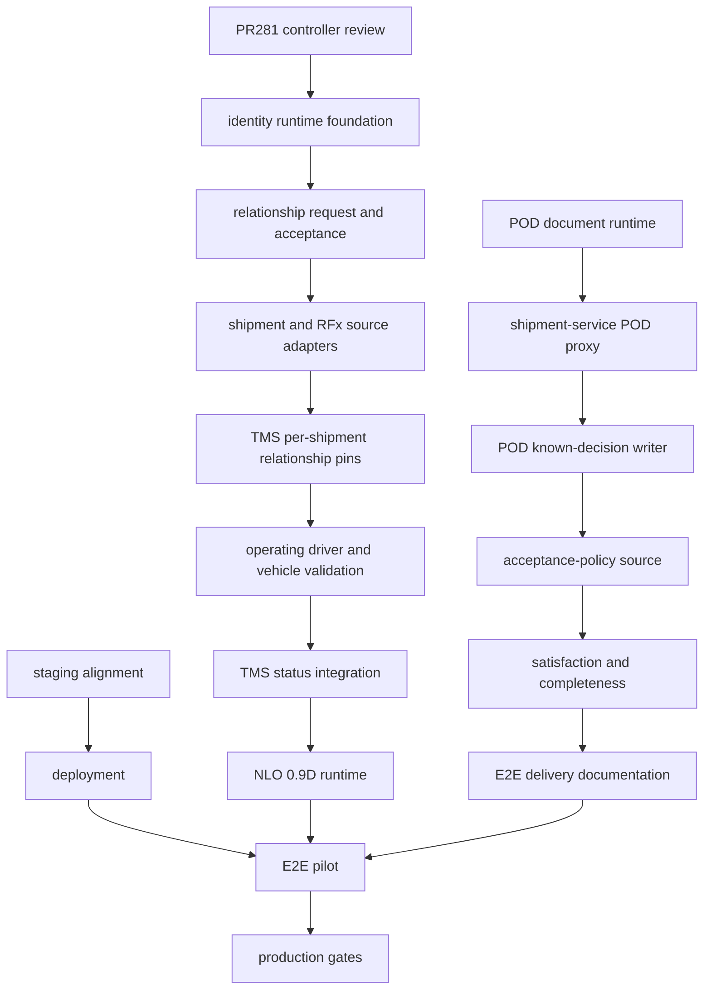

# BINTRANS — полный отчёт о готовности, пробелах и поставке

**Дата:** 2026-10-18  
**Роль:** AGENT=REPORT  
**Стадия:** BINTRANS-FULL-PROJECT-READINESS-REPORT-2026-10-18  
**База отчёта:** `3eaa9ef621406730e3d6335a322271abde37b269`  
**Ветка наблюдения:** `docs/bintrans-full-project-readiness-report-2026-10-18`  
**Продукт:** BINTRANS Platform

Краткое управленческое резюме: [BINTRANS_EXECUTIVE_STATUS_2026_10_18.md](BINTRANS_EXECUTIVE_STATUS_2026_10_18.md).

Этот документ фиксирует наблюдаемое состояние `main`. Архитектурный текст не считается работающим runtime. Открытый PR не входит в оценку `main`. Живой staging в ходе аудита не читался и не изменялся.

## 1. Препроверка

| Поле | Наблюдение |
| --- | --- |
| TOPLEVEL | `D:/Projects/freight-platform-wt/bintrans-full-project-readiness-report-2026-10-18` |
| BRANCH | `docs/bintrans-full-project-readiness-report-2026-10-18` |
| HEAD | `3eaa9ef621406730e3d6335a322271abde37b269` |
| ORIGIN_MAIN | `3eaa9ef621406730e3d6335a322271abde37b269` |
| WORKTREE_CLEAN на старте | YES |
| MIGRATION_HEAD | `000099` |
| MIGRATION_CHAIN_CONTIGUOUS | YES |

`git fetch origin --prune` выполнен до записи файлов. `origin/main` не сдвинулся. Рабочее дерево на старте было чистым. Остановка по контракту не потребовалась.

CI точного `main`: `CI_RUN=39070635241`, event `push`, conclusion `success`, head `3eaa9ef621406730e3d6335a322271abde37b269`, workflow `CI`, создан 2026-10-17T21:22:02Z.  
Это доказательство сборки `main`. Это не доказательство живого staging.

## 2. Как читать состояния

Первичное состояние каждой способности — ровно одно значение:

`IN_MAIN_RUNTIME`, `IN_MAIN_DOCS_ONLY`, `OPEN_PR_RUNTIME`, `OPEN_PR_DOCS_ONLY`, `IMPLEMENTED_NOT_INTEGRATED`, `IMPLEMENTED_NOT_DEPLOYED`, `PARTIAL`, `BLOCKED`, `NOT_STARTED`, `SUPERSEDED`, `STALE_EVIDENCE`, `UNKNOWN`.

Уверенность: `HIGH`, `MEDIUM`, `LOW`, `UNKNOWN`.

`HIGH` используется только там, где runtime лежит в `main`, есть профильные автотесты и успешный CI на текущем SHA. Сквозной пилот и живой staging при этом могут отсутствовать: тогда уверенность домена снижается до `MEDIUM`, даже если модульные job зелёные.

## 3. Инвентарь репозитория

Наблюдение по дереву `3eaa9ef`.

| Класс | Количество | Состав |
| --- | --- | --- |
| Backend-сервисы | 17 | api-gateway, identity-service, company-service, transport-order-service, rfx-service, shipment-service, document-service, billing-register-service, payment-service, contract-rate-service, freight-cost-service, analytics-service, network-optimizer-service, tracking-service, control-tower-read-model-service, localization-service, low-code-service |
| Web-приложения | 6 | web-admin, web-shipper, web-carrier, web-procurement, web-consignee, web-finance |
| Мобильные приложения | 1 | driver-mobile (Vue + Capacitor) |
| Каталог forwarder | 0 | `apps/web-forwarder` отсутствует. DOCUMENT=`docs/architecture/customer-portals/CUSTOMER_PORTALS_0_1B_NAVIGATION.md` прямо говорит, что пакет не создаётся в 0.1B |
| Общие пакеты | 7 | `packages/shared-go`, `packages/statussnapshot`, `packages/openapi`, `packages/ui`, `packages/shared-ts`, `packages/i18n`, `packages/portal-client` |
| Миграции | 99 пар, 198 файлов | `infrastructure/migrations/000001` … `000099`, у каждой номер есть `.up.sql` и `.down.sql` |
| OpenAPI | 25 файлов | 12 сервисных YAML плюс `openapi.yaml`, `openapi.json` и схемы |
| Workflow | 2 | `.github/workflows/ci.yml`, `.github/workflows/ci-manual.yml` |
| Job в `ci.yml` | 49 имён | плюс матрица `backend-go-check` по модулям Go |
| Dockerfile | 20 | все 17 сервисов; из UI — web-admin, web-shipper, web-carrier |
| Compose-файлы | 8 | каталог `infrastructure/docker-compose/` |
| Shell-скрипты | 87 | `scripts/**/*.sh` |
| Runbooks в `docs/runbooks` | 0 | каталог пуст или отсутствует. Операционные тексты лежат в `docs/` и `docs/operations` этим аудитом как единый комплект не подтверждены: `docs/operations` не содержит markdown |

Каталог сам по себе не считается готовым сервисом. Ниже — то, что подтверждено кодом, миграцией, gateway, compose или CI.

### 3.1 Сервисы

Язык всех backend-сервисов — Go. Dockerfile есть у каждого из 17. Наблюдаемость в базовом compose — Prometheus и Grafana, без доказанного per-service SLO.

| Сервис | Назначение | Домен | Схемы | Публичный API | Внутренний контур | Outbox / события | Compose `docker-compose.yml` | Staging-файл репозитория | Состояние | Уверенность |
| --- | --- | --- | --- | --- | --- | --- | --- | --- | --- | --- |
| api-gateway | Единая точка входа, JWT, RBAC, прокси | Platform | не владеет | да, `/api/v1/**` | ставит служебные заголовки после JWT | нет своей схемы | да | да | IN_MAIN_RUNTIME | HIGH |
| identity-service | Пользователи и аутентификационные данные | Platform | `core` (схема создана `000001`) | `identity-service.yaml` | за gateway | не аудировался как продуктный outbox | да | да | IN_MAIN_RUNTIME | MEDIUM |
| company-service | Компании и членство | Platform | `core` | `company-service.yaml` | за gateway | не подтверждён relationship-outbox | да | да | IN_MAIN_RUNTIME | MEDIUM |
| transport-order-service | Транспортные заказы | TMS | `transport` | `transport-order-service.yaml` | за gateway | не сводился в этот отчёт | да | да | IN_MAIN_RUNTIME | MEDIUM |
| rfx-service | Тендеры, ответы, оценка, award | RFx | `rfx` | `rfx-service.yaml` | за gateway | deadline worker в CI | да | да | IN_MAIN_RUNTIME | HIGH |
| shipment-service | Исполнение, остановки, диспозиция, чтение POD-требования | TMS | `transport` | `shipment-service.yaml` | внутренний приём активации route plan | outbox отправления, миграция `000014` | да | да | PARTIAL | MEDIUM |
| document-service | Документы, вложения, POD action evidence | EDO | `documents` | `document-service.yaml` | `/internal/v1/pod-action-evidence/**` | нет вызова из shipment-service | да | да | IMPLEMENTED_NOT_INTEGRATED | MEDIUM |
| billing-register-service | Реестр биллинга | Finance | `billing` | `billing-register-service.yaml` | за gateway | интеграционный job в CI | да | да | IN_MAIN_RUNTIME | MEDIUM |
| payment-service | Платежи | Finance | `billing` | `payment-service.yaml` | за gateway | проекция оплаты, миграция `000046` | да | да | IN_MAIN_RUNTIME | MEDIUM |
| contract-rate-service | Контрактные ставки | Finance | `contract_rate` (`000048`) | `contract-rate-service.yaml` | за gateway | CI core + public e2e | нет | да, staging overlay | IMPLEMENTED_NOT_DEPLOYED | MEDIUM |
| freight-cost-service | Стоимость перевозки и аналитика затрат | Finance | `freight_cost` (`000054`) | `freight-cost-service.yaml` | за gateway | CI ledger, analytics, 100k | нет | да, staging overlay | IMPLEMENTED_NOT_DEPLOYED | MEDIUM |
| analytics-service | Отдельный analytics-сервис | Analytics | отдельный `CREATE SCHEMA` не найден | `analytics-service.yaml` | gateway-модуль `internal/analytics` | job уровня сервиса в CI не выделен | нет | нет | PARTIAL | LOW |
| network-optimizer-service | Поиск цепочек и route plan | NLO | `network_optimizer` (`000075`) | `network-optimizer-service.yaml` | активация вызывает shipment-service | CI race и chain persistence | нет | нет в текущих compose-файлах | PARTIAL | MEDIUM |
| tracking-service | Локации, ETA, слоты | Tracking | `tracking` (`000026`) | отдельного YAML нет | gateway читает сервис | CI execution-tracking | нет | да, staging overlay | IMPLEMENTED_NOT_DEPLOYED | MEDIUM |
| control-tower-read-model-service | Проекции, алерты, кейсы, playbooks | Control Tower | `control_tower` | отдельного YAML нет | читает события отправления | CI backend-go-check | да | да | IN_MAIN_RUNTIME | MEDIUM |
| localization-service | Локализация | Portals | не выделена отдельным CREATE SCHEMA в этом аудите | отдельного YAML нет | за gateway не развёрнут в базовом compose | только матрица `backend-go-check` | нет | нет | PARTIAL | LOW |
| low-code-service | Настраиваемые поля и шаблоны форм | Platform | `lowcode` (`000011`) | отдельного YAML нет | за gateway | страницы в web-admin; сервис не входит в матрицу `backend-go-check` | да | да | PARTIAL | MEDIUM |

Базовый `infrastructure/docker-compose/docker-compose.yml` регистрирует: postgres, identity, company, transport-order, rfx, shipment, document, billing-register, payment, low-code, control-tower, api-gateway, prometheus, grafana, migrate, redpanda.

`docker-compose.bintrans-ct-staging.yml` добавляет к этому контуру contract-rate, freight-cost и tracking. `docker-compose.bintrans-ct-staging-web-admin.yml` добавляет web-admin.

В текущих compose-файлах репозитория строка `network-optimizer-service` не найдена. Исторический манифест от 2026-10-04 при этом пишет, что сервис на staging тогда работал. Это расхождение репозиторной конфигурации и исторического наблюдения, а не доказательство текущего runtime.

### 3.2 Приложения

| Приложение | Стек | Страницы | CI | Dockerfile | Compose | Состояние | Уверенность |
| --- | --- | --- | --- | --- | --- | --- | --- |
| web-admin | Nuxt 3 | широкий кабинет: компании, пользователи, RFx studio, Control Tower, low-code | `frontend-web-admin-build` | да | только staging overlay | PARTIAL | MEDIUM |
| web-shipper | Nuxt 3 | login, отправления, документы, tracking | `frontend-web-shipper-check` | да | нет | PARTIAL | MEDIUM |
| web-carrier | Nuxt 3 | тендеры, заказы, флот, tracking, документы отправления | `frontend-web-carrier-check` | да | нет | PARTIAL | MEDIUM |
| web-procurement | Nuxt 3 | тендеры, XLSX, ставки, freight cost, settlement, billing, платежи | `frontend-web-procurement-check` | нет | нет | PARTIAL | MEDIUM |
| web-consignee | Nuxt 3 | одна страница `pages/index.vue` | нет | нет | нет | NOT_STARTED | HIGH |
| web-finance | Nuxt 3 | одна страница `pages/index.vue` | нет | нет | нет | NOT_STARTED | HIGH |
| driver-mobile | Vue + Capacitor | логин, отправления, остановки, загрузка POD, отчёты о задержке и проблеме | нет job в `ci.yml` | нет | нет | PARTIAL | LOW |

Локали `ru-RU`, `en-US`, `zh-CN` видны в ресурсах web-procurement. Это файлы интерфейса, не доказательство промышленной локализации всех кабинетов.

### 3.3 OpenAPI

Сервисные контракты есть у identity, company, transport-order, rfx, shipment, document, billing-register, payment, contract-rate, freight-cost, analytics, network-optimizer.

Отдельного сервисного YAML нет у api-gateway, control-tower-read-model, tracking, localization, low-code. Gateway при этом содержит конкретные маршруты tracking, freight cost и network. Отсутствие YAML — пробел контракта, не доказательство отсутствия маршрута.

## 4. Аудит миграций

| Поле | Значение |
| --- | --- |
| MIGRATION_HEAD | `000099` |
| MIGRATION_CHAIN_CONTIGUOUS | YES |
| MIGRATION_GAPS | нет |
| MIGRATION_COLLISIONS | нет |
| UP_FILES_MISSING | нет |
| DOWN_FILES_MISSING | нет |
| CURRENT_STAGING_DB_VERSION_PROVEN | NO |

Проверка: 99 уникальных номеров от `000001` до `000099`, 198 файлов, у каждого номера ровно один up и один down.

### 4.1 Миграции текущих программ

| Миграция | Программа | Что создаёт в репозитории |
| --- | --- | --- |
| `000048` | Ставки | схема `contract_rate` |
| `000054` | Freight cost | схема `freight_cost` |
| `000075`–`000086` | NLO / BNO | marketplace, поиск, route plan, accept/activate |
| `000087`, `000095`, `000096` | EDO | схема 0.3, вложение подписанного файла, фундамент проверки подписи |
| `000088`–`000093` | TMS | фундамент исполнения, команды, задачи водителя, tracking остановок, проекция Control Tower, диспозиция |
| `000094` | NLO | политика длительности обслуживания |
| `000097` | NLO 0.9C | сохранение поиска цепочки; проверка `execution_supported=false` |
| `000098` | POD requirement | `transport.transport_execution_pod_requirement_decisions` |
| `000099` | POD evidence | `documents.pod_delivery_action_upload_intent`, `documents.pod_delivery_action_evidence` |

Миграции отношения перевозчика (`relationship_id`, `relationship_version`) в `infrastructure/migrations` не найдены. `IDENTITY_MIGRATION_PRESENT=NO`.

### 4.2 Высокий риск

Высокий риск здесь означает «уже в `main`, но не доказано на последнем известном staging DB».

| ID | Почему |
| --- | --- |
| `000096` | проверка подписи EDO; staging исторически остановился на 95 |
| `000097` | долговечный поиск цепочек; включает ограничение `execution_supported=false` |
| `000098` | неизменяемые решения POD; писателя известного решения нет |
| `000099` | документное доказательство POD; вызывающей стороны в shipment-service нет |

Последнее доказанное значение staging DB — version `95`, dirty `false`, наблюдение 2026-10-04. Источник: `docs/releases/BINTRANS_CT_STAGING_ALIGN_2AE8C2C_RELEASE_MANIFEST.md`. Текущую версию живой базы из этого файла выводить нельзя.

## 5. Открытые pull request

`gh pr list --state open` на 2026-10-18 вернул 10 PR. Других открытых PR этот вызов не показал.

Защита ветки `main`: strict required checks, approving reviews = 0. Обязательные контексты: `repository-safety`, `system-security-wave1`, `system-wave2-core-business-flow`, `frontend-web-admin-build`, `frontend-web-procurement-check`, `scripts-check` и пять матричных `backend-go-check` (gateway, shipment, rfx, transport-order, control-tower). Полный набор из 49 job в защиту не входит.

### 5.1 Реестр

| PR | TITLE | HEAD | BASE | DRAFT | MERGEABLE | LAST_CI | FILES | Способность | Состояние | Класс | Действие |
| --- | --- | --- | --- | --- | --- | --- | --- | --- | --- | --- | --- |
| 281 | docs(platform): cross-tenant execution identity 0.1B runtime design | `8441798c70b4adcb84088f11f52b3d7a0cc51935` | `3eaa9ef621406730e3d6335a322271abde37b269` | YES | MERGEABLE | SUCCESS, run `39072457524` | 2 docs | identity 0.1B design | OPEN_PR_DOCS_ONLY | ACTIVE_RELEVANT | CONTROLLER_REVIEW |
| 272 | docs(edo): freeze requirement runtime task contract | `2bc3ba2b962c0dff207e0ce590d004d3128b6a47` | `109ec8117b75cb8205af7667eef6d52b30a11bc6` | YES | CONFLICTING | UNKNOWN | `docs/adr/README.md`, `docs/architecture/edo-document-requirement-runtime-contract-v0.1b.md` | EDO requirement contract | OPEN_PR_DOCS_ONLY | STALE_BASE | MANUAL_REVIEW_REQUIRED |
| 163 | DO_NOT_MERGE: Render RFx tender status badge | `7956ef30e703f7d572becd46c468cba73ce22c99` | `c38f2d13f08fffe2018d631881ff93b3ad2479f2` | YES | MERGEABLE | UNKNOWN | 6, UI badge и e2e | RFx badge | OPEN_PR_RUNTIME | DO_NOT_MERGE | CLOSE_STALE |
| 161 | DO_NOT_MERGE: F5 Create-from-XLSX Training T1 RU | `7621b9d9f6105b1eaa8d689f4bd8c1d2a4c20300` | `c38f2d13f08fffe2018d631881ff93b3ad2479f2` | YES | MERGEABLE | UNKNOWN | 5 docs | обучение XLSX | OPEN_PR_DOCS_ONLY | DO_NOT_MERGE | RETAIN_FOR_HISTORICAL_EVIDENCE |
| 65 | System Test Wave 3: Failure, Recovery, Resilience v1 | `f34175dc462b028f09313ec18934fc4eea2165b3` | `49938beb0d194ba3e0780ad7beb9f3db3d7f572b` | NO | CONFLICTING | UNKNOWN | 16, тесты устойчивости | resilience tests | OPEN_PR_RUNTIME | STALE_BASE | MANUAL_REVIEW_REQUIRED |
| 61 | FREIGHT COST INTELLIGENCE v2.2 — Controlled Rollout Readiness | `c2ec57f259f67e40656f1893c09697f0d42cf634` | `37c2eb62ccf9377359eb5c2fdf6f71eb9d187140` | NO | CONFLICTING | UNKNOWN | 14, rollout scripts и compose | finance rollout | OPEN_PR_RUNTIME | STALE_BASE | MANUAL_REVIEW_REQUIRED |
| 51 | FREIGHT COST MANAGEMENT v2.1D — Final Integration & Release Readiness Gate | `dbb6333a4e98bcc80ea5bee1cd6b9a22617f4dd3` | `6597f52e285a30da2f1b8e993461f44f5cea57fa` | NO | MERGEABLE | UNKNOWN | 1 doc | finance gate doc | OPEN_PR_DOCS_ONLY | STALE_BASE | MANUAL_REVIEW_REQUIRED |
| 13 | feat(driver-mobile): native Android/iOS + responsive qualification v0.9.6 | `8383ebf25b694abd2bc459f3834e825afc7045bc` | `9e2c73fe4340e48257913b13765adf6486ddd166` | NO | MERGEABLE | UNKNOWN | 28, native iOS и CI | driver mobile native | OPEN_PR_RUNTIME | STALE_BASE | MANUAL_REVIEW_REQUIRED |
| 11 | ops(pilot): remediate recovery and launch blockers v0.1 | `8a770525b9e79769e0651efac62a5bc87c16a60a` | `234c8b78d198e1a694757be20fb5e53b32dd77ad` | NO | CONFLICTING | UNKNOWN | 17, backup и runbook | pilot ops | OPEN_PR_RUNTIME | STALE_BASE | MANUAL_REVIEW_REQUIRED |
| 10 | ops(pilot): launch blocker closure v0.1 | `1708d31aeda880e836ba3a543f5cfd5e7336ae66` | `234c8b78d198e1a694757be20fb5e53b32dd77ad` | NO | MERGEABLE | UNKNOWN | 6 docs и restore script | pilot ops | OPEN_PR_DOCS_ONLY | HISTORICAL_ONLY | RETAIN_FOR_HISTORICAL_EVIDENCE |

`LAST_CI=UNKNOWN` означает, что в этом аудите не снимался исторический check-run этих голов. Классификация опирается на заголовок, состав файлов, base SHA и `mergeable`. Рекомендации не выполнялись.

Счётчики: ACTIVE_RELEVANT=1, STALE_BASE=6 (#272, #65, #61, #51, #13, #11), DO_NOT_MERGE=2, HISTORICAL_ONLY=1, SUPERSEDED как первичный класс=0.

### 5.2 PR #281

| Поле | Значение |
| --- | --- |
| PRIMARY_STATE | OPEN_PR_DOCS_ONLY |
| CI_RESULT | SUCCESS |
| IN_MAIN | NO |
| COUNTED_IN_MAIN_SCORE | NO |
| CONTROLLER_REVIEW_PENDING | YES |
| Файлы | `docs/architecture/platform/PLATFORM_CROSS_TENANT_EXECUTION_IDENTITY_0_1B_RUNTIME_DESIGN.md`, `docs/architecture/platform/PLATFORM_CROSS_TENANT_EXECUTION_IDENTITY_0_1B_RUNTIME_DESIGN_FREEZE.md` |

Проекция «если #281 слить»: функциональная полнота `main` не меняется, потому что файлы документные. `IDENTITY_RUNTIME_IMPLEMENTED` остаётся `NO`.

## 6. Недавно слитые PR, которые задают текущую границу

Просмотрены 20 последних merged PR (`#260`–`#280`, кроме открытого `#272`). Для границы программ важны:

| PR | Слито | Что попало в main | Чего это не даёт |
| --- | --- | --- | --- |
| 280 | 2026-10-17 | discovery и freeze идентичности 0.1A | runtime, схему, мост. В freeze: `IMPLEMENTATION_AUTHORIZED=NO`, `SCHEMA_CREATED=NO` |
| 279 | 2026-10-17 | документный POD action evidence, миграция `000099` | прокси, gateway для водителя, приёмку, удовлетворённость |
| 278 | 2026-10-17 | freeze политики статусов depot-start | `READY_FOR_NLO_0_9D_RUNTIME=NO`, `READY_FOR_NLO_0_9D_STATUS_INTEGRATION=NO` |
| 276 | 2026-10-16 | freeze привязки плана цепочки | runtime 0.9D |
| 275 | 2026-10-16 | discovery приёмки цепочки | маршрут accept кандидата |
| 274 | 2026-10-16 | фундамент решения POD, миграция `000098` | писатель известного решения и политику приёмки |
| 273 | 2026-10-16 | документный контракт источника требования | сам документ на своём SHA писал, что таблицы ещё нет; код 274 появился позже |
| 271, 270, 269 | 2026-10-15…16 | долговечный API и сохранение поиска цепочек | `execution_supported=true` |

## 7. Домены

Измерения, для которых нет отдельного факта, помечены `UNKNOWN`, а не засчитаны как готовые. `NOT_APPLICABLE` стоит только у мобильного измерения там, где мобильный клиент домену не принадлежит.

### 7.1 Платформа, идентичность, тенантность, компании, RBAC

| Измерение | Состояние |
| --- | --- |
| ARCHITECTURE_STATE | IN_MAIN_DOCS_ONLY для межтенантного моста; runtime-архитектура gateway уже в коде |
| BACKEND_STATE | IN_MAIN_RUNTIME для JWT, компаний и ролей |
| PERSISTENCE_STATE | PARTIAL: схемы `core` есть, таблиц отношения нет |
| API_STATE | IN_MAIN_RUNTIME для текущего входа; команд `CreateCarrierOperatingRelationshipRequest` нет |
| GATEWAY_STATE | IN_MAIN_RUNTIME |
| UI_STATE | PARTIAL: компании и пользователи в web-admin |
| MOBILE_STATE | NOT_APPLICABLE |
| TEST_STATE | IN_MAIN_RUNTIME: `system-security-wave1` на CI `39070635241` |
| SECURITY_STATE | PARTIAL |
| STAGING_STATE | STALE_EVIDENCE |
| OPERATIONS_STATE | PARTIAL |
| PRODUCTION_STATE | NOT_STARTED |
| FIRST_BLOCKER | нет runtime межтенантного отношения |
| PRIMARY_STATE | PARTIAL |
| CONFIDENCE | MEDIUM |

Доказательства gateway: `StripUntrustedIdentityHeaders` удаляет `X-Tenant-ID`, `X-User-ID`, `X-User-Email`, `X-User-Roles`, `X-Company-ID`, `X-Actor-Kind`, `X-Internal-Service-Token`, `X-Platform-Admin`, `X-Role`. FILE=`services/api-gateway/internal/http/middleware/auth_context.go`.

### 7.2 RFx, тендеры, закупки

| Измерение | Состояние |
| --- | --- |
| ARCHITECTURE_STATE | IN_MAIN_RUNTIME для реализованного контура v3 |
| BACKEND_STATE | IN_MAIN_RUNTIME |
| PERSISTENCE_STATE | IN_MAIN_RUNTIME, схема `rfx` |
| API_STATE | IN_MAIN_RUNTIME |
| GATEWAY_STATE | IN_MAIN_RUNTIME |
| UI_STATE | PARTIAL: web-procurement и web-admin; обучение T1 только в PR #161 |
| MOBILE_STATE | NOT_APPLICABLE |
| TEST_STATE | IN_MAIN_RUNTIME: набор rfx integration и browser job в том же CI |
| SECURITY_STATE | PARTIAL: enterprise auth job есть; отдельного промышленного security sign-off нет |
| STAGING_STATE | STALE_EVIDENCE |
| OPERATIONS_STATE | PARTIAL |
| PRODUCTION_STATE | NOT_STARTED |
| FIRST_BLOCKER | нет живого пилота текущего SHA и нет замкнутой передачи в исполнение перевозчика |
| PRIMARY_STATE | IN_MAIN_RUNTIME |
| CONFIDENCE | HIGH для кода и CI, MEDIUM для пилота |

Покрытие функций на `main`: создание покупателем, XLSX create/import/export, questionnaire/studio, ответ перевозчика, scoring, award, award-to-transport-order, позднее предложение, ERP postgres integration. Каждой соответствует job в `.github/workflows/ci.yml`, и все эти job на run `39070635241` завершились `SUCCESS`.

### 7.3 Транспортные заказы и отправления

| Измерение | Состояние |
| --- | --- |
| ARCHITECTURE_STATE | PARTIAL |
| BACKEND_STATE | IN_MAIN_RUNTIME |
| PERSISTENCE_STATE | IN_MAIN_RUNTIME, схема `transport` |
| API_STATE | IN_MAIN_RUNTIME |
| GATEWAY_STATE | IN_MAIN_RUNTIME |
| UI_STATE | PARTIAL |
| MOBILE_STATE | PARTIAL |
| TEST_STATE | PARTIAL: `order-execution-integration` SUCCESS |
| SECURITY_STATE | PARTIAL |
| STAGING_STATE | STALE_EVIDENCE |
| OPERATIONS_STATE | UNKNOWN |
| PRODUCTION_STATE | NOT_STARTED |
| FIRST_BLOCKER | исполнение не связано с межтенантным отношением |
| PRIMARY_STATE | PARTIAL |
| CONFIDENCE | MEDIUM |

### 7.4 TMS multi-stop

PRIMARY_STATE=`PARTIAL`, CONFIDENCE=`MEDIUM`.  
Миграции `000088`–`000093` в main. Команды исполнения, остановки, задачи водителя, проекция и диспозиция существуют как код shipment-service. Сквозной кабинет и мобильный контур не замыкают все действия остановки. FIRST_BLOCKER: нет доказанного E2E от действия на остановке до полноты документов.

### 7.5 Возврат, отказ, переадресация

PRIMARY_STATE=`PARTIAL`, CONFIDENCE=`MEDIUM`.  
Диспозиция доставки — миграция `000093`. Отдельный замкнутый продуктный поток возврата через порталы и биллинг не доказан. FIRST_BLOCKER: диспозиция не связана с POD satisfaction и расчётом.

### 7.6 Сеть, обратная загрузка, оптимизация цепочек

PRIMARY_STATE=`PARTIAL`, CONFIDENCE=`MEDIUM`.  
Поиск и сохранение цепочек — runtime. Материализация исполнения цепочки и активация с `execution_supported=true` — нет. FIRST_BLOCKER: freeze запрещает runtime 0.9D и интеграцию статусов. Детализация — раздел 9.

### 7.7 EDO и документы

PRIMARY_STATE=`PARTIAL`, CONFIDENCE=`MEDIUM`.  
`000087`, `000095`, `000096` дают фундамент схемы, вложения и проверки подписи. Это не полный юридически значимый обмен с контрагентом. FIRST_BLOCKER: нет сквозного контура «документ → полнота → решение TMS».

### 7.8 POD и полнота документов

PRIMARY_STATE=`IMPLEMENTED_NOT_INTEGRATED`, CONFIDENCE=`MEDIUM`.  
Документная сторона действия доставки реализована. TMS хранит фундамент решения и умеет его читать. Писателя, политики, удовлетворённости и прокси нет. FIRST_BLOCKER: shipment-service не вызывает document-service. Детализация — раздел 9.

### 7.9 Control Tower

PRIMARY_STATE=`IN_MAIN_RUNTIME`, CONFIDENCE=`MEDIUM`.  
Read model, подтверждения критических событий, рабочее место оператора, кейсы, playbooks и слотовая аналитика имеют миграции `000015`–`000029` и сервис в compose. Это проекция, не источник исполнения. FIRST_BLOCKER: живой режим текущего SHA не доказан. Исторические runbook всё ещё описывают целевую версию миграции 19.

### 7.10 Tracking и ETA

PRIMARY_STATE=`IMPLEMENTED_NOT_DEPLOYED`, CONFIDENCE=`MEDIUM`.  
Gateway отдаёт tracking, locations, eta, slots для оператора, грузоотправителя и перевозчика. FILE=`services/api-gateway/internal/http/router.go`. Сервис есть в staging overlay и отсутствует в базовом compose. FIRST_BLOCKER: нет живого доказательства текущего образа.

### 7.11 Слоты

PRIMARY_STATE=`PARTIAL`, CONFIDENCE=`MEDIUM`.  
Маршруты слотов есть рядом с tracking. Политика межгрузоотправительского слота на старте из депо заблокирована моделью идентичности. DOCUMENT=`docs/architecture/tms/TMS_NLO_CHAIN_MULTISHIPMENT_STATUS_POLICY_0_1A_FREEZE.md`, поле `CROSS_SHIPPER_PICKUP_SLOT_BOOKED_POLICY=BLOCKED_BY_IDENTITY_MODEL`. FIRST_BLOCKER: идентичность.

### 7.12 Мобильное приложение водителя

PRIMARY_STATE=`PARTIAL`, CONFIDENCE=`LOW`.  
Приложение и часть серверных задач водителя (`000090`) есть. Native qualification остаётся в устаревшем PR #13. В `ci.yml` нет сборки Android или iOS. FIRST_BLOCKER: нет обязательного CI и нет связи с POD action evidence.

### 7.13 Контракты и ставки

PRIMARY_STATE=`IMPLEMENTED_NOT_DEPLOYED`, CONFIDENCE=`MEDIUM`.  
Сервис, схема `contract_rate`, OpenAPI и CI `contract-rate-core-integration` / `contract-rate-public-e2e` на текущем SHA успешны. В базовом compose сервиса нет, в staging overlay есть. FIRST_BLOCKER: текущий staging не доказан.

### 7.14 Freight cost

PRIMARY_STATE=`IMPLEMENTED_NOT_DEPLOYED`, CONFIDENCE=`MEDIUM`.  
Ledger, variance, analytics jobs, включая `freight-cost-analytics-100k-gate` с `PERF_100K=1`, успешны на run `39070635241`. Rollout PR #61 не слит и конфликтует. FIRST_BLOCKER: нет принятого rollout текущего SHA.

### 7.15 Settlement, billing, платежи

PRIMARY_STATE=`PARTIAL`, CONFIDENCE=`MEDIUM`.  
Отдельные интеграции settlement, billing closing и payments в CI успешны. Связка «полнота POD → допуск к биллингу» не реализована. FIRST_BLOCKER: POD satisfaction отсутствует.

### 7.16 Аналитика и BI

PRIMARY_STATE=`PARTIAL`, CONFIDENCE=`MEDIUM`.  
Freight-cost intelligence имеет browser e2e в CI и страницы web-procurement. Отдельный analytics-service не зарегистрирован в compose. TMS-аналитика POD как источник полноты не считается: контракт 0.4B запрещает аналитике читать таблицы TMS как доказательство POD. FIRST_BLOCKER: нет удовлетворённости POD.

### 7.17 Кабинет грузоотправителя

PRIMARY_STATE=`PARTIAL`, CONFIDENCE=`MEDIUM`.  
web-shipper имеет отправления, документы и tracking. Job `frontend-web-shipper-check` запускает `pnpm exec playwright test`, и spec офиса проверяет `company-gate`. Этот job не входит в обязательные проверки защиты `main`. FIRST_BLOCKER: нет пилотного образа текущего SHA.

### 7.18 Кабинет перевозчика

PRIMARY_STATE=`PARTIAL`, CONFIDENCE=`MEDIUM`.  
web-carrier показывает заказы, тендеры, флот, tracking и документы. Job `frontend-web-carrier-check` так же запускает Playwright офиса, включая `company-gate`, и тоже не входит в обязательные проверки `main`. FIRST_BLOCKER: нет пилотного образа текущего SHA в репозиторном доказательстве.

### 7.19 Кабинет экспедитора

PRIMARY_STATE=`NOT_STARTED`, CONFIDENCE=`HIGH`.  
Отдельного приложения нет. Роль экспедитора существует в RBAC и в web-admin / web-procurement. FIRST_BLOCKER: нет продуктового решения о составе кабинета и нет каталога `apps/web-forwarder`.

### 7.20 Административный кабинет

PRIMARY_STATE=`PARTIAL`, CONFIDENCE=`MEDIUM`.  
Самый широкий UI и единственное web-приложение со staging Dockerfile overlay. FIRST_BLOCKER: исторический образ web-admin не равен `3eaa9ef`.

### 7.21 Локализация

PRIMARY_STATE=`PARTIAL`, CONFIDENCE=`LOW`.  
Сервис и пакет `packages/i18n` есть. Сервис не входит в compose. Отдельного OpenAPI нет. FIRST_BLOCKER: нет контура поставки.

### 7.22 Инфраструктура, CI/CD, релиз

PRIMARY_STATE=`PARTIAL`, CONFIDENCE=`MEDIUM`.  
CI на точном SHA зелёный. Инструменты pinning и staging scripts в репозитории есть. Релиз текущего SHA не собран как живой манифест. FIRST_BLOCKER: нет наблюдения staging после 2026-10-04.

### 7.23 Мониторинг, backup, restore, оповещения, on-call

PRIMARY_STATE=`STALE_EVIDENCE`, CONFIDENCE=`MEDIUM`.  
Prometheus и Grafana есть в compose. Правила алертов в репозитории — example и provisional. Backup на 2026-10-04 описан в манифесте. Restore drill текущего релиза не доказан. On-call в main не назначен; тексты назначения лежат в неслитых PR #10 и #11. FIRST_BLOCKER: нет актуального операционного владельца.

### 7.24 Безопасность, аудит, изоляция тенантов

PRIMARY_STATE=`PARTIAL`, CONFIDENCE=`MEDIUM`.  
Wave 1 CI успешен. Межтенантное исполнение не имеет серверного моста. Общий `INTERNAL_SERVICE_TOKEN` остаётся у части внутренних вызовов; POD action evidence требует отдельный токен. FIRST_BLOCKER: непроверенный текущий staging и отсутствующий relationship pin. Разбор границ — раздел 14.

## 8. Сквозные потоки

Вердикт `END_TO_END_READY` не ставится, если отсутствует критическое звено.

| Поток | Готовые части | Нет | Граница тенанта | Security gates | Тесты | Staging | Первый блокер | % | Уверенность | Вердикт |
| --- | --- | --- | --- | --- | --- | --- | --- | --- | --- | --- |
| FLOW_01 RFx → ответ → оценка → award → заказ → отправление | RFx до award-to-transport-order | один автоматический контур до исполнения перевозчиком | компания покупателя в RFx доказана job-ами | rfx enterprise auth job | CI rfx + `order-execution-integration` | исторический | нет замкнутой передачи в исполнение на текущем релизе | 55 | MEDIUM | NOT_END_TO_END_READY |
| FLOW_02 отправление → назначение перевозчика → водитель/ТС → исполнение | команды TMS и задачи водителя | пин отношения и проверка оператора | локальная компания перевозчика не равна оператору | company RBAC на gateway | order execution CI | исторический | нет runtime идентичности | 40 | MEDIUM | NOT_END_TO_END_READY |
| FLOW_03 multi-stop → действия → диспозиция | миграции `000090`–`000093` | полный UI и связь с полнотой документов | tenant исполнения | driver routes отвергают клиентскую execution identity в тесте | частичные integration | не доказан на 099 | диспозиция не закрывает документный контур | 45 | MEDIUM | NOT_END_TO_END_READY |
| FLOW_04 доставка → POD → решение → полнота → допуск к биллингу | документный evidence, чтение требования, прежняя загрузка POD на отправление | прокси action-evidence, писатель, политика, satisfaction | документный тенант action-evidence = тенант оператора | отдельный токен для action-evidence; legacy upload идёт через gateway | тесты document-service и settlement; e2e action-evidence нет | не развёрнут 099 | action-evidence не вызывается из shipment-service; settlement смотрит только документ POD на shipment | 25 | MEDIUM | NOT_END_TO_END_READY |
| FLOW_05 NLO → кандидат → accept → activate → TMS | поиск, сохранение, accept/activate одиночного route plan | accept кандидата, материализация, `execution_supported=true` | цепочка пока в тенанте вызывающего | network RBAC на gateway | CI chain persistence | репозиторный compose NLO отсутствует; исторически сервис наблюдался | статусная интеграция и идентичность запрещены freeze | 25 | MEDIUM | NOT_END_TO_END_READY |
| FLOW_06 tracking → ETA → Control Tower → действие | маршруты ETA и проекции CT | замкнутое действие оператора на текущем релизе | carrier/shipper read gates | company context guards | `execution-tracking-pod-integration` SUCCESS | tracking только в overlay; живой SHA неизвестен | нет живого контура оповещения | 45 | MEDIUM | NOT_END_TO_END_READY |
| FLOW_07 ставка → freight cost → settlement → реестр → платёж | каждый сервис имеет свой CI | один промышленный rollout и допуск из POD | company-scoped finance guards | public e2e rates и freight cost | соответствующие job SUCCESS | образы исторические, не `3eaa9ef` | rollout PR не слиты, текущий staging не доказан | 50 | MEDIUM | NOT_END_TO_END_READY |
| FLOW_08 мобильный водитель → назначение → события → CT | страницы приложения и серверные driver tasks | native CI, POD upload, пин отношения | авторизация водителя частичная | нет mobile job | локальные тесты приложения, не CI | нет | PR #13 устарел, CI мобильной сборки нет | 25 | LOW | NOT_END_TO_END_READY |
| FLOW_09 несколько грузоотправителей, один оператор | freeze политики depot-start | runtime идентичности, пины, проверка водителя и ТС | `CROSS_TENANT_*_SOURCE=NONE` | не реализованы | нет e2e | нет | идентичность | 10 | HIGH в том, что потока нет | BLOCKED |

## 9. Текущие программы

### 9.1 Межтенантная идентичность исполнения

| Поле | Значение | Доказательство |
| --- | --- | --- |
| IDENTITY_0_1A_IN_MAIN | YES | PR #280 слит; FILE=`docs/architecture/platform/PLATFORM_CROSS_TENANT_EXECUTION_IDENTITY_0_1A_FREEZE.md` |
| IDENTITY_0_1B_PR | 281 | открыт |
| IDENTITY_0_1B_IN_MAIN | NO | файлов 0.1B в дереве `3eaa9ef` нет |
| IDENTITY_RUNTIME_IMPLEMENTED | NO | freeze: `IMPLEMENTATION_AUTHORIZED=NO`, `BRIDGE_PRESENT=NO` |
| IDENTITY_MIGRATION_PRESENT | NO | поиск `relationship_id` по миграциям пуст |
| IDENTITY_TMS_INTEGRATED | NO | колонок пина на ревизии исполнения миграция не добавляет |
| IDENTITY_NLO_INTEGRATED | NO | политика статусов: источники идентичности `NONE` |

0.1A описывает будущие команды `CreateCarrierOperatingRelationshipRequest` и `AcceptCarrierOperatingRelationshipRequest`, владельца `company-service`, пин на `transport.transport_execution_revisions` в момент активации. Это контракт. Кода команд в этом аудите нет.

### 9.2 NLO 0.9D

| Способность | Состояние | Факт |
| --- | --- | --- |
| CHAIN_DISCOVERY_RUNTIME | IN_MAIN_RUNTIME | `POST/GET /v1/network/chain-searches`; `ExecutionSupported=false` |
| CHAIN_CANDIDATE_PERSISTENCE | IN_MAIN_RUNTIME | миграция `000097` |
| ROUTE_PLAN_MATERIALIZATION | NOT_STARTED для кандидата цепочки | discovery: `chainorch.project` пишет `RoutePlanID: nil` |
| EXECUTION_SUBJECT_MATERIALIZATION | IN_MAIN_DOCS_ONLY | freeze 0.9D-A закрывает блокер как контракт, `IMPLEMENTATION_AUTHORIZED=NO` |
| DEPOT_START_STATUS_POLICY | IN_MAIN_DOCS_ONLY | freeze 0.1A, `STATUS_POLICY_FROZEN=YES`, реализация не разрешена |
| CROSS_TENANT_IDENTITY_DEPENDENCY | BLOCKED | источники carrier/driver/vehicle = `NONE` |
| ACTIVATION_RUNTIME | PARTIAL | accept/activate есть у route plan, не у кандидата цепочки |
| CURRENT_TRIP_SCOPE | IN_MAIN_DOCS_ONLY | `CURRENT_TRIP_EXECUTION_INCLUDED=NO` |
| DEPOT_START_SCOPE | IN_MAIN_DOCS_ONLY | `DEPOT_START_ONLY=YES` как политика, не как включённый runtime |
| STAGING_STATE | STALE_EVIDENCE | исторически сервис наблюдался; в текущих compose-файлах регистрации нет |

`READY_FOR_STATUS_INTEGRATION=NO`.  
`READY_FOR_RUNTIME=NO`.  
Источник обоих отказов: `docs/architecture/tms/TMS_NLO_CHAIN_MULTISHIPMENT_STATUS_POLICY_0_1A_FREEZE.md`.

### 9.3 POD

| Способность | Состояние | Факт |
| --- | --- | --- |
| DOCUMENT_SERVICE_ACTION_EVIDENCE_RUNTIME | IN_MAIN_RUNTIME | SYMBOL=`PODActionEvidenceService`, миграция `000099`, внутренние маршруты |
| SHIPMENT_SERVICE_ACTION_VERIFICATION | NOT_STARTED для этого контракта | в shipment-service нет `PODActionEvidence` |
| SHIPMENT_SERVICE_PROXY | NOT_STARTED | вызовов `/internal/v1/pod-action-evidence` из shipment-service нет |
| DRIVER_OR_GATEWAY_INTEGRATION | PARTIAL | gateway вызывает legacy `CreatePODUpload` на `/internal/v1/pod-uploads`; action-evidence этот путь не вызывает. Прямой браузерный доступ к action-evidence по контракту запрещён |
| POD_REQUIREMENT_FOUNDATION | IN_MAIN_RUNTIME | миграция `000098`, чтение, состояние `UNKNOWN` без строки |
| POD_KNOWN_DECISION_WRITER | NOT_STARTED | репозиторий содержит `LoadPODRequirement`, `loadSubject`, `loadLatestDecision`; команды записи нет. Интеграционный тест вставляет строку SQL сам |
| POD_ACCEPTANCE_POLICY | NOT_STARTED | колонки есть, источника политики нет |
| POD_SATISFACTION_COMPOSITION | NOT_STARTED | `POD_SATISFACTION_RUNTIME=NO` в документе 0.1B |
| HISTORICAL_REPLAY | NOT_STARTED | `HISTORICAL_SHIPMENT_POD_AUTO_BACKFILL=NO` |
| STAGING_STATE | STALE_EVIDENCE | DB 95 не содержит `000099` |

Миграция `000099` и документный runtime не делают POD сквозным. Документ 0.1B: `END_TO_END_POD_ACTION_RUNTIME_READY=NO`.

CI job `execution-tracking-pod-integration` на run `39070635241` успешен. Имя job не отменяет явное ограничение 0.1B. Этот аудит не перечитывал лог job и не считает его доказательством нового action-evidence контура.

### 9.4 RFx

См. домен 7.2. Открытые `DO_NOT_MERGE`: #161 обучение, #163 бейдж статуса. Они не входят в main. Стадия обучения и бейджа для пилота поэтому не закрыта, хотя основной runtime тендера в main есть.

### 9.5 Финансы

| Контур | В main как код | CI на `3eaa9ef` | Staging репозитория | Пром |
| --- | --- | --- | --- | --- |
| Ставки | да | да | overlay | не доказан на этом SHA |
| Freight cost | да | да, включая 100k | overlay | PR #61 не слит |
| Settlement | да | да | через billing/payment образы исторически | e2e с POD нет |
| Закрывающие документы | да, job billing closing | да | исторический образ billing | не пром-план |
| Billing register | да | да | да в staging compose | исторический digest |
| Платежи | да | да | да в staging compose | исторический digest |
| Аналитика затрат | да | browser e2e | не отдельным analytics-service | PR #51/#61 не слиты |
| Пром-rollout | нет | не применимо | нет манифеста `3eaa9ef` | NO_GO |

## 10. Матрица main и открытых PR

| Способность | IN_MAIN | RUNTIME | DOCS_ONLY | OPEN_PR | Миграция | Тесты | Staging | Состояние | Первый блокер |
| --- | --- | --- | --- | --- | --- | --- | --- | --- | --- |
| Cross-tenant identity | контракт 0.1A | нет | да | #281 docs | нет | нет runtime-тестов | нет | IN_MAIN_DOCS_ONLY | ревью #281, затем отдельный runtime-контракт |
| NLO 0.9D | поиск и freeze | поиск да, 0.9D нет | да | нет активного | `000097` и ранее | CI chain persistence | исторический / compose отсутствует | PARTIAL | статусная интеграция запрещена |
| POD action evidence | да | document-service да | нет | нет | `000099` | unit и integration document-service | нет на DB 95 | IMPLEMENTED_NOT_INTEGRATED | нет прокси |
| POD requirement source | чтение и таблица | писатель нет | контракт 0.4C устарел относительно 0.4D | #272 stale docs | `000098` | foundation integration | нет | PARTIAL | нет писателя известного решения |
| POD acceptance policy | колонки | нет | да | #272 не сливать как есть | поля в `000098` | отрицательные тесты пустой политики | нет | NOT_STARTED | нет источника политики |
| POD satisfaction | нет | нет | запрещено текущим контрактом | нет | нет | нет | нет | NOT_STARTED | нет политики и прокси |
| RFx award-to-order | да | да | нет | #161 #163 не сливать | rfx-миграции | CI job SUCCESS | исторический | IN_MAIN_RUNTIME | пилот текущего SHA |
| TMS multi-stop | да | частично | политика статусов | нет | `000088`–`000093` | execution tests | исторический shipment image | PARTIAL | E2E и идентичность |
| Return / redirection | диспозиция | частично | да | нет | `000093` | не выделен отдельный e2e | нет | PARTIAL | нет связи с POD и расчётом |
| Tracking | да | да | нет | нет | `000026` и TMS `000091` | execution-tracking job | overlay, живой SHA неизвестен | IMPLEMENTED_NOT_DEPLOYED | релиз текущего образа |
| Analytics | freight-cost да | частично | TMS source contracts | #51 #61 stale | `freight_cost` | 100k и browser | не доказан | PARTIAL | нет POD-источника |
| Finance | да | да | rollout docs в открытых PR | #51 #61 | `000042`–`000064` | finance CI | исторические digest | IMPLEMENTED_NOT_DEPLOYED | нет текущего rollout |
| Forwarder portal | роль в RBAC | приложения нет | 0.1B говорит, что каталога нет | нет | нет | нет | нет | NOT_STARTED | продуктовое решение |

## 11. Расчёт готовности

### 11.1 Веса измерений внутри модуля

Архитектура 10%, backend 20%, persistence 10%, API 15%, UI 15%, тесты и безопасность 15%, staging 10%, операции 5%.

Для инфраструктуры UI снят (15%) и остальные веса нормированы делением на 0,85.

Правила, которые уже сидят в оценках: документный контур получает в основном архитектурные баллы; PR #281 не добавляет баллов; backend без вызывающей стороны не получает полный балл интеграции; отсутствие живого staging даёт низкий, не нулевой балл только там, где исторический манифест конкретен, и ноль там, где наблюдения нет; неизвестный текущий staging снижает уверенность.

### 11.2 Оценки модулей

Формула: `0,10A+0,20B+0,10P+0,15I+0,15U+0,15T+0,10S+0,05O`, затем округление модуля до 5.

| Модуль | A | B | P | I | U | T | S | O | Сырое | В main-оценке |
| --- | --- | --- | --- | --- | --- | --- | --- | --- | --- | --- |
| Платформа / идентичность / безопасность | 80 | 70 | 65 | 65 | 45 | 75 | 25 | 20 | 59,75 | 60 |
| RFx / тендеры | 85 | 85 | 85 | 80 | 75 | 85 | 25 | 20 | 73,50 | 75 |
| Заказ / отправление / TMS | 70 | 65 | 75 | 55 | 40 | 60 | 20 | 15 | 53,50 | 55 |
| NLO | 75 | 45 | 60 | 40 | 20 | 55 | 15 | 10 | 41,75 | 40 |
| EDO / POD | 70 | 40 | 65 | 25 | 15 | 45 | 10 | 10 | 35,75 | 35 |
| Control Tower / tracking / слоты | 65 | 60 | 70 | 55 | 45 | 50 | 25 | 15 | 51,25 | 50 |
| Водитель | 50 | 40 | 45 | 35 | 45 | 20 | 10 | 5 | 33,75 | 35 |
| Ставки / cost / settlement / billing / платежи | 70 | 70 | 75 | 65 | 55 | 70 | 25 | 15 | 60,25 | 60 |
| Аналитика | 55 | 50 | 50 | 45 | 50 | 55 | 15 | 10 | 45,00 | 45 |
| Порталы / админ / экспедитор / локализация | 55 | 35 | 25 | 30 | 55 | 55 | 20 | 10 | 38,50 | 40 |
| Инфраструктура | 60 | 55 | 80 | 40 | н/п | 65 | 20 | 20 | 43,75 из 85 = 51,47 | 50 |

Инфраструктура: UI не применяется. Сырое 43,75 относится к весу 0,85. Нормированное значение 51,47 округляется до 50.

### 11.3 Функциональная полнота

| Модуль | Вес | Балл | Вклад |
| --- | --- | --- | --- |
| Платформа / идентичность / безопасность | 10 | 60 | 6,00 |
| RFx / тендеры / закупки | 10 | 75 | 7,50 |
| Заказ / отправление / TMS | 15 | 55 | 8,25 |
| NLO | 12 | 40 | 4,80 |
| EDO / документы / POD | 10 | 35 | 3,50 |
| Control Tower / tracking / слоты | 8 | 50 | 4,00 |
| Водитель | 7 | 35 | 2,45 |
| Финансы | 10 | 60 | 6,00 |
| Аналитика | 6 | 45 | 2,70 |
| Порталы | 6 | 40 | 2,40 |
| Инфраструктура | 6 | 50 | 3,00 |
| Сумма | 100 |  | 50,60 |

`FUNCTIONAL_COMPLETENESS_PERCENT=50`. Сырая сумма 50,60 округляется до 50. Балл порталов поднят до 40, потому что Playwright офиса shipper и carrier, включая company-gate, входит в CI и успешен на run `39070635241`.
`FUNCTIONAL_COMPLETENESS_CONFIDENCE=MEDIUM`.

Потолок 50 отражает реальный код и зелёный CI, а не пилот. Слияние PR #281 этот процент не меняет.

### 11.4 Уверенность в доказательствах

`EVIDENCE_CONFIDENCE_PERCENT=60`, уверенность самой оценки `MEDIUM`.

Сильная часть — дерево, миграции и CI run `39070635241`. Слабая часть — живой staging, restore, on-call и непрочитанные исторические check-run старых PR. Неизвестный текущий staging специально удерживает оценку ниже 80.

## 12. Ворота пилота

| Ворота | Результат | Почему |
| --- | --- | --- |
| Аутентификация | PARTIAL | код и `system-security-wave1` SUCCESS; живой вход на `3eaa9ef` не наблюдался |
| Изоляция тенантов | PARTIAL | wave 1 и company guards есть; межтенантное исполнение не реализовано |
| Хотя бы один полный деловой поток | PARTIAL | `system-wave2-core-business-flow` SUCCESS; ни один поток раздела 8 не `END_TO_END_READY` |
| Миграции | PARTIAL | репозиторий сплошной до `000099`; живая база доказана только как исторические 95 |
| SHA релиза и pinning образов | FAIL | последний манифест закрепляет `2ae8c2c`, не `3eaa9ef` |
| Развёртывание | UNKNOWN | живой доступ запрещён аудитом и доказательств текущего SHA нет |
| Smoke | PARTIAL | CI smoke/wave 2 есть; живой smoke текущего SHA нет |
| Безопасные тестовые данные | PARTIAL | скрипты seed в репозитории; текущий cohort не наблюдался |
| Откат | PARTIAL | исторический rollback pin в манифесте 2026-10-04; плана отката `3eaa9ef` нет |
| Базовый мониторинг | PARTIAL | Prometheus и Grafana в compose; боевая маршрутизация не доказана |
| Runbook оператора | PARTIAL | `docs/BINTRANS_DEDICATED_CONTROL_TOWER_STAGING_RUNBOOK.md` целится в миграцию 19 |

Сырой балл: девять `PARTIAL` по 0,5, один `FAIL`, один `UNKNOWN` → 4,5/11 = 40,9%, округление 40.  
Потолок из-за отсутствующего E2E и неизвестного развёртывания: **30**.

`CONTROLLED_PILOT_READINESS_PERCENT=30`  
`CONTROLLED_PILOT_VERDICT=NO_GO`  
`CONTROLLED_PILOT_CONFIDENCE=MEDIUM`

`GO` не ставится: критические ворота `FAIL` и `UNKNOWN`.

## 13. Ворота промышленной эксплуатации

| Ворота | Результат |
| --- | --- |
| Все ворота пилота | FAIL |
| Security review текущего релиза | PARTIAL |
| Backup | FAIL для текущего SHA; исторический backup 2026-10-04 не переносится |
| Успешный restore drill | UNKNOWN |
| Маршрутизация алертов | PARTIAL |
| On-call | FAIL |
| SLO/SLA | UNKNOWN |
| Реакция на инциденты | PARTIAL |
| Срок хранения аудита | PARTIAL |
| Производительность и ёмкость | PARTIAL: 100k относится к freight-cost analytics, не к платформе |
| Стратегия миграции данных 95→99 | UNKNOWN |
| Compliance | UNKNOWN |
| План промышленного rollout | FAIL |
| План отката текущего SHA | PARTIAL |

Сырой балл частичных ворот: 3,0/14 = 21,4%, округление **20**. Вердикт при `FAIL` и `UNKNOWN` — только `NO_GO`.

`PRODUCTION_READINESS_PERCENT=20`  
`PRODUCTION_VERDICT=NO_GO`  
`PRODUCTION_CONFIDENCE=HIGH`

Уверенность относится к вердикту «не готово». Точность процента низкая, потому что живых измерений нет; для запрета промышленного старта дополнительных измерений не требуется.

## 14. CI и тесты

На run `39070635241` все перечисленные ниже классы, для которых job существует, завершились `SUCCESS`. Этот аудит job заново не запускал.

| Класс | Где | Оценка |
| --- | --- | --- |
| Защита ветки | 11 обязательных контекстов, reviews=0, strict=true | PARTIAL: многие интеграционные job не обязательны |
| Unit | `backend-go-check` по модулям | есть, SUCCESS |
| Integration | rfx, order, finance, NLO, execution-tracking | есть, SUCCESS |
| Security | `system-security-wave1` | есть, SUCCESS |
| Browser E2E | набор rfx и freight-cost intelligence | есть для этих контуров |
| Mobile build | нет job | MISSING |
| Migration tests | внутри integration job и foundation-тестов | PARTIAL |
| Race | `network-optimizer-race-gate`, `freight-cost-analytics-race-gate` | есть |
| Performance | `freight-cost-analytics-100k-gate`, `PERF_100K=1` | есть для analytics, не для платформы |
| Resilience | PR #65 не слит | MISSING в main |
| Repository safety | job и naming gate | есть |

Отдельные наблюдения:

- Embedded PostgreSQL (`github.com/fergusstrange/embedded-postgres`, V16) используется в harness document-service, tracking-service, network-optimizer и других. CI-интеграции, которые смотрел этот аудит, поднимают сервис `postgres:16` через GitHub service, а не этот downloader. Риск скачивания остаётся у локальных и у тех тестов, которые стартуют embedded binary. Нестабильность на run `39070635241` не проявилась: run зелёный.
- Browser company-gate покрыт `apps/web-shipper/e2e/shipper-office.spec.ts` и `apps/web-carrier/e2e/carrier-office.spec.ts`. Job `frontend-web-shipper-check` и `frontend-web-carrier-check` выполняют `pnpm exec playwright test`. Оба job успешны на run `39070635241`. В обязательный набор защиты `main` они не входят. Отдельного свидетельства нестабильности company-gate на этом run нет.
- `low-code-service` отсутствует в матрице `backend-go-check`. Его тесты этим workflow не запускаются.
- `t.Skip`, если нет `TEST_DATABASE_URL`, есть во многих integration helpers. Профильные CI job выставляют `TEST_DATABASE_URL` и часто `REQUIRE_TEST_DATABASE=1`. Пропуск опасен для локального запуска и для job без этого env. Зелёный exact-head run не доказывает, что ни один невыбранный тест не пропустился по `-run` или `-skip`.
- `TestFC22G1` включается флагом `PERF_100K`. Job 100k этот флаг ставит.
- Часть browser-тестов rfx пропускается без `BROWSER_E2E=1`. Именованные browser job CI существуют и на этом run успешны; непросмотренный лог не цитируется как доказательство числа assertions.
- Restore и resilience в main не закрыты: PR #65 конфликтует, PR #11 конфликтует.
- Native mobile build в CI отсутствует.

## 15. Границы безопасности

| Граница | Класс | Доказательство |
| --- | --- | --- |
| JWT authority | PARTIAL | gateway проверяет JWT до прокси, CI wave 1 успешен. `identity-service` вешает JWT только на `GET /v1/auth/me`. Группы `/v1/users` и `/v1/roles` middleware не имеют: `tenant_id` берётся из query или body. Это закрыто, только если сервис не опубликован мимо gateway |
| Снятие недоверенных заголовков | PROVEN | `StripUntrustedIdentityHeaders` |
| Вывод тенанта | PROVEN | из проверенного JWT в `AuthContext`, не из сырого заголовка клиента |
| Выбранная компания | PARTIAL | server-side company context есть; browser e2e не в CI |
| Company-scoped RBAC | PARTIAL | guards у transport, rates, freight cost, network, carrier read |
| Platform admin | PARTIAL | заголовок `X-Platform-Admin` снимается; полный промышленный обзор scope не делался |
| Внутренняя аутентификация сервисов | PARTIAL | общий `X-Internal-Service-Token` и отдельные токены сосуществуют |
| Отдельные учётные данные сервиса | PARTIAL | POD: `POD_ACTION_EVIDENCE_SHIPMENT_SERVICE_TOKEN`; пустой токен закрывает доступ. Остальные вызовы часто делят общий токен |
| Межтенантное чтение | PARTIAL | доменные предикаты есть; моста исполнения нет |
| Межтенантная запись | MISSING | команды отношения не реализованы |
| Утечка существования | PARTIAL | для POD чтение чужого действия должно отсекаться shipment-service до вызова; самого прокси нет, поэтому контур не проверен |
| Авторизация водителя | PARTIAL | driver routes и тесты отклонения клиентской execution identity |
| Авторизация документов | PARTIAL | внутренний POD-контур отдельным токеном; пользовательский путь не подключён |
| Идемпотентность | PARTIAL | POD intent требует ключ; relationship-команд нет |
| Historical replay pins | DESIGN_ONLY | контракт 0.1A и POD 0.1B описывают pin; TMS pin отношения не записан |
| Audit / outbox | PARTIAL | outbox отправлений `000014`; единая политика хранения не доказана |

## 16. Staging и операции

| Контур | Состояние |
| --- | --- |
| REPOSITORY_STAGING_CONFIGURATION | есть compose overlay, скрипты `scripts/ops/bintrans_ct_staging`, шаблоны образов |
| LIVE_STAGING_RUNTIME | не читался |
| LIVE_STAGING_STATE_PROVEN | NO |
| CURRENT_LIVE_STAGING_STATE | UNKNOWN |

Историческое свидетельство, не текущее состояние:

| Поле | Значение |
| --- | --- |
| LAST_KNOWN_STAGING_EVIDENCE_DATE | 2026-10-04T14:45:10Z |
| LAST_KNOWN_STAGING_SHA | `2ae8c2c69e87d9363dd4982633c853ac6d99b59a` |
| LAST_KNOWN_STAGING_DB_VERSION | 95, dirty false |
| LIVE_CHECKOUT_HEAD в том манифесте | `4c8b22e8d447b7c80a3ca73a427a0a9630f916be`, dirty YES |
| Backup | файл под `/protected/...`, SHA256 записан в манифесте; значение секретов не копировалось |
| UNHEALTHY_SERVICES на ту дату | 0 |
| Остаточный долг манифеста | грязный checkout, orphan exporters, overlay хоста отличается от main, часть образов старше логического SHA |

Более нового release manifest, чем `docs/releases/BINTRANS_CT_STAGING_ALIGN_2AE8C2C_RELEASE_MANIFEST.md`, в `docs/releases` нет. Второй файл там — более раннее shadow-наблюдение Control Tower.

Runbook выделенного staging всё ещё описывает целевую миграцию 19. Для головы `000099` он устарел.

## 17. Пробелы

### 17.1 NOT_STARTED

| Объект | Бизнес-эффект | Зависимость | Владелец | Следующая стадия | Пилот | Пром | Состояние |
| --- | --- | --- | --- | --- | --- | --- | --- |
| Команды и схема отношения перевозчика | нельзя законно связать грузоотправителя и оператора | ревью #281 | A | runtime только после нового контракта | да | да | NOT_STARTED |
| Адаптеры источников shipment и RFx | отношение не к чему привязать | команды отношения | A с C | после runtime идентичности | да | да | NOT_STARTED |
| Пин отношения на исполнении | исполнение не доказывает, какой оператор принят | адаптеры | C | после пина в контракте | да | да | NOT_STARTED |
| Проверка водителя и ТС оператора | назначение можно собрать из локальных UUID | пин | C | после пина | да | да | NOT_STARTED |
| Accept кандидата цепочки | диспетчер не выбирает цепочку безопасно | материализация плана | D | после снятия запрета 0.9D | да | да | NOT_STARTED |
| Материализация предмета исполнения цепочки | цепочка не становится отправлениями | идентичность и статусы | D | не раньше статуса | да | да | NOT_STARTED |
| Прокси POD в shipment-service | водитель и TMS не записывают доказательство | document runtime уже есть | C | отдельный контракт | да | да | NOT_STARTED |
| Писатель известного POD-решения | требование остаётся UNKNOWN | источник политики | C | отдельный контракт | да | да | NOT_STARTED |
| Источник политики приёмки | нельзя решить, какой документ достаточен | писатель | C / B | после писателя | да | да | NOT_STARTED |
| Satisfaction / полнота | биллинг не знает, закрыта ли доставка | политика и evidence | B+C | после обоих | да | да | NOT_STARTED |
| Кабинет экспедитора | экспедитор работает чужим UI | продуктовое решение | F | не начинать без решения | нет | да | NOT_STARTED |
| Продукт web-consignee и web-finance | кабинет получателя и отдельный финансовый кабинет — заглушки | решение о границе с procurement | F / G | не начинать копированием страниц | нет | да | NOT_STARTED |
| Native CI водителя | регрессия мобильного клиента не ловится | ревью объёма PR #13 | C | не сливать #13 как есть | да для мобильного пилота | да | NOT_STARTED |
| On-call текущего релиза | некому принять инцидент | решение контролёра | A | не брать из PR #10/#11 автоматически | да | да | NOT_STARTED |

NOT_STARTED_COUNT=14.

### 17.2 PARTIALLY_IMPLEMENTED

| Объект | Бизнес-эффект | Зависимость | Владелец | Следующая стадия | Пилот | Пром | Состояние |
| --- | --- | --- | --- | --- | --- | --- | --- |
| Идентичность 0.1A | правила есть, исполнять нечего | #281 | A | ревью | да | да | IN_MAIN_DOCS_ONLY |
| Поиск цепочек NLO | можно искать, нельзя исполнить | 0.9D | D | ждать статус | да | да | PARTIAL |
| Accept/activate route plan | работает для плана, не для цепочки | кандидат | D | не расширять самовольно | да | да | PARTIAL |
| TMS multi-stop | исполнение пишется, кабинет не замыкает | POD и UI | C | не начинать статус NLO | да | да | PARTIAL |
| Диспозиция | возврат хранится | POD satisfaction | C | после полноты | нет | да | PARTIAL |
| POD document runtime | доказательство можно записать внутренним API | прокси | B | не расширять на TMS | да | да | IMPLEMENTED_NOT_INTEGRATED |
| Чтение POD-требования | честный UNKNOWN | писатель | C | писатель отдельной стадией | да | да | PARTIAL |
| EDO подпись | фундамент проверки | полный обмен | B | не объявлять ЭДО готовым | нет | да | PARTIAL |
| RFx | тендеры в CI зелёные | пилот и обучение | отдельный контур | не сливать #161/#163 | да для пилота тендера | да | IN_MAIN_RUNTIME |
| Финансы | сервисы есть | rollout и POD | G | не сливать #51/#61 | да | да | IMPLEMENTED_NOT_DEPLOYED |
| Аналитика затрат | отчёты в CI | источник POD | E | не читать TMS как POD | нет | да | PARTIAL |
| Tracking / ETA / слоты | API есть | текущий образ | A | только с разрешённым релизом | да | да | IMPLEMENTED_NOT_DEPLOYED |
| Control Tower | проекции есть | живой режим | A | не переключать primary без разрешения | да | да | IN_MAIN_RUNTIME |
| Водительское приложение | экраны есть | CI и POD | C | не сливать #13 | да | да | PARTIAL |
| Порталы shipper/carrier/admin/procurement | рабочие контуры | forwarder и e2e | F | не создавать новый app | да | да | PARTIAL |
| Конфигурация staging | скрипты и overlay | живое наблюдение | A | не ходить на хост из этого отчёта | да | да | STALE_EVIDENCE |

PARTIAL_COUNT=16.

### 17.3 BLOCKED_BY_DEPENDENCY

| Объект | Бизнес-эффект | Чем заблокировано | Владелец | Следующая стадия | Пилот | Пром | Состояние |
| --- | --- | --- | --- | --- | --- | --- | --- |
| Runtime NLO 0.9D | нельзя активировать цепочку | freeze: не готов к runtime и к статусам; нет идентичности | D | ждать A и C | да | да | BLOCKED |
| Интеграция статусов NLO | нельзя проверить допустимость старта из депо | `READY_FOR_NLO_0_9D_STATUS_INTEGRATION=NO` | C | не писать код интеграции | да | да | BLOCKED |
| FLOW_09 | один оператор не везёт грузы разных тенантов законно | идентичность | A затем C и D | после пинов | да | да | BLOCKED |
| Сквозной POD | нельзя закрыть доставку документом | прокси, писатель, политика | C затем B | после контракта прокси | да | да | BLOCKED |
| Допуск биллинга из action-evidence | settlement смотрит документ `POD` на shipment, не action-evidence и не satisfaction | писатель и политика action-POD | G ждёт C | не подменять legacy-проверку новым контуром | да | да | BLOCKED |
| Межгрузоотправительский слот на старте | слот нельзя подтвердить для чужого тенанта | `BLOCKED_BY_IDENTITY_MODEL` | C | после идентичности | да | да | BLOCKED |
| Контролируемый пилот текущего SHA | нет среды, равной main | неизвестное развёртывание и миграции 96–99 | A | только по отдельному разрешению на staging | да | да | BLOCKED |
| Промышленный старт | нет операционного контура | backup/restore/on-call/SLO | A | после пилота | нет | да | BLOCKED |

BLOCKED_COUNT=8.

## 18. Технический долг

| Тема | Серьёзность | Тип |
| --- | --- | --- |
| Открытые PR с базой августа–октября, не равной `3eaa9ef` | HIGH | DELIVERY_PROCESS_RISK |
| PR #161 и #163 с заголовком DO_NOT_MERGE | HIGH | DELIVERY_PROCESS_RISK |
| Исторические имена в старых доказательствах | LOW | DOCUMENTATION_DRIFT |
| Staging-наблюдение 2026-10-04 против main `3eaa9ef` / DB 99 | CRITICAL | OPERATIONAL_GAP |
| Общий internal token у части сервисов | HIGH | SECURITY_RISK |
| `/v1/users` и `/v1/roles` identity-service без JWT middleware | HIGH | SECURITY_RISK |
| Embedded PostgreSQL и `t.Skip` без БД | MEDIUM | TECHNICAL_DEBT |
| Freeze 0.1A, 0.9D и POD 0.1B без разрешённой реализации следующих звеньев | HIGH | TECHNICAL_DEBT |
| Временная модель: локальный UUID перевозчика не является оператором | CRITICAL | SECURITY_RISK |
| Нет кабинета экспедитора и пустые consignee/finance | MEDIUM | PRODUCT_DEFECT |
| NLO не зарегистрирован в текущих compose при историческом наблюдении сервиса | HIGH | DOCUMENTATION_DRIFT |
| Runbook целится в миграцию 19 | HIGH | DOCUMENTATION_DRIFT |
| Нет владельца on-call в main | CRITICAL | OPERATIONAL_GAP |
| Нет промышленного доказательства | CRITICAL | OPERATIONAL_GAP |
| Защита `main` не требует полного CI и не требует review | MEDIUM | DELIVERY_PROCESS_RISK |
| Company-gate есть в Playwright shipper/carrier, но эти job не обязательны для `main` | MEDIUM | DELIVERY_PROCESS_RISK |

LEGACY_NAMING: активное имя продукта — BINTRANS. Старые имена в истории и в контроле `scripts/test/check-active-bintrans-naming.sh` не переписываются этим отчётом и не объявляются текущим названием.

## 19. Реестр рисков

| ID | Серьёзность | Вероятность | Эффект | Поток | Доказательство | Смягчение | Владелец | Блокирует |
| --- | --- | --- | --- | --- | --- | --- | --- | --- |
| R01 | CRITICAL | HIGH | исполнение чужого тенанта без моста | FLOW_09 | freeze 0.1A, миграции отношения нет | не начинать multi-shipper до runtime идентичности | A | пилот и пром |
| R02 | CRITICAL | HIGH | пилот на неизвестной среде | все | нет живого доказательства `3eaa9ef` | не выдавать GO | A | пилот |
| R03 | CRITICAL | HIGH | документы доставки не попадают в TMS | FLOW_04 | 0.1B: e2e не готов | не объявлять POD готовым | C | пилот доставки |
| R04 | CRITICAL | HIGH | цепочка не активируется | FLOW_05 | `READY_FOR_0_9D_RUNTIME=NO` | не писать runtime 0.9D | D | пилот NLO |
| R05 | CRITICAL | MEDIUM | инцидент без владельца | операции | on-call нет в main | назначить владельца отдельным решением | A | пром |
| R06 | HIGH | MEDIUM | откат текущего релиза нечем доказать | релиз | restore текущего SHA UNKNOWN | не идти в пром | A | пром |
| R07 | HIGH | MEDIUM | общий внутренний токен | все внутренние вызовы | gateway ставит `X-Internal-Service-Token` | сужать до выделенных токенов отдельными контрактами | A | пром |
| R08 | HIGH | HIGH | слияние устаревшего PR ломает main | поставка | #65 #61 #11 CONFLICTING; #13 MERGEABLE на старой базе | не сливать без нового контракта | контролёр | поставка |
| R09 | HIGH | MEDIUM | DB 95 против кода 99 | релиз | манифест version 95 | не выводить текущую версию из манифеста | A | пилот |
| R10 | HIGH | MEDIUM | биллинг без доказательства доставки | FLOW_07 | satisfaction NOT_STARTED | не связывать счёт с POD до writer | G | пром |
| R11 | MEDIUM | MEDIUM | ложнозелёный локальный тест | CI | `t.Skip` без `TEST_DATABASE_URL` | не считать локальный прогон без БД доказательством | все | качество |
| R12 | MEDIUM | MEDIUM | company-gate не в required checks | FLOW_02 | Playwright есть в shipper/carrier job, защиты ветки для них нет | решить, делать ли эти job обязательными | F | пилот кабинетов |
| R13 | MEDIUM | LOW | скачивание embedded Postgres | CI | harness V16 | CI-сервис Postgres уже используется профильными job | все | качество |
| R14 | MEDIUM | HIGH | экспедитор без кабинета | порталы | каталога нет | не создавать app молча | F | пром UX |
| R15 | LOW | HIGH | PR #281 ошибочно засчитают как код | идентичность | два markdown-файла | держать COUNTED_IN_MAIN_SCORE=NO | контролёр | управление |

## 20. Граф зависимости



Узел `podDoc` уже находится в main. Остальные узлы продуктового графа, кроме поиска цепочек вне этого рисунка, не реализованы. Выравнивание staging не заменяет идентичность и POD.

## 21. Следующие 10 действий

Календарные даты не назначаются. Размеры: S до одного ревью, M один контракт, L несколько сервисов, XL программа.

| # | PRIORITY | OWNER | DEPENDENCY | SCOPE | Результат | Вход | Выход | Размер |
| --- | --- | --- | --- | --- | --- | --- | --- | --- |
| 1 | P0 | контролёр | нет | ревью PR #281 | решение по документному 0.1B | CI #281 уже SUCCESS | принято или возвращено; в main по-прежнему нет runtime | S |
| 2 | P0 | контролёр | нет | судьба #10 #11 #13 #51 #61 #65 #161 #163 #272 | список close / retain без выполнения из этого отчёта | этот реестр | ни один stale PR не слит | S |
| 3 | P0 | A, только план | решение о доступе | не ходить на staging, пока нет разрешения | письменный запрет считать манифест 2026-10-04 текущим | этот отчёт | LIVE остаётся UNKNOWN | S |
| 4 | P0 | A | принятый #281 и новый контракт | runtime-фундамент идентичности | миграция и команды без TMS-пина | контракт | тесты fail-closed, схемы в main | XL |
| 5 | P0 | A | действие 4 | запрос и принятие отношения | company-service | контракт | идемпотентный accept | L |
| 6 | P1 | A и владельцы источников | действие 5 | адаптеры shipment и RFx | проверка источника на стороне владельца | контракт | отказ при сыром id | L |
| 7 | P1 | C | действия 5–6 | пины на ревизии исполнения | только момент активации | контракт | исторический pin не переписывается | L |
| 8 | P1 | C | document runtime уже в main; нужен новый контракт | прокси POD | shipment-service вызывает внутренний API | контракт | нет прямого доступа браузера | M |
| 9 | P1 | C | действие 8 и источник правила | писатель известного решения | не превращать UNKNOWN в false | контракт | строка решения только из сервера | L |
| 10 | P2 | A | отдельное разрешение на хост | план перехода DB 95→99 | без исполнения в этом отчёте | разрешение | наблюдаемый SHA и version | L |

Действия 4–10 не стартуют из этого отчёта.

### 21.1 Окна 30 / 60 / 90 дней

Допущение: контролёр доступен в первую неделю; агенты A–G существуют и ждут; параллельно можно готовить только ревью и документы; live staging, миграции и merge по-прежнему требуют отдельного разрешения; один XL-поток идентичности не делится на двоих писателей одной схемы.

**30 дней.** Ревью #281. Решение по устаревшим PR. Никакого продуктового кода, если контролёр не выпустит новый контракт. Если контракт идентичности выпущен, Agent A начинает только фундамент.

**60 дней.** При принятом фундаменте — запрос и принятие отношения и адаптеры источников. Agent C может получить отдельный контракт прокси POD, потому что document runtime уже в main; этот контракт не даёт права на NLO. Agent G не выпускает rollout.

**90 дней.** Пины исполнения и проверка водителя/ТС, если предыдущие стадии приняты. Интеграция статусов и runtime NLO 0.9D остаются закрытыми, пока freeze не сменён новым разрешением. Пилот возможен только после живого SHA, миграции `000099` и одного замкнутого потока. Промышленный старт в это окно не планируется.

## 22. Агенты A–G

Ни один агент этим отчётом не запускается.

| Агент | Сейчас | Следующая разрешённая стадия | Чем заблокирован | Параллельно | Ждать | Приоритет |
| --- | --- | --- | --- | --- | --- | --- |
| A Platform / Identity / Staging / Release | 0.1A в main как контракт; runtime нет; #281 ждёт ревью | ждать решения по #281 | контролёр | только ревью, не код | решение #281 | P0 |
| B EDO / Documents | document evidence в main; e2e нет | не расширять document-service | прокси и писатель принадлежат C | нет нового runtime | контракт C на прокси | P1 |
| C TMS | исполнение и чтение POD-требования | не писать статус NLO и пины | идентичность; для прокси нужен новый контракт | прокси логически отделён от NLO, но не начат | контракт | P0 после решения по A |
| D NLO | поиск и сохранение; 0.9D запрещён | не писать runtime 0.9D | статусная интеграция и идентичность | нет | A, затем C | P1 |
| E Analytics | freight-cost analytics в CI | не строить метрику полноты POD | нет satisfaction | нет | C и B | P3 |
| F Forwarder / UI | каталога экспедитора нет; consignee и finance — заглушки | не создавать приложение | нет решения о составе кабинета | нет | контролёр | P3 |
| G Finance | сервисы в main; rollout PR устарели | не сливать #51 и #61 и не начинать пром | staging и POD eligibility | нет | A для релиза, C для POD | P2 |

## 23. Что готово, что нет, что не начато

**Готово сейчас в main:** вход через gateway, RFx до транспортного заказа, отдельные финансовые сервисы, поиск цепочек без исполнения, фундамент TMS, документная запись POD без вызывающей стороны, чтение POD-требования как UNKNOWN, CI run `39070635241`.

**Не готово:** сквозные потоки 01–09, пилот, пром, текущий staging, NLO 0.9D, удовлетворённость POD, кабинет экспедитора, промышленные операции.

**Не начато:** runtime идентичности и всё, что стоит после него в графе; прокси и писатель POD; native CI водителя; продукты consignee, finance и forwarder.

## 24. Обязательные вердикты

```text
REPORT_BASE_SHA=3eaa9ef621406730e3d6335a322271abde37b269
REPORT_DATE=2026-10-18
FUNCTIONAL_COMPLETENESS_PERCENT=50
FUNCTIONAL_COMPLETENESS_CONFIDENCE=MEDIUM
CONTROLLED_PILOT_READINESS_PERCENT=30
CONTROLLED_PILOT_VERDICT=NO_GO
CONTROLLED_PILOT_CONFIDENCE=MEDIUM
PRODUCTION_READINESS_PERCENT=20
PRODUCTION_VERDICT=NO_GO
PRODUCTION_CONFIDENCE=HIGH
EVIDENCE_CONFIDENCE_PERCENT=60
MAIN_CRITICAL_PATH=PR281 review -> identity runtime -> relationship accept -> source adapters -> TMS pins -> driver/vehicle validation -> TMS status integration -> NLO 0.9D runtime; parallel POD document runtime -> shipment proxy -> known-decision writer -> acceptance policy -> satisfaction -> delivery E2E; staging alignment -> deployment -> pilot -> production
TOP_5_BLOCKERS=identity runtime absent; no end-to-end flow; NLO 0.9D not ready for runtime or status integration; current SHA deployment unproven; production ops gates fail
WHAT_IS_READY_NOW=gateway auth and RBAC baseline; RFx through award-to-order; finance services as separate runtimes; NLO chain search with execution_supported false; TMS execution foundation; document-service POD action evidence without a caller; POD requirement read model
WHAT_IS_NOT_READY=controlled pilot; production; live staging of 3eaa9ef; POD e2e; NLO 0.9D execution; cross-shipper execution; forwarder portal; current backup restore and on-call
WHAT_HAS_NOT_STARTED=relationship schema and commands; source adapters; TMS relationship pins; operating driver and vehicle validation; chain candidate accept; chain execution materialization; POD proxy; POD known-decision writer; acceptance policy; satisfaction; native mobile CI; consignee finance and forwarder products
NEXT_CONTROLLER_DECISION=review PR 281 as docs-only and keep it out of the main score
PR281_NOT_IN_MAIN=YES
LIVE_STAGING_STATE_PROVEN=NO
```
